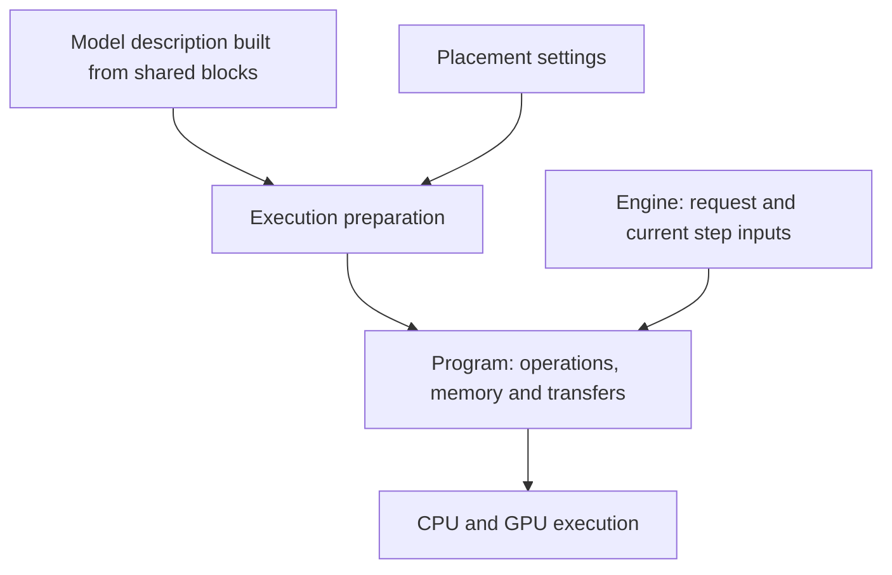

# lumen-rs Engine Architecture

`lumen-rs` is an engine for running language models on one computer. Its main use case is a model that does not fit in GPU memory, so some data must live in system RAM or on an NVMe drive. Computation can then be divided between the GPU and CPU. We call this hybrid execution.

A MoE block contains several subnetworks called experts, and a router selects which experts process a token. For example, the GPU might compute attention while the CPU computes the selected experts. The engine must transfer the experts' input from GPU to CPU, wait for the result, and return it to the GPU. It needs to know which data each computation requires, where that data lives, and how much memory the work will use. This separation between describing the model, preparing the work, and executing it is the basis of the architecture.

**The project is currently building its foundation.** Configuration parsing, model component trees, and the `inspect` command work: they show the selected placement. There is also LTQ container reading and validation, a reference weight decoder, memory size calculations, and several reference kernels. Running a complete model and generating text is not possible yet: execution preparation and working CPU/CUDA backends are still to be implemented.

The sections below explain how these parts should work together. Where existing code has narrower capabilities, that limitation is stated separately. Development milestones are in [roadmap.md](roadmap.md); optimization ideas that still need validation are in [execution-design.md](execution-design.md).

## 1. Four Levels of Modularity

The engine has four main responsibilities: describe a model, assemble it from shared computation blocks, prepare execution for the selected hardware, and execute the computations.

**The model description** answers “what should be computed?” It specifies the layers, their order and connections, and how weights from the file correspond to those layers. One model might alternate ordinary attention and MLP blocks, while another uses recurrent blocks and MoE. Those choices belong in the model description.

**Shared blocks** let model descriptions reuse computations instead of copying each layer's implementation. A large block such as MoE can be assembled from routing, expert computation, and combining expert outputs. Smaller operations such as projections, normalization, and selection can be reused across blocks. A layer need not be a rigid boundary: several layers may read the same storage, and residual connections may connect different parts of the model.

**Execution preparation** answers “how will these computations run here?” It takes the model description and placement settings, chooses supported implementations, reserves memory, and adds the required transfers. The result is called `Program`: a prepared execution schedule. A straightforward schedule is enough for the first working model; a general optimizer for every possible model is not required.

**Backends** execute operations on particular hardware. The CPU backend calls CPU kernels, and the CUDA backend calls GPU kernels. Allocated memory, device queues, and transfers should be managed by common services so that each block does not build its own system for managing them.

Model-family names are needed when reading their configurations and weights. A shared block should describe a computational mechanism, not a special case for a family. QSA and DSA, for example, are different sparse attention algorithms. They can reuse common operations, but a single `sparse` flag cannot describe their differences.

## 2. Cargo Workspace Layout and Build System

A crate is a separate Rust compilation unit with its own dependencies. The project currently has 20 crates, although some contain only placeholders. The table therefore shows both the purpose and the current state of each part.

The order is checked by architectural tests: a crate may depend only on crates above it in the table. This helps prevent, for example, a compute backend from depending on specific model descriptions. Actual dependencies are recorded in each crate's `Cargo.toml`.

| Crate | What it does now or will do |
| :--- | :--- |
| `lumen-core` | Shared types: tensor shapes and data types, devices, storage locations, component paths, and errors |
| `lumen-kabi` | Parameter types and constants for passing data between Rust and CUDA C++ |
| `lumen-config` | Reads JSON, applies placement rules, and explains the source of each setting in `inspect` |
| `lumen-mem` | Describes buffers, calculates cache sizes, and plans temporary data within a shared memory region; working pools are still to come |
| `lumen-tensor` | Describes tensors and weights: dimensions, formats, and references to data |
| `lumen-ltq` | Provides reference LTQ decoding and the associated input transform |
| `lumen-format` | Reads and validates LTQ containers |
| `lumen-backend` | Defines operations and their executor interface |
| `lumen-ref` | Contains individual reference kernels; execution through the common operation interface is not wired up yet |
| `lumen-cpu` | Future CPU backend; currently a placeholder |
| `lumen-cuda-kernels` | Future CUDA kernel build; currently a placeholder |
| `lumen-cuda` | Future CUDA backend; currently a placeholder |
| `lumen-models` | Reads model configs and builds component trees; weight mapping and computation descriptions are still to come |
| `lumen-exec` | Will prepare execution; currently a placeholder |
| `lumen-media` | Will prepare images, audio, and other media; currently a placeholder |
| `lumen-chat` | Will turn conversational messages into tokens and parse responses; currently a placeholder |
| `lumen-engine` | Will manage generation and request state; currently a placeholder |
| `lumen-quantize` | Will calibrate and quantize weights; currently a placeholder |
| `lumen-server` | Will provide HTTP interfaces; currently a placeholder |
| `lumen-cli` | Command-line interface: `inspect` works; other commands report that they are not implemented |

This organization can change. A separate crate is useful when it isolates dependencies, provides a reusable library, or has a special build process such as CUDA. Ordinary modules are sufficient for separating code within a responsibility. For example, execution preparation and generation management can remain distinct modules within one runtime crate. Combining or splitting crates requires updating manifests and architectural tests together.

The project currently uses Rust edition 2024 with a minimum compiler version of 1.89 and builds without CUDA. CUDA compilation, generated C headers, and enabling backends through Cargo features are still future work.

## 3. Placement Plan (`PlacementPlan`) and Data Access Modes

Where data is stored and where computation runs are separate settings. Weights can live in RAM but be used by the GPU. Alternatively, expert weights can stay in RAM while the CPU computes the result there and sends only the output to the GPU.

Configuration expresses this through `store` and `compute`. An additional field, `prefill-compute`, can select a different device for processing the input text. Processing the known input is called **prefill**; subsequent step-by-step generation is called **decode**. They involve different amounts of work, so suitable placement can differ.

`lumen-config` applies settings to the model's component tree, `ComponentTree`. A path such as `attention/kv-cache` identifies a part of the model, while a rule for a range of layers avoids listing each layer separately. The result is a `PlacementPlan` in which those rules have already been resolved. The `inspect` command shows this plan and the source of each setting. See [config.md](config.md) for the syntax.

One path can identify components with different access patterns on different layers. Ordinary attention, for example, reads the available context or window, while sparse attention reads selected positions. Component kind therefore belongs to a particular pair of layer and path. Registration checks layer bounds and conflicting kinds; `inspect` groups report rows only when placement, kinds, and setting sources match.

The plan currently also assigns labels for expected access strategies. `Streamed` means copying data in portions, `ZeroCopy` means direct GPU reads from registered host memory, `Fetch` means disk reads, and `FetchH2d` adds a transfer to the GPU. `AccessMode::resolve` chooses a label from storage, compute, and the current access classification.

That classification is still simplified. The indexer cache, for example, is marked sparse to select `ZeroCopy`, even though the indexer scans it in full. This is a limitation of the current policy, not a definition of the algorithm. The labels do not yet represent working offload either: future execution preparation must check operation support, reads and writes, transfers, and available memory. Acceptance of a config alone does not establish those properties.

## 4. Memory Subsystem: Four Classes of Data

Allocating and reusing memory safely requires knowing how long data is needed. Weights usually remain for as long as the model is loaded. Activations—the intermediate results of computation—are needed only during part of the current step. Attention state and recurrent state survive between steps and belong to a particular token sequence. These are the four main data classes; transfers also need temporary buffers.

These lifetimes allow memory to be reused. Two intermediate results can occupy the same region if the first is no longer needed when the second is produced. But data that the GPU is still reading or the CPU is still transferring cannot be reused. Cancelling a request does not free a buffer immediately either: work using it must finish first.

**The names of computation inputs do not determine how many stores exist.** Q, K, and V are roles at the inputs of attention. The model architecture specifies where each comes from. They might be separately stored tensors, transformations of one shared representation, or data from another layer. Deriving K from V, V from K, or both from a third representation requires an explicit transformation; the engine does not assume that any such reconstruction is always possible.

Suppose two layers read the same buffer S. Memory for S is allocated and counted once, and both layers receive a reference to it. If reading requires a transformation, preparation also accounts for that transformation's temporary memory. Producing an input in small pieces and first building a complete additional tensor have different memory costs. A block must not hide that cost.

Before execution, preparation sets maximum step sizes and reserves the required memory. The executor can then take free pages or slots from an already allocated pool without invoking the general-purpose allocator for every token. Behavior beyond the reserved capacity must be defined rather than silently exceeding the budget.

Writes to state also matter. In ordinary generation, the updated state becomes the basis of the next step. In speculative generation, some proposed tokens may be rejected, so their corresponding state changes must be reversible. The order of writes, commitment, and rollback must be defined before enabling such modes.

Currently, `KvLayerSpec` and `StateLayerSpec` only calculate sizes. The KV description already has variants for separate K/V, one stored representation, and a reference to another layer, but a general description of all these connections and working pools does not exist yet. Quantized cache sizing also omits quantization metadata such as scales and zero points.

## 5. Offload Mechanics: GPU ↔ CPU Synchronization and Disk Prefetch

Offload requires more than choosing a device: it also requires ordering the work. Returning to the CPU-expert example, the GPU first computes the input and expert selection, then copies the data into RAM. The CPU can begin only after that transfer finishes. The result is copied back to the GPU before the next dependent operation uses it.

Meanwhile, the GPU can execute another branch if that branch does not need the CPU result. For example, shared MoE experts can run in parallel with selected experts. The prepared plan must distinguish independent branches from points where their results must be joined.

Explicit copies and completion events are sufficient for the first working path. More complex mechanisms—flags in pinned memory, actively polling CPU workers, double buffering, and CUDA Graphs—should be adopted after measurement. Their candidates and validation criteria are in [execution-design.md](execution-design.md).

Disk access follows the same dependency rule. A table row can be fetched once its address is known. If other work can run before the row is consumed, reading and computation can overlap. If the row is needed by the very first computation, as with an input embedding, execution must wait for the read. A small row does not by itself make NVMe latency disappear.

## 6. Weight Representations and Model Loading

Loading a model involves several tasks that should remain separate. The container reader checks whether the file is structurally valid and whether its data dimensions and ranges are acceptable. It should not need to know which layer of a particular family uses each matrix.

The model adapter knows that. It maps tensor names in the checkpoint to parts of the model and converts their organization into common weight descriptions. One checkpoint might store expert matrices separately; another might stack them into one large tensor. After loading, computation should receive a usable description of the experts while preserving their order, scales, and other parameters.

The existing descriptions are `LtqLinear`, `DenseLinear`, `RowTable`, and `ExpertBank`: an LTQ-quantized matrix, an ordinary matrix, a table of rows, and a collection of experts. These are descriptors—structures containing dimensions, formats, and references to data. Their definitions are in `lumen-tensor`; the LTQ byte format is specified in [ltq-format.md](ltq-format.md).

A backend can then prepare weights in a layout suited to its hardware. CPU and GPU implementations may prefer different data orders in memory, but repacking must preserve weight values. If multiple representations are needed at the same time, each counts toward the memory budget. Loading and preparation should be usable by both generation and quantization.

## 7. Plan Compiler (`lumen-exec`) and Step Execution

The job of `lumen-exec` is to turn computation descriptions and placement into work that an executor can repeat. Calling it a compiler does not mean a universal optimization system must be built first. The first `Program` only needs operation order, selected implementations, buffer references, and the required waits and transfers.

Before execution, for example, preparation can decide that a projection runs as a GPU kernel, writes its output to a particular buffer, and then sends part of that data to the CPU. During the step, the executor does not need to find the weight by its checkpoint name again or decide which device should run the projection. Preparation has already made those decisions.

Other data changes between steps: token IDs, positions, sequence lengths, state pages, and sampling settings. These are passed separately as step inputs. Prefill and decode can initially use different prepared schedules, each with its own size limits.

Preparation must check that the backends support the selected operations and that memory fits the budget. An operation can be a large block or a sequence of smaller actions. Either way, preparation must know which data it reads, which it changes, and how much temporary memory it needs; otherwise, it cannot build a safe schedule.

Later, adjacent operations can be combined into one kernel (fusion), regions of execution can be captured in CUDA Graphs, and placement can be chosen automatically. These are ways to accelerate an already correct execution path. They are added after checking numerical results, state changes, and measured benefit.

**The current `Architecture` trait does not yet provide that complete description.** It returns a structural `Layout` and a component tree for configuration. `Layout` does not yet retain all the information needed for computation. Implementing execution requires expressing that information explicitly; the `ComponentTree` of paths alone describes neither computation nor memory ownership.

## 8. Generation Runtime (`Engine`), Speculative Decoding, and Multimodality

`Program` describes how to execute computations, while `Engine` manages a request over time. It keeps sequence state, invokes input processing, receives next-token scores, and selects a token according to the sampling settings. It repeats steps until a stopping condition is met. When a request finishes, it releases resources after all work using them has completed.

The initial implementation can handle one sequence. Later, `Engine` can batch work from multiple requests, reuse computed state for a shared prefix, and verify tokens proposed by a draft model. These features change sequence management; attention and other block algorithms remain in the model description and computation implementations.

Multimodal input adds preparation of images, audio, and other data, together with the required model computations. Specific queues, threads, prefix storage policies, and draft interfaces will be decided during implementation. They do not need to be fixed for the first text-generation path.

Quantization calibration uses some of the same computations for a different purpose: it runs prepared inputs through a model and collects statistics from intermediate results. It therefore needs model loading and lower-level execution, but not HTTP, conversation formatting, or request scheduling. The placeholder `quantize → engine` dependency is provisional and should be revisited when calibration is implemented. A backward pass for additional statistics requires separate work; it does not follow automatically from having a forward pass.

## 9. Extensibility Rules and Architectural Boundaries

Adding a model starts with its configuration, weight mapping, and block connections. Existing computations should be reused where they suffice. Otherwise, identify the missing general mechanism. A new input transformation or state-storage behavior, for example, should be defined by what it does rather than by a condition saying “if this is that model family.”

This does not promise that every model will touch exactly one crate. A new computational capability can require extending operation interfaces, memory handling, and backends. What matters is that the resulting mechanism can be used by any suitable composition.

A new operation needs a simple reference implementation. Optimized CPU/GPU versions are compared with it within stated numerical tolerances. Whole-model results also need comparison with an independent implementation: an internal reference and a fast path can share the same error in the model description.

Operations are currently listed in a closed `Op` enum. Each backend must handle every variant explicitly, either executing it or reporting missing support. Wildcard arms in these matches are forbidden so that a new variant cannot be silently skipped. This does not require splitting every block into scalar actions or imply a ready-made third-party plugin interface.

Automated checks also enforce dependency direction and keep family names inside `lumen-models` and `lumen-chat`. These tests help maintain boundaries, but they do not replace mathematical and memory checks. Every optimization must leave the owner, size, lifetime, and modifying operations of each buffer understandable.

The initial scope is autoregressive inference: a model generates tokens in sequence. General model training and other generation loops are outside that scope for now. The next steps and their acceptance criteria are in [roadmap.md](roadmap.md).
