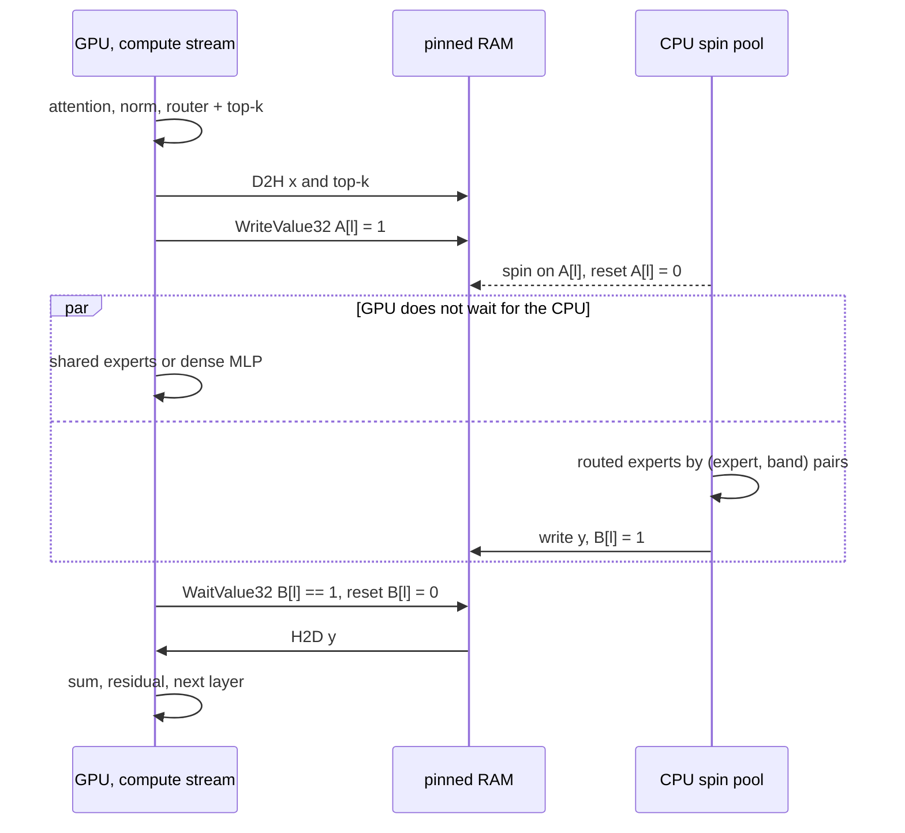

# lumen-rs — Engine Architecture

Oct 27, 2026 · @Vemloir

lumen-rs is an LLM inference engine built first of all for offloading: the model does not fit in VRAM, so part of the weights is computed by the CPU and part lives in RAM or on NVMe. The engine is designed as an execution plan compiler: during loading, the configuration and model description are turned into an immutable `Program`, where every operator is pre-assigned a device, buffers, a stream, and synchronization points. The hot loop contains no allocations, no name lookups, and no placement decisions — only kernel launches, transitions, and disk reads.

- **Offloading is the primary scenario; the yardstick is the physical ceiling.** The CPU and CUDA backends are developed as equals. The engine is measured not against other engines but against the lower bound on step time set by the hardware's bandwidth and latencies ([performance.md](performance.md)).
- **Rust host, CUDA C++ kernels.** All engine code is Rust; GPU kernels are CUDA C++, compiled ahead of time by nvcc together with their `extern "C"` launchers into a static library linked into the binary, so at run time only the CUDA driver is needed. Rust and C++ meet only at a C ABI — the launchers and the kernel parameter structs of `lumen-kabi`. CUTLASS and FlashInfer (header-only) are used directly; exllamav3 kernels serve as porting references.
- **Model decoupled from placement.** The architecture provides a component tree and a logical graph; the `PlacementPlan` maps component paths to where they are computed and stored; the `lumen-exec` scheduler connects them. A cascading JSON config and auto-placement are two ways to produce a plan.
- **Three kinds of weights.** Quantized matrices (`LtqLinear`, the LTQ format), row tables for lookups (`RowTable`: embeddings, n-grams, PLE), and dense matrices (`DenseLinear`). Every on-disk layout is normalized into them at load time.
- **Three storage locations and four memory classes.** Locations: `vram`, `ram`, `disk`. Classes: weights — static and permanent; activations — statically laid out by arena offsets; KV — a paged pool; recurrent state — a fixed-size slot per sequence.
- **Transitions are explicit operators.** `Transfer` moves activations between devices, `Fetch` reads table rows and tensors from disk. The compute device and the storage location are independent: any pair is allowed, and only the access mode depends on it, resolved from the (store, compute, access kind) triple once, at load time.
- **The quantization format is LTQ.** Our own format and quantizer: trellis-coded quantization (Ungerboeck TCQ, 1024 states, tail-biting trellis) of 16×16 tiles, fractional rates via parity of the low bits, and bit width per row slice assigned by DP from Fisher information. On six models — from dense to MoE, Gated DeltaNet and PLE — KLD at the same bit width is below EXL3 or on par, and quantization is 2.4–7 times faster. Specification: [ltq-format.md](ltq-format.md); rationale: [ltq-design.md](ltq-design.md).
- **GPU kernels are CUDA C++.** Our own kernels decode LTQ and implement the architecture operators, CUTLASS provides dense GEMM in prefill and MMA (CuTe) inside our kernels, and FlashInfer is the base for attention. No cuBLAS or other CUDA libraries at run time. cuda-oxide was measured as an alternative: on the LTQ GEMV it matches nvcc only through libNVVM, and its tooling is still alpha ([experiment](https://github.com/lumen-inference/ltq-research/blob/main/results/kbench_gemv_g4.json)).
- **The generation core is synchronous.** The CLI runs its loop on the main thread, while the HTTP server talks to it via channels.
- **Extension goes through known points.** Each axis of growth (architectures, backends, operators, formats, drafters, APIs) has one extension point with a narrow contract; a model does not know the backend, a backend does not know the model, and speedups live inside the contracts. The rules are checked in CI (section 8).

**Documents.** This file is the structure of the engine: crates, placement plan, memory, weights, scheduler, runtime and extension rules. The rest is next to it:

- [performance.md](performance.md) — the ceiling model, the reference rig, η targets
- [kernels.md](kernels.md) — GPU and CPU kernels and their measurements
- [ltq-format.md](ltq-format.md) — the LTQ format specification; [ltq-design.md](ltq-design.md) — why it looks like this, comparisons and the quantizer
- [config.md](config.md) — configuration and the placement cascade
- [api.md](api.md) — chat layer, CLI and server
- [models/](models/README.md) — model architectures, one file per family
- [roadmap.md](roadmap.md) — implementation order and risks

## 1. Cargo Workspace

20 crates; each depends only on those listed above it in the table. CUDA is gated behind the `cuda` feature; with it, `lumen-cuda-kernels` compiles the `.cu` sources with nvcc at build time.

| Crate | Responsibility | Key Dependencies |
| --- | --- | --- |
| `lumen-core` | `DType` (incl. quantized types), `Shape`, `Device`, `MemLoc`, `ComponentPath`, errors | half, bytemuck, thiserror |
| `lumen-kabi` | `#[repr(C)]` kernel parameters and format constants; the `lumen_kabi.h` header for the `.cu` side is generated from them by cbindgen | — |
| `lumen-config` | serde schema, cascading, range grammar, validation → `PlacementPlan` | serde, serde\_json, serde\_path\_to\_error, strsim |
| `lumen-mem` | `Buffer` and handles, allocator trait, arenas, paged KV pool, state pool, NUMA, disk reads | memmap2, libc, io-uring |
| `lumen-tensor` | `TensorRef`, `TensorView`, `LtqLinear`, `RowTable`, `DenseLinear`, `ExpertBank` | core, mem |
| `lumen-format` | the `.ltq` container (header, tensor table, file mmap) and the quantizer's BF16 input (safetensors and index.json), manifest; knows nothing about architectures | safetensors, memmap2, hf-hub |
| `lumen-ltq` | LTQ reference decoder per the [specification](ltq-format.md), Hadamard-256; golden tests against `ltq-research/src/ltq_format.py` | core, half |
| `lumen-backend` | operator set `Op`, `trait Executor` (operator support, weight repacking, segment execution, measuring its own resources), `HwProfile`, kernel registry | tensor |
| `lumen-ref` | reference executor: scalar f32, runs any `Program`; oracle for differential tests | backend, ltq |
| `lumen-cpu` | hot-path spin pool, rayon for loading, AVX2 and AVX-512 kernels, CPU side of `Transfer` and `Fetch` | backend, ltq, rayon |
| `lumen-cuda-kernels` | CUDA C++ kernels (`.cu`), their `extern "C"` launchers (template specializations are dispatched in C++) and raw driver API bindings (bindgen over `cuda.h`): LTQ GEMV and GEMM, mgemm, reconstruct + GEMM on CUTLASS, Hadamard-256, row decoding, attention on FlashInfer, DeltaNet, norms, router, sampling; quantizer Viterbi and LDLQ steps. `build.rs` compiles them with nvcc into a static library | kabi; nvcc, CUTLASS, FlashInfer (header-only, pinned), bindgen |
| `lumen-cuda` | contexts, streams, events, VRAM allocator, pinned registration, GPU side of `Transfer` and `Fetch`, kernel launches through the launchers, CUDA Graphs | backend, cuda-kernels |
| `lumen-models` | architecture registry by `model_type`; architecture → component tree, logical graph from shared block builders, name aliases, MoE normalization | tensor, format |
| `lumen-exec` | scheduler → `Program`, the ceiling model (`Program::floor`), auto-placement; talks to backends only through `Executor` | config, models, backend |
| `lumen-media` | images and audio: decoding, resizing, patching, frames | image, symphonia, rubato |
| `lumen-chat` | tokenizers + minijinja, Harmony, reasoning and tool-call parsers, multimodal messages, detokenization | tokenizers, minijinja, minijinja-contrib, openai-harmony, media |
| `lumen-engine` | `Engine`: KV and states, prefix cache, batching, sampling, speculative decoding, stopping conditions; wires up concrete executors | exec, cpu, cuda (opt), chat |
| `lumen-quantize` | LTQ quantizer: calibration pass, Hessians, Fisher (backward pass of the supported blocks), row-slice profile and DP, Viterbi + Block16-LDLQ on the GPU, scale polishing, container writer | engine, ltq |
| `lumen-server` | axum: OpenAI and Anthropic APIs, SSE | engine, chat, tokio, axum |
| `lumen-cli` | the `lumen` binary: run, chat, serve, inspect, bench, probe, pack, quantize | engine, quantize, chat, server, clap |

**Toolchains and Build Setup**

- Stable Rust with MSRV 1.89: AVX-512 intrinsics are stable from this release. Non-pointer intrinsics are safe inside `#[target_feature]` functions since 1.87; pointer loads and stores go in explicit `unsafe {}` blocks, and the project requires a block even inside an `unsafe fn`.
- CUDA kernels are C++20 built with nvcc from CUDA Toolkit ≥ 12.8 (sm\_120 support). `lumen-cuda-kernels/build.rs` compiles kernels and launchers into a static library with SASS for sm\_80, 86, 89, 90, 100 and 120 plus PTX compute\_120 for newer GPUs, linked with the static CUDA runtime; Rust calls the launchers and the driver API directly. The Toolkit is needed only to build; at run time only the driver. CUTLASS and FlashInfer are git submodules pinned to a commit.
- Host and device code interface only through `lumen-kabi`: parameter structs and raw pointers. The C header is generated from the Rust definitions (cbindgen) and CI fails on a stale committed header; tests launch every kernel with shapes checked on both sides.
- Build time: template instantiations (FlashInfer, CUTLASS, format specializations) are split into separate `.cu` files compiled in parallel and cached (sccache); a build without the `cuda` feature needs no CUDA at all.
- Feature flags: `cuda` and `server`. The CPU instruction set is selected at runtime (`is_x86_feature_detected!`).
- `xtask`: LTQ golden fixture generation from the Python reference (`ltq-research/src/ltq_format.py`), benchmarks.

## 2. Placement Plan

The configuration is resolved once into a flat `PlacementPlan`: for every component of every layer — where it is computed, where it is stored, and, if needed, a separate compute device for prefill. After loading, nothing reads the JSON again. The cascading config is one way to produce a plan; the other is auto-placement (`--auto --vram 14G`), which searches for the plan with the lowest critical-path ceiling ([performance.md](performance.md)) within a memory budget and prints the result via `lumen inspect`.

**The component tree comes from the architecture.** The config schema is not hard-coded in the engine: `Architecture::components()` lists the model's components, and the cascade, validation, and `inspect` work over that tree. Component names, cascade rules, and config sections are in [config.md](config.md).

```rust
pub struct Place {
    pub compute: Device,
    pub store: MemLoc,
    pub prefill_compute: Option<Device>,          // where to compute during prefill, if different from decode
}

pub struct PlacementPlan {
    pub tree: ComponentTree,                       // from the architecture
    pub global: BTreeMap<ComponentPath, Place>,    // outside layers: embed, ple, vision-tower, lm-head, mtp
    pub layers: Vec<BTreeMap<ComponentPath, Place>>, // index = layer number
    pub kv: Vec<KvPlacement>,                      // store, dtype, context, window, layout (section 3)
    pub state: Vec<StatePlacement>,                // recurrent states of the layer
    pub provenance: Provenance,                    // JSON path of every value — for inspect
}
```

## 3. Memory, Storage Locations, and Access Modes

```rust
#[derive(Copy, Clone, Eq, PartialEq, Hash)]
pub enum Device { Cpu(u16), Cuda(u16) }           // who computes: "cpu:0", "cuda:1"

#[derive(Copy, Clone, Eq, PartialEq, Hash)]
pub enum MemLoc { Ram(u16), Vram(u16), Disk }     // where the bytes live: "ram:0", "vram:1", "disk"

pub struct Buffer {                                // owns memory
    loc: MemLoc,
    ptr: RawPtr,                                   // Host(*mut u8) | Dev(u64) | File(FileSpan)
    len: usize,
    kind: BufKind,                                 // HostNuma | HostPinned | Device | Mapped
}

#[derive(Copy, Clone)]
pub struct TensorRef {                             // what a Program stores
    buf: BufferId, offset: usize, shape: Shape, strides: Strides, dtype: DType,
}

#[derive(Copy, Clone)]
pub struct TensorView<'a> {                        // what kernels receive for the duration of a call; no refcount
    buf: &'a Buffer, offset: usize, shape: Shape, strides: Strides, dtype: DType,
}
```

A `Program` stores `TensorRef` — a handle plus an offset — since otherwise it would reference itself; a `TensorView` is assembled for the duration of a launch. Kernels receive raw device pointers and shapes in `lumen-kabi` parameter structs. Allocating VRAM and registering pinned memory need a CUDA context, so `lumen-mem` only provides the allocator trait and arenas, and `lumen-cuda` holds the CUDA implementation.

**Four Memory Classes**

| Class | Lifetime | Allocator | Location |
| --- | --- | --- | --- |
| Weights | entire session | one region per device, sub-allocated with 256 B alignment; in RAM — anon mmap + `mbind` + `MADV_HUGEPAGE`; on disk — a file mmap with no copy | per `store` |
| Activations | one step | static layout: each intermediate tensor gets an arena offset by live interval, sized for the maximum batch | on the operator's `compute` |
| KV cache | sequence lifetime | paged pool (64-token blocks) and a block table; a ring for sliding layers | per `kv-cache.store` |
| Recurrent state | sequence lifetime | a fixed-size slot per sequence plus history for rollback | per `state.store` |

**KV Layouts**

- A regular layer stores K and V.
- A K = V layer (global layers of Gemma 4 12B, 26B, 31B) stores only V; K is reconstructed inside the attention kernel ([models/](models/README.md)). The global KV is half the size.
- A shared-KV layer (the last `num_kv_shared_layers` layers of Gemma 4 E2B/E4B) has no cache of its own and reads the cache of the last layer of the same type before the sharing point.
- A sliding layer stores a ring of W + T\_max − 1 positions, where W is the window and T\_max is the maximum number of tokens of one sequence per step (a prefill chunk or k+1 drafts). A ring of exactly W positions breaks: later tokens of a chunk overwrite slots that earlier queries of the same chunk still need, and draft rollback loses needed positions. The alternative is for the kernel to take the current step's K/V from the arena and write into the ring after attention; that saves memory but complicates the kernel.
- The QSA indexer (Qwen3.8-Flash-Next) keeps its own cache: a raw 128-dimensional key per token and pooled keys of completed 4-token blocks.
- KV quantization (the `kv-quantization` section, [config.md](config.md)) sets the bit width of K and V separately, the same for all layers; the attention kernel dequantizes blocks on the fly. For a layer with K = V, only `v-bits` applies.

**Recurrent State**

| Source | State per sequence |
| --- | --- |
| Gated DeltaNet (`qwen3_next`, `qwen3_5_dense`, `qwen3_5_moe`, Qwen3.8-Flash-Next) | an $H_v \times D_k \times D_v$ matrix in fp32 and a conv state of `conv_kernel - 1` positions (e.g. 48 heads × 128 × 128 × fp32 = 3 MB per layer, 108 MB for 36 layers) |
| PLE layer of Qwen3.8-Flash-Next | the last 9 positions of the dilated conv across 4 residual streams and the last 2 token ids |

Rolling back speculative decoding by truncating the length only works for KV. A state slot keeps history: draft verification writes per-position states into trailing columns, and rollback restores the window from them (exllamav3 does it this way). For hybrid models the prefix cache relies on state snapshots, and a Qwen3.8-Flash-Next snapshot weighs 108 MB, so snapshots go at chat-turn boundaries, not at every block.

**Tensor Access Modes**

The compute device and the storage location are independent: any (store, compute) pair is allowed, and only the access mode depends on it. The mode is resolved from the (store, compute, access kind) triple once, at load time: a matmul and dense attention need the whole tensor, a lookup needs only the required part (table rows, active experts, KV blocks chosen by the indexer).

| store ↓ / compute → | cpu, whole tensor | cpu, lookup | cuda, whole tensor | cuda, lookup |
| --- | --- | --- | --- | --- |
| vram:G | Readback | Readback | Direct; Peer; Staged via pinned RAM without P2P | Direct; Peer |
| ram:N | Direct; NumaRemote with a warning | Direct | Streamed | ZeroCopy |
| disk | Fetch | Fetch | Fetch + H2D | Fetch + H2D |

- **Streamed**: weights live in pinned RAM and are copied into a VRAM ring on a separate stream, one layer ahead. During prefill the copy is amortized over the chunk; during decode the weights cross PCIe again for every token.
- **ZeroCopy**: the table sits in pinned RAM (`cuMemHostRegister`), and the kernel reads exactly the needed rows over PCIe. The host is not involved, token ids are already on the device, and the launch fits into a CUDA Graph. This is how the GPU reads embeddings from RAM: 5 KB per token for Qwen3.8-Flash-Next, whereas Streamed would push the whole 1.27 GB table.
- **Readback**: the tensor is copied D2H from VRAM into a pinned buffer on the d2h stream, one layer ahead; the CPU waits for readiness with the same flag protocol as `Transfer`. A whole tensor crosses PCIe on every call, a lookup moves only the needed rows or experts. This lets VRAM serve as extra memory when RAM runs short.
- **Fetch**: rows or a whole tensor are read from disk into a pinned buffer (see "Disk Reads"); from there the CPU uses them or the GPU takes them with a single H2D copy. ZeroCopy is impossible here: registering the mmap would pin the entire file in RAM.
- **No pair is an error.** Expensive combinations — Streamed, Readback, and whole-tensor Fetch during decode — produce a warning, `lumen inspect` prints PCIe and disk bytes per token for every pair, and auto-placement compares all pairs by their floor.
- **KV and recurrent states** follow the same table: `kv-cache.store` and `state.store` are ordinary storage locations. Dense attention reads the layer's whole cache, sparse attention (QSA) reads only the blocks chosen by the indexer, so KV in `ram:N` with attention on `cuda:G` is read via ZeroCopy and frees VRAM for weights. The indexer cache (`indexer/keys`) is scanned in full: in `ram:N` that costs Qwen3.8-Flash-Next ~0.2 GB of PCIe traffic per token at a 262k context (~3 ms on PCIe 5.0) but frees VRAM; on the attention device the scan stays in VRAM. Writing the new token (`KvWrite`) and the updated state goes back over the same channel; the DeltaNet state is read and written in full on every step.

**Activation Transitions**

When adjacent operators are on different devices, the scheduler inserts `Transfer { src, dst, bytes }` with a buffer in pinned RAM. Only the input and output of a sub-block cross the boundary: in models with hyper-connections, the four residual streams stay on the GPU.

Flags are 32-bit words in pinned RAM. The GPU waits for the CPU via `cuStreamWaitValue32`, the flag for the CPU is set by `cuStreamWriteValue32`, and CPU workers spin on the same word. This is how CPU offloading works in exllamav3 (`EXL3_MOE_MEMOPS`): the host stays out of the hot loop.

Waits are captured into a CUDA Graph as batch mem op nodes, and the awaited value is baked into the node at capture time. A monotonic step counter therefore does not work. The protocol is "the consumer resets the flag", with a pair of flags for every layer with a CPU part:

```
GPU:  D2H x and top-k → WriteValue32(A[l], 1)
CPU:  wait for A[l] == 1 (Acquire) → A[l] = 0 → experts → write y → B[l] = 1 (Release)
GPU:  WaitValue32(B[l] == 1) → WriteValue32(B[l], 0) → H2D y
```

The next step sets A[l] only after the GPU has passed B[l] of the current step, so there are no races. These are plain driver API calls through the bindgen bindings in `lumen-cuda-kernels`. Each GPU has three streams — compute, h2d, d2h; dependencies within a GPU are events.

**Disk Reads**

Disk most often holds tables whose row addresses depend only on token ids: the n-grams of Qwen3.8-Flash-Next, the PLE of Gemma 4 E2B/E4B, embeddings. Reads can therefore start before the data is needed:

- during prefill, all addresses of a chunk are known in advance, and reads run ahead;
- during decode, the id is known right after sampling (it goes to the host anyway for detokenization), and PLE is needed not at the input but in one of the first layers — the read hides behind them; speculative drafts give addresses even earlier;
- frequent rows settle in the page cache.

Matmul weights on disk are read in full several layers ahead: their addresses are known at load time. Routed experts' addresses are known only after the router, so their reads land on the critical path; `inspect` shows the cost.

Design:

- `MemLoc::Disk` is a file mmap with no copy into anonymous memory, so there is no repacking at load time and the rows on disk must be usable as they are. Row tables are stored row by row (section 4), so exactly the needed bytes are read. Quantized matrices are read in the file's layout; if the model is not pre-packed (`lumen pack`, section 4), repacking happens in the I/O pool after the read, and `inspect` warns about it.
- The hot loop must not take page faults: a page miss on a spin worker or the engine thread stalls the whole step. A separate I/O pool (`io-threads`, pread or io\_uring) reads into a double pinned buffer; the `Fetch` operator waits for readiness with the same flag protocol as `Transfer`; kernels read only from a ready buffer.
- `inspect` prints rows and bytes read from disk per token. `disk.mlock` keeps the whole table in RAM when memory allows (the counterpart of `--ngram_lock` in exllamav3).

**CPU Pool**

The flag scheme needs workers that are already awake. The hot path therefore runs on its own spin pool: a node's workers spin on the layer flag, split the work themselves, and set the completion flag themselves. rayon stays for loading and repacking. `threads: 0` means the node's physical core count minus `reserve-cores` (default 1): the engine thread, the CUDA driver, the I/O pool, and tokio need a core of their own. SMT is not used — GEMV is memory-bound.

**NUMA** — for multi-socket machines; a desktop CPU has one node.

- `numa-spread: true`: device `cpu:N` is a pool with threads pinned to node N's cores (`sched_setaffinity`); `ram:N` is node N's memory (`mbind(MPOL_BIND)` via `libc::syscall`, then first-touch by the node's threads). `false`: a single `cpu:0` and `ram:0` for the whole machine.
- CPU weights are copied from the mmap into the node's anonymous memory (they have to be repacked anyway) unless the model was packed in advance (`lumen pack`, section 4).
- Exchange buffers with a GPU are allocated on the node the card is attached to (`numa_node` from sysfs) and registered via `cuMemHostRegister`.

## 4. Weights: Descriptors and Loading

Quantized matrices are stored in LTQ (*Lumen Trellis Quant*), the engine's own format; the full specification with the bit layout and the reference decode is [ltq-format.md](ltq-format.md). The loader reduces all weights to three descriptors: a quantized linear layer (`LtqLinear`), `RowTable`, and `DenseLinear`. The engine reads no other quantization formats: models come from BF16 through our own quantizer (`lumen quantize`, the `lumen-quantize` crate). Why the format looks like this, comparisons and the quantizer are in [ltq-design.md](ltq-design.md).

The descriptor fields mirror the matrix tensors in the container ([specification, section 6](ltq-format.md#6-container)):

```rust
pub struct LtqLinear {
    pub m: u32, pub k: u32,              // logical sizes
    pub m_pad: u32, pub k_pad: u32,      // multiples of 16 and 256
    pub slices: Vec<LtqSlice>,           // row ranges, each with its own format
    pub d_row: WeightRef,                // fp16 [M]
    pub e: WeightRef,                    // int8 [M, K/256]
    pub suh: WeightRef,                  // fp16 [K]
    pub bias: Option<WeightRef>,
    pub layout: TileLayout,              // Canonical (as on disk) | CpuBand16 | GpuWarp — after repacking
}

pub struct LtqSlice { pub rows: Range<u32>, pub format: FormatId, pub data: WeightRef }

pub struct LtqFormat {                   // from the .ltq header, shared by the model
    pub k: u8, pub frac: Frac,           // Frac::{None, D2, D4}
    pub masks: ArrayVec<u16, 3>,         // m₀ = 359 and the extra masks
    pub h: u8, pub sub: u8,
    pub lut: Vec<f32>, pub gain: Vec<f32>,
}
```

On disk the tiles are in the canonical layout of the specification: by slice, and within a slice by row group, fields as SoA. Backends repack them at load time (`Executor::prepare_weight`):

- **CPU** — in bands of 16 rows: a tile row group is contiguous along K and the tile fields are interleaved, so the kernel reads DRAM as one sequential stream. The same trick (a band of tiles instead of a column-wise walk) gave ×3.4 on "cold" experts in exllamav3's CPU MoE.
- **GPU** — for warp decode: the codes and planes of a tile as consecutive u32 words.

`lumen pack` does the repacking once and writes the model in its final layouts; after that, loading is an mmap with no copy, and `store = disk` works for any weights.

**Row tables** (embeddings, n-grams, PLE) are stored row by row: densely (bf16, int8 with a scale) or as LTQ rings ([specification, section 9](ltq-format.md#9-row-tables)). Rows are independent, so a lookup reads exactly the bytes it needs in one chunk; ring quality is in [ltq-design.md](ltq-design.md).

```rust
pub struct RowTable {
    pub rows: u64, pub dim: u32,
    pub codec: RowCodec,                 // Dense(dtype) | Int8Rows | LtqRing { format, ring, hadamard }
    pub shards: Vec<WeightRef>,          // parts as stored (n-gram heads), not concatenated; disk ones are mmap handles
    pub head_offsets: Option<Vec<u64>>,  // n-grams: start of each hash head
    pub head_bias: Option<WeightRef>,
}
```

**Loading**

1. The `.ltq` header ([specification, section 6](ltq-format.md#6-container)): `config` → architecture; tokenizer, chat template and preprocessor; `quantization` → the format table (`lut`, `gain`), row tables, the list of unquantized modules, the final bit width.
2. The file is mmapped once; the `tensors` table gives every tensor its offset, data is not copied (`lumen-format`).
3. Manifest: a matrix with `{p}.ltq.slices` → `LtqLinear`; a row table → `RowTable`; `.weight` → `DenseLinear` or an unquantized `RowTable`.
4. Names are mapped to a canonical `WeightKey { layer, component, expert }` through the architecture's alias table. The table lives in `lumen-models`; `lumen-format` knows nothing about architectures.
5. MoE normalization (`Architecture::normalize`).
6. The backend's `Executor::prepare_weight` moves the weight to the target `store` with repacking; tensors with `store = disk` stay as mmap handles.

**Expert normalization**

The canonical form is an `ExpertBank` per projection: a table of expert descriptors (slices, scales, `suh`, bias) and, where possible, a contiguous layout of all experts in a row. Kernels always go through the table, so experts with different bit widths break nothing: DP assigns each expert its own format.

| Layout on disk | How we recognize it | What we do |
| --- | --- | --- |
| LTQ per expert: `mlp.experts.{e}.gate_up_proj.ltq.*`, `mlp.experts.{e}.down_proj.ltq.*` | expert index in the name | the bank is assembled by e; gate\_up stays fused, as `lumen-quantize` quantized it |
| Dense stack: `mlp.experts.gate_up_proj` and `down_proj` with an E axis (BF16 builds of gpt-oss, Qwen3-MoE, Qwen3.8-Flash-Next, Gemma 4 26B-A4B) | 3-D tensor, axis 0 = num\_experts | split along E, computed on the dense path (quantizer input and unquantized models) |
| Fused gate\_up | second axis = 2·I | concat — split in half; interleave (in gpt-oss, even rows are gate, odd are up) — separated while copying |
| Other names (`block_sparse_moe.experts.{e}.w1/w3/w2` in Mixtral) | architecture aliases | reduced to gate, up, down |

The same step reduces routing to a `RouterSpec`:

| Model | Routing |
| --- | --- |
| Qwen, Mixtral | softmax → top-k with or without renormalization |
| gpt-oss | top-k → softmax |
| DeepSeek-V3 | sigmoid + correction bias + grouped top-k |
| Gemma 4 | input: weightless RMSNorm × scale × hidden^(−½); softmax → top-k → renormalization → × per\_expert\_scale |

## 5. Scheduler and Execution Pipeline

The model describes a component tree and a logical graph, and the scheduler compiles them together with the `PlacementPlan` into a `Program` — a list of per-device segments with pre-assigned buffers, streams, and transitions.

**Logical graph** (`lumen-models`)

```rust
pub trait Architecture {
    fn from_hf(cfg: &HfConfig) -> Result<Self> where Self: Sized;
    fn components(&self) -> ComponentTree;                  // what can be placed
    fn weights(&self) -> WeightSchema;                      // canonical keys, shapes, name aliases
    fn normalize(&self, m: &mut Manifest) -> Result<()>;    // expert layouts, fused projections
    fn build(&self, g: &mut GraphBuilder);                  // operators with component paths
}
```

Operators: `Embed`, `RowGather`, `PleInject`, `RmsNorm`, `RmsNormGated`, `Linear`, `QkNorm`, `Rope(RopeSpec)`, `Attention { window, sinks, mask, kv, sparse, gated }`, `KvWrite`, `IndexerScore`, `DeltaNet`, `ShortConv`, `HcMix`, `HcInject`, `Router(RouterSpec)`, `Experts { bank, act }`, `SharedExpert { gated }`, `DenseMlp`, `Act`, `Add`, `Scale`, `Softcap`, `LmHead`, `Sample`, `VisionEmbed`, plus `Transfer` and `Fetch` inserted by the scheduler. Each has a component path (`hidden-layers/moe/routed-experts/projections/gate`) and a layer number, which select its place in the plan. Architecture quirks are operator parameters, not separate executor code: 3:1 hybrid Gated DeltaNet + Gated Attention, zero-centered RMSNorm (`1 + w`), and the shared-expert σ-gate in `qwen3_next` / `qwen3_5_dense` / `qwen3_5_moe`, sinks and sliding/full alternation in gpt-oss, K = V and p-RoPE in Gemma 4, four residual streams in Qwen3.8-Flash-Next.

**Scheduler passes** (`lumen-exec`)

1. Placement: each operator gets a `Device`, each weight a `MemLoc`; `rope` and the indexer take the attention device.
2. Validation: backend support for the operator (`Executor::supports`). The store/compute combination is not checked — any pair is allowed.
3. Dead rows. During prefill, rows that feed neither a cache nor logits are not computed: `LmHead` runs only on the last row; in shared-KV models (Gemma 4 E2B/E4B), the last `num_kv_shared_layers` layers run only for rows that need logits — 18 of 42 layers in E4B.
4. Fusion within one device: q, k, v — one launch with three descriptors (each has its own `suh` and scales, so they cannot be merged into one matrix); gate and up; add + RMSNorm; bias + residual; hyper-connection stream mixing with the norm; reconstructing K from V together with RoPE inside attention.
5. Insertion of `Transfer` and `Fetch` on cross-device edges and choice of access modes for weights, KV, and states; `Fetch` is placed so the read completes during the layers before its consumer.
6. Segmentation: consecutive operators on one device form a `Segment`.
7. Memory layout: live intervals → arena offsets for the maximum batch; sliding rings of W + T\_max − 1; state slots with history for the maximum speculative k.
8. Streams, events, flags; CUDA Graphs for decode per batch-size bucket (1, 2, 4, 8, …).

At each step only the `StepInputs` of a `Program` change: tokens, positions (\[3, T\] for M-RoPE), KV block tables, sequence lengths, span masks, external embeddings (section 7), row ids for `Fetch`.

**A layer with experts on the CPU**



The GPU sets flag A after copying the input and moves on, waiting for flag B only before copying the result. While the CPU computes the routed experts, the GPU runs the shared experts (Qwen) or the dense MLP, which in Gemma 4 26B-A4B runs in parallel with the MoE from the same input. The x, top-k, and y buffers live in pinned RAM, so the whole step fits into one CUDA Graph.

**Prefill and Decode**

- Prefill runs in chunks of `cuda.prefill-chunk-size` tokens. The GPU uses the reconstruct + CUTLASS path, while CPU experts get up to 1024 rows at a time — this is the bottleneck. A chunk in a mixed batch slows down its decode neighbours, so its size adapts to the number of active decode sequences.
- `prefill-compute: "cuda:0"` on a component: during prefill, experts from `ram:0` stream over PCIe into a VRAM ring and are computed on the GPU; storage does not change and the RAM copy is the same one: both backends understand the CPU layout in 16-row bands, and the prefill GPU kernels compute tile addresses from `TileLayout`. The counterpart of op-offload in llama.cpp.
- A chunk does not split an image span if the model sees the image bidirectionally (section 7).
- Decode: one CUDA Graph per GPU segment, and with the flags from section 3 — one graph for the whole step. CPU segments run on their node's spin pool.

**Asynchronous step.** The sampled token stays on the device and immediately becomes the next step's input, so the host enqueues step N+1 before reading the result of step N. Detokenization, stopping conditions, and events hide behind GPU work. If a stopping condition is detected later, the extra step is cancelled: its result is discarded and the sequence length is rolled back. If the model needs a `Fetch` by id (n-grams), the id already goes to the host for detokenization, and the GPU waits for the `Fetch` flag only before the PLE layer.

## 6. Runtime: Generation Core and Speculative Decoding

The generation core is a synchronous `Engine` owned by a single thread. The CLI runs its loop directly without tokio; the server talks to it via command and event channels.

```rust
pub struct Engine {
    program: Program, kv: KvPool, states: StatePool, prefix: PrefixCache,
    sched: Scheduler, sampler: Sampler, drafter: Option<Box<dyn Drafter>>,
}

impl Engine {
    pub fn submit(&mut self, req: GenRequest, sink: Box<dyn EventSink>) -> SeqId;
    pub fn cancel(&mut self, id: SeqId);
    pub fn step(&mut self) -> StepReport;   // a prefill chunk and/or decode of all active sequences
}

pub enum Event {
    Token { id: u32, text: String, logprob: Option<f32> },
    Done { reason: Finish, usage: Usage },
    Error(EngineError),
}
```

A step: accept new requests, look up their prefix in the cache, and allocate KV blocks and state slots → build a batch of decode sequences and one prefill chunk → `Program::run` → sampling → draft verification → events → stopping conditions.

**Prefix cache.** KV blocks are addressed by a chain hash: block hash = hash(previous block hash, block tokens, hashes of images in the block); blocks are reference-counted. A new request looks for the longest common token prefix instead of appending to an old sequence: gpt-oss and other reasoning models have templates that drop the reasoning of past turns, so the prompt diverges from what was generated. For hybrid models a prefix is usable only up to the nearest recurrent-state snapshot (section 3). Encoder outputs are cached by content hash.

**Sampling** runs on the `output-layer` device: logit softcap (30 · tanh(z/30) in Gemma 4) → repeat-penalty → temperature → top-k → top-p → min-p → selection (Philox). Only the token id goes to the host, so a decode step fits entirely into a graph. Parameters live per sequence in a device buffer, and one batch can mix different settings; CPU-only configs get a CPU implementation.

**Speculative Decoding**

```rust
pub trait Drafter {
    /// Drafts for a batch of sequences at once.
    fn propose(&mut self, req: &DraftRequest<'_>, out: &mut DraftOut);
}

pub struct DraftRequest<'a> {
    pub seqs: &'a [SeqId],
    pub k: usize,
    pub last_tokens: &'a [u32],
    pub target_hidden: Option<TensorView<'a>>,  // the target's last hidden state
    pub target_kv: Option<KvView<'a>>,          // read access to the target's KV
}

pub struct DraftOut {
    pub tokens: Vec<u32>,                       // seqs × k
    pub probs: Option<Vec<f32>>,                // draft probabilities; None — a deterministic draft
}
```

| Drafter | What it takes from the target | Notes |
| --- | --- | --- |
| `NGram` (prompt lookup) | nothing | deterministic, `probs = None` |
| `DraftModel` | nothing | its own `draft` subsection with the same cascade |
| `Mtp` (Qwen3.8-Flash-Next) | hidden state | an MTP layer with its own attention, MoE, and hyper-connections; it has its own place in the plan (`mtp`) |
| `Gemma4Assistant` (`gemma-4-*-assistant`) | hidden state, embedding table, and KV | 4 layers without their own KV: attention reads the target's cache ([models/gemma4.md](models/gemma4.md)) |

The target model verifies k+1 tokens per step: exact match under greedy, otherwise standard rejection sampling with `probs`. KV rollback truncates the length and blocks are simply overwritten; state rollback uses the slot history (section 3). With CPU experts, k+1 tokens touch more distinct experts, so k is tuned by the acceptance rate.

## 7. Multimodality

An encoder is a separate `Program` with its own place in the plan; the decoder receives its outputs as external embeddings.

Which models have which encoders is in [models/](models/README.md#encoders).

- **Decoder input** — token ids plus external embeddings at `image_token_id` and `audio_token_id` positions: `Embed` substitutes them by mask. For M-RoPE, positions are three-dimensional.
- **Mask.** In Gemma 4, tokens of one image see each other bidirectionally, but only in sliding layers; global layers stay causal. Hence a scheduler constraint: a prefill chunk does not split an image span.
- **Preprocessing** — `lumen-media` per `processor_config` from the `.ltq` header (the model's `preprocessor_config.json` or `processor_config.json`): resizing, normalization, patching, video frames, audio resampling.
- **Caching.** Encoder outputs are cached by content hash; prefix-cache blocks include image hashes, so a multi-turn chat does not re-encode the same image on every turn.
- DeepStack (Qwen3-VL) is off in Qwen3.8-Flash-Next (`deepstack_visual_indexes: []`); should it be needed, "add into layer ℓ" is the same operator as PLE.

## 8. Extensibility

The engine will grow along known axes: model architectures, backends, operators, weight formats, speculative drafters, APIs. Each axis has one extension point with a narrow contract, and adding along one axis does not touch the others. Speed is not bought by breaking these boundaries: all speedups live inside the contracts — in kernels, scheduler passes and weight layouts — and the hot loop runs a `Program` in which the decisions are already made.

**Extension points**

| What is added | Where | Contract | What does not change |
| --- | --- | --- | --- |
| Model architecture | a family module in `lumen-models`, registered by `model_type` | `Architecture` (section 5): component tree, weight schema, normalization, a graph of existing operators | scheduler, backends, config, format |
| Operator | an `Op` variant in `lumen-backend` and an implementation in `lumen-ref` | the reference defines the semantics; a backend without its own implementation answers `supports = false`, and the plan fails at load time, not at run time | architectures that do not use it |
| Backend (ROCm, Metal, Vulkan) | its own crate | `Executor`: operator support, weight repacking, segment execution, resource measurement for `HwProfile` | models, scheduler, other backends |
| Device or storage location (second GPU, NUMA node, CXL) | `Device` and `MemLoc`, a row of the access-mode table (section 3) | `Transfer` and `Fetch` for the new pair of locations | operators and kernels |
| LTQ format | the `formats` table in the `.ltq` header | K, masks, h, sub, `lut` and `gain` are data; the decoder takes them from the file | kernels, as long as the format is within their parameters |
| Weight kind or container version | `lumen-format`, `lumen-tensor` | at load time everything reduces to `LtqLinear`, `RowTable`, `DenseLinear` | operators and kernels |
| Speculative drafter | an implementation of `Drafter` (section 6) | `DraftRequest` → `DraftOut` | `Engine`, models |
| Chat format, API | `lumen-chat` (template, output parser), an adapter in `lumen-server` | `ChatRequest` → a stream of `ChatEvent` | the generation core |

**Rules that hold the boundaries**

1. **A model name appears in two crates.** `model_type` and family names live only in `lumen-models` (the architecture registry) and `lumen-chat` (output parsers). The scheduler, backends, kernels and runtime have no branches on the model; CI searches for family names outside these crates.
2. **A model quirk is an operator parameter, not a code branch.** A new `Op` variant is added only if the behaviour cannot be expressed by parameters and composition of existing ones. The operator set is closed — an enum, not trait objects: the scheduler must see operators to fuse them, and a `Program` must stay data that `inspect` prints.
3. **Families are assembled from blocks, not copied.** `lumen-models` has shared block builders: attention with the variants from [kernels.md](kernels.md), Gated DeltaNet, MoE, dense MLP, norms, PLE, hyper-connections. An architecture is config parsing plus a composition of blocks; an extension (Qwen3.8-Flash-Next over `qwen3_5_moe`, Gemma 4 E2B/E4B over base Gemma 4) swaps blocks instead of copying `build`.
4. **The dependency direction is checked.** A crate depends only on crates above it in the table of section 1; `lumen-exec` knows backends only through `Executor`, backends do not know models, models do not know backends. CI compares the graph from `cargo metadata` against the allowed one.
5. **Reference first, speed second.** An operator arrives together with its implementation in `lumen-ref`; the fast kernel comes after, under a diff test against the reference. A `match` on `Op` has no `_` arm: a new variant does not build until every backend states explicitly whether it supports it.
6. **Every format has a slow but correct path.** A generic kernel reads the format parameters at run time, and template specializations by K, masks and fractional mode speed up the menu formats. A new format works immediately and becomes fast once a specialization is added for it.
7. **Speedups only in declared places:** kernels and their specializations, scheduler passes (fusions, section 5) and weight layouts (section 4). A pass is registered in the pass list, and a test compares logits with and without it. There are no fast paths around `Program`.
8. **The config schema is derived from the component tree.** A new architecture adds no code to `lumen-config`: the cascade, validation and `inspect` work from its `components()`.
9. **Build features are per backend and server** (`cuda`, `server`, later `rocm`, `metal`); there are no per-model features.

**Forecast:** what will likely have to be added and where it lands.

| Expected | What it needs | Cost |
| --- | --- | --- |
| Dense and MoE models on known blocks (new Llama, Qwen, Mistral) | a module in `lumen-models` and a tiny fixture | no changes outside `lumen-models` |
| MLA and sparse attention with an indexer (DeepSeek, DSA from V3.2) | a "latent" KV variant: a compressed key-value and a shared RoPE key, projections absorbed in the kernel; the indexer uses the same block-list mechanism as QSA | a new attention variant in kernels; the scheduler and memory do not change, KV is already paged |
| SSM layers (Mamba-2) and hybrids built on them (Nemotron-H) | an `Ssm` operator; the "recurrent state" memory class already exists for Gated DeltaNet | a new operator and its kernels |
| Several GPUs | `cuda:1` in the plan, `Transfer` GPU ↔ GPU (P2P or through RAM) | splitting by layers fits the plan today; tensor parallelism is a new collective operator |
| ROCm (HIP) | a `lumen-rocm` crate: the CUDA C++ kernels move over via hipify, composable\_kernel and an attention port replace CUTLASS and FlashInfer | a separate backend, the rest is untouched |
| Apple (Metal, unified memory) | a `lumen-metal` crate; `ram` and `vram` are one memory, offload reduces to choosing the compute device | a backend, kernels written anew |
| Quantized KV (TurboQuant-MSE) | a KV layout parameter on `Attention`, a Hadamard rotation in `KvWrite` | attention kernels and the KV page layout |
| New LTQ formats | rows in the format table | data; kernels only when a format leaves their parameters |
| Drafters like EAGLE-3 | hidden states of several target layers in `DraftRequest` | an extension of `DraftRequest` |
| New APIs (OpenAI Responses and others) | an adapter in `lumen-server` | the server only |

Out of scope: models that do not generate one token at a time (diffusion LMs), and training. Their loop does not fit `Engine::step`; if they are needed, that is a separate runtime over the same `Program` and backends.

## Sources

- [CUDA Driver API](https://docs.nvidia.com/cuda/cuda-driver-api/)
- [NVIDIA CUTLASS and CuTe](https://github.com/NVIDIA/cutlass)
- [FlashInfer — attention kernels with paged KV](https://github.com/flashinfer-ai/flashinfer)
- cuda-oxide against CUDA C++ on the LTQ GEMV: [`results/kbench_gemv_g4.json`](https://github.com/lumen-inference/ltq-research/blob/main/results/kbench_gemv_g4.json), [`src/kbench/`](https://github.com/lumen-inference/ltq-research/tree/main/src/kbench)
- [turboderp-org/exllamav3](https://github.com/turboderp-org/exllamav3) — 1.6.3: the quality baseline; `modules/row_table.py`, `modules/ngram_embedding.py`, `modules/ple.py`, `modules/qsa_indexer.py`, `modules/hyperconnections.py` — reference for the architecture modules
- [DeepWiki: CPU MoE Offloading](https://deepwiki.com/turboderp-org/exllamav3/2.3.1-cpu-moe-offloading)
