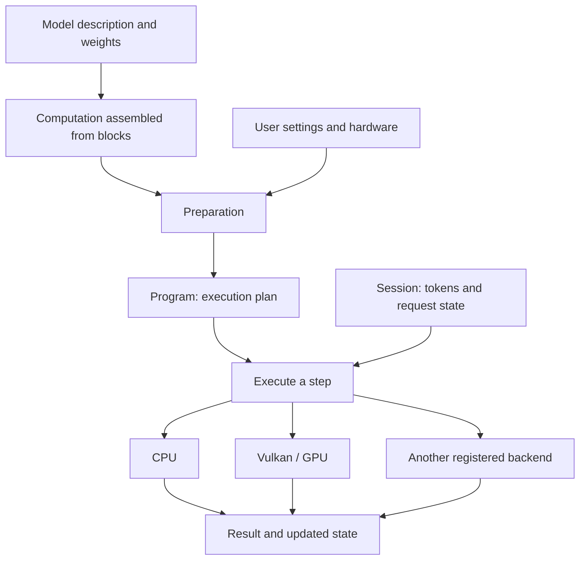

# How Velri works

[Русский](../RU/architecture.md)

Velri is an engine for running neural network models. It should load a model, perform its computations on the available hardware, and return a result to the application. For a language model, this usually means scores for the next token, from which a continuation can be selected.

We are designing the engine in **C17, with CPU and Vulkan as the first two backends**, for Windows, Linux, and Android ARM64. Other backends will connect through a common internal C interface. C is the engine language; Vulkan is the GPU API, with kernels written in GLSL and compiled to SPIR-V.

This is the target architecture. The earlier Rust prototype provided configuration loading, `inspect`, LTQ validation, a computation graph, a test dense-f32 decoder with synthetic weights, and CPU kernels. The C library, Vulkan execution, and generation with a real model are not ready yet. Historical Rust package names retain the `lumen-*` prefix. Project references and paths in the documentation use `velri`.

This document explains the overall structure. Definitions are collected in the [glossary](glossary.md); the [documentation index](README.md) suggests a reading order.

The first concrete C component is the [CPU linear module](cpu-linear.md), with build instructions and exact reference checks. It does not yet implement the runtime or common backend interface.

## What happens when a model runs

Suppose an application sends a request to the engine and asks it to continue some text.

1. **Load the model description and weights.** The description tells us which layers are needed, how they connect, and where their weights are stored.
2. **Assemble the computation from reusable blocks.** A layer might contain attention, an MLP, and residual connections. This stage describes the model's mathematics.
3. **Prepare execution.** Account for user settings and hardware capabilities: choose kernels, place data, reserve memory, and construct jobs.
4. **Create a session.** Each request has its own token history and mutable state. Several sessions can use the same model weights.
5. **Execute steps.** Process the input text first, then generate a continuation. Preserve the data needed again between steps.

This separation lets us describe a model once and choose how to execute it on a particular device. Adding a model should not require writing thread management or GPU data transfers again.

## Who is responsible for what

| Engine part | Responsibility |
| :--- | :--- |
| Model description | Layer order, connections, parameters, and weight mappings |
| Common blocks | Repeated computations: attention, MLP, MoE, normalization, and other mechanisms |
| Preparation | Computation validation, implementation selection, data placement, and memory planning |
| Runtime | Step execution, session state, completion, and cancellation |
| Backends | Operation support queries, prepared kernels, memory, and execution on their devices |
| Platform code | OS threads, processor information, files, clocks, and library loading |

For example, an attention block states which data it needs and what it computes. Preparation chooses a suitable kernel. The CPU backend runs it on the processor, while the Vulkan backend runs it on the GPU. Backends do not need to read a model family's configuration: preparation has already supplied the necessary parameters.

A small model can run entirely on one device. For a large model, we plan to distribute work: attention on the GPU, selected MoE experts on the CPU, and some data on disk. This placement requires explicit transfers and an account of their cost. It should not complicate ordinary execution entirely on the CPU or GPU.

## How another backend connects

Each backend has a registration, its own devices, and a table of C functions. Preparation asks whether a device can execute a particular operation with the specified sizes, types, and layouts. It then obtains a prepared implementation and its memory requirements. The runtime starts the work and waits for its result through a common completion interface.

To add a backend, create its module, include its registration in the build, and run the common checks. Model descriptions and the planner do not gain conditions based on the new backend's name. A backend can start with a few operations; missing operations are placed on other devices only in a permitted mixed plan with explicit data transfers.

The basic transfer route between two devices passes through RAM in an agreed data representation. An incompatible private layout requires an explicit supported conversion. A new module therefore implements transfers to and from CPU memory, rather than a separate protocol for every existing backend. Direct device-to-device copies can be added later as an optimization.

Memory, preparation, error, and registration requirements are collected in the [backend interface](backends.md). It remains an internal source interface; the first working version does not need a stable ABI for external binary plugins.

## How a new architecture is added

An architecture defines layers and their connections. Layers are assembled from blocks, and blocks from operations. The same MLP block can be used on its own and inside a MoE expert. Reusing code does not automatically give those blocks shared weights.

For a new model, read its settings, map weight names, assemble the required blocks, and describe persistent state. If the necessary operations already exist, kernels need no changes. If a model introduces new mathematics, add a common mechanism with explicit parameters and checks. A common block must not contain conditions such as “if this is family X, behave differently.”

Attention also has separate parts: constructing inputs, accounting for position, selecting available history, and computing the result. Full attention, sliding-window attention, QSA, and DSA can share parts, but their differences must be explicit. A single `sparse` flag is not enough. GDN separately describes its recurrent update.

The graph records connections, sizes, data types, and state access. It need not turn every addition of two numbers into a separate node: an operation can be large enough for a fast kernel and have a simple decomposition for reference computation.

Preparation can fuse several operations, including across layer boundaries. This is allowed only when the result, state update order, and data lifetimes are preserved. Different layers can read the same resource. The [blocks document](blocks.md) gives a detailed architecture composition example.

## How memory is organized

Data descriptions and memory allocation are separate concerns. A memory region has an owner responsible for its size, capacity, placement, and release. Several views with different shapes, offsets, and strides can refer to the same region. Creating such a view does not itself copy data.

This is especially important for attention state. **K and V describe input roles; their names do not imply two separate buffers.** A model can store them separately, use a shared region, reconstruct one input from the other, or obtain both from common compressed state. The transformations must be recorded in the graph.

The allocator therefore allocates only explicitly declared regions. It knows no family names and has no special “V-only” or “K-only” mode. If both roles use the same stored data, count that data once. If a transformation needs a temporary result, account for its memory separately. A kernel can avoid materializing that result by combining the transformation with the following computation, if it supports this work.

| Data | Lifetime responsibility |
| :--- | :--- |
| Weights and prepared storage representations | Model; release is possible after all sessions and work using them have finished |
| Immutable job schedule and descriptions of selected kernels | `Program`, tied to the model and device context |
| Attention history and recurrent state | `Session`; data persists between steps of one session |
| Intermediate results, scratch, and transfer buffers | Session or individual execution slot; reuse is possible after the last consumer |

Prepared weights are immutable. Their identity is determined by their source owner and version, device, implementation, and packing format: equal dimensions are not enough to permit sharing. Mutable parameters and commands belong to a session or a preallocated execution slot.

Memory budgets include all simultaneously live data: source and repacked weights, physical reservation overhead, padding, state, intermediate results, and outstanding transfers. Driver memory whose size cannot be reported is marked as unknown. If the CPU and GPU share physical RAM, it cannot be counted twice as two independent memory supplies: the names host-visible and device-local do not establish independent capacities.

Before execution, set limits for context length, tokens per step, and active sequences. Within these limits, use preallocated memory. Calling a general-purpose allocator for every operation during generation should not be necessary. Exceeding a limit produces a clear capacity error or requires a separate explicit growth operation once no work remains outstanding.

## What is done ahead of time and at each step

Weight dimensions and many model connections do not change with every generated token. Preparation validates these once and looks up weights by name. It then queries support on every permitted device, accounting for shapes, types, strides, permitted aliasing, state access, and bounds on changing values. It selects placement, kernels, and weight layouts; before allocation, it makes required transfers and conversions explicit.

Preparation computes repeated parts of jobs: tile sizes, worker ranges, addressing, and temporary memory requirements. Workers do not parse JSON, look up weights by name, or recompute constant geometry on every call.

Tokens, positions, the current history length, MoE routes, and selected state pages change at each step. Prepared templates with bounded sizes handle these values. Changing the number of tokens or selected experts should not rebuild the entire model. Dynamic bounds still need checks: prior validation of weights does not protect against an invalid index at runtime. Already validated constants are not rescanned without a reason.

The CPU thread pool belongs to the execution context. Users set the thread count; available cores, SMT, and shared caches are discovered on the actual device. Sometimes it is useful to execute several operations as one job to reduce worker coordination. Check this decision using the time for the whole step and individual phases: fewer jobs must not impede useful parallelism.

Autotuning can compare execution strategies, but it must have a bounded budget and a clear, reproducible report of its choice. Its result depends on the task shape, implementation, and available resources. Winning at repeated reads of one cached matrix does not establish a speedup for a whole model. Measurement rules are in the [performance document](performance.md).

## What the Vulkan backend requires

The proposed baseline is **Vulkan 1.1 compute with FP32**. The backend checks whether the device supports each required operation, data format, and task size. Faster variants may use FP16, BF16, integer dot instructions, or cooperative matrices when the necessary capabilities are available. No fixed subgroup size is assumed. Capability checks matter more than the vendor name. [Vulkan guide](https://docs.vulkan.org/guide/latest/querying_extensions_features.html).

The backend manages GPU memory, compute pipelines, descriptions of resources available to shaders, command buffers, and queues. Shaders ship as SPIR-V. All of this stays inside the backend: users of the public C API do not manage Vulkan objects. Pipeline creation and descriptor preparation happen during loading or preparation, rather than again for every token.

CPU/GPU communication starts with explicit copies and Vulkan synchronization rules. If the GPU writes a result, the CPU must wait for the write to finish and gain access to current data. Shared physical memory alone does not provide this; an ordinary C atomic does not replace Vulkan synchronization either. See the [execution design](execution-design.md) for details.

Windows, Linux, and Android are target platforms, not an already verified device list. CPU execution must build independently. If the user explicitly requests a GPU on which the required path is unavailable, preparation returns the reason. Preparation may choose another permitted device or a declared equivalent decomposition of an operation; the choice must appear in the report. Automatic substitution with the CPU is allowed only in a mode selected for that purpose. A backend cannot silently switch to the CPU during an executing step.

## How correctness is checked

Every operation must describe its inputs, outputs, state access, and temporary memory. A backend either supports these requirements or explicitly rejects the operation. It must not skip an unfamiliar operation and continue.

When adding an operation in C, update its common validation, diagnostic name, and reference implementation. A backend chooses a handler from the operation description or explicitly rejects it; the common backend interface does not need a new field for every kernel. Registry checks and tests must catch missing handlers. This replaces part of the protection currently provided by exhaustive Rust `match` expressions. A backend may support only some operations, but a whole model needs a fully supported prepared plan.

New mathematics gets a simple reference implementation. Compare an optimized kernel against it, then measure speed. Also compare a complete model with an independent executor: correct matrix multiplication does not establish correct layer order, masks, or state. Correctness, speed, and portability are verified separately.

The public library reports errors to the calling application and does not terminate its process. Long-lived objects use opaque C handles. They have matching creation and release operations; borrowed data has a documented lifetime. Concurrency and cancellation rules are described in the [API](api.md).

## How the code will be organized

Start with one `velri` library, separately built optional backends, and separate applications. A module is a group of C files with a small internal interface. Each such directory does not need to become a separate library.

| Planned directory | Contents |
| :--- | :--- |
| `include/velri/` | Public C API: object creation, execution, statuses, and diagnostics |
| `src/core/` | Common types, tensor and storage descriptors, size validation, graph |
| `src/model/` | Model-family descriptions and common blocks |
| `src/format/` | Weight and LTQ reading, format and offset validation |
| `src/plan/` | Placement and kernel selection, data lifetimes, prepared jobs |
| `src/runtime/` | Sessions, steps, token selection, completion, and cancellation |
| `src/backend/interface.h`, `src/backend/registry.c`, `src/backend/common/` | Internal C interface, registered modules, common helpers, and RAM transfers |
| `src/backend/cpu/`, `src/backend/vulkan/`, future modules | Kernels, device resources, queues, and execution |
| `src/platform/` | OS threads, hardware information, file mapping, clocks, library loading |
| `apps/`, `tools/` | Command line, server, quantizer, and code generator |

This is a future layout. Start with the CPU library and tests; Vulkan and HTTP are enabled separately. The server and quantizer are not compute-core dependencies. Common blocks do not depend on Vulkan, SIMD instructions, or family names; backends do not read model configs; platform code knows nothing about tensors. Preparation connects them through opaque resources, operation descriptions, and C function tables. A static registry explicitly includes modules selected at build time. The public application API is separate from this internal interface. Dynamic plugins are not needed at the first stage.

First establish a verifiable path: small weights → graph → preparation → CPU execution → checked result. Preserve independent Python fixtures and reference results for comparison. Keeping the Rust implementation runnable until the new path is ready is not required. First check the common interface with a small backend that has limited operation support and controllable completion delay. Then add real models, Vulkan, and cooperation between devices. Old crates should not become C libraries one for one. Before removing old code, preserve the necessary reference data, measurements, and algorithm descriptions; CPU kernels already have a [separate document](kernel-reference.md).

Tokenization and chat templates are checked separately; the library also accepts token IDs. LTQ v1's specification survives the language change. The quantizer can reuse common loading and execution, but develops separately from the server. Builds and libraries are described in the [dependency stack](dependencies.md), and acceptance criteria in the [roadmap](roadmap.md).
