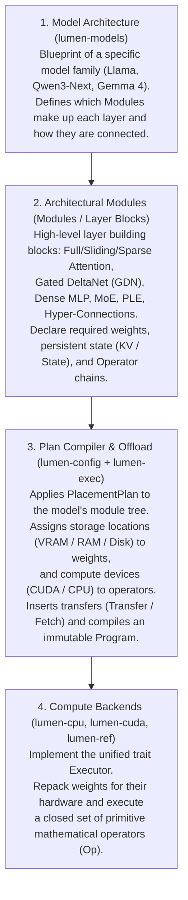
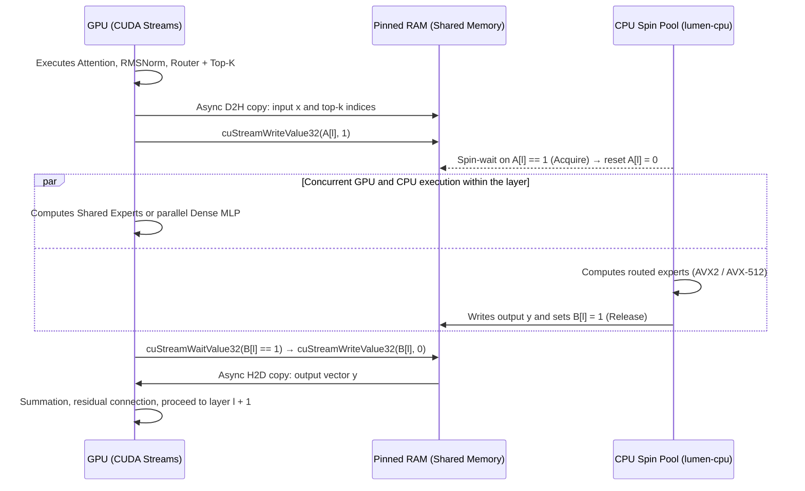

# lumen-rs Engine Architecture

**lumen-rs** is an inference engine for large language (LLM) and multimodal models designed specifically for **hybrid execution (offloading)**.

The primary target scenario is running models that do not fit into the memory of a single consumer GPU (16–32 GB VRAM): part of the weights and states resides in system RAM or on an NVMe SSD, and each generation step distributes work between the GPU and the CPU.

To run this hybrid pipeline near the physical bandwidth ceiling of the hardware, the engine is structured as an **ahead-of-time execution plan compiler (`Program`)**:
- At load time, the model architecture description and placement configuration are compiled once into an immutable `Program`. Every operator in `Program` is pre-assigned a compute device, memory buffers, CUDA streams, and synchronization points.
- In the token generation hot loop there are no memory allocations, no tensor name lookups, and no dynamic device branching. The runtime executes a pre-compiled sequence of compute kernels, device-to-device transfers, and disk reads.

---

## Contents

1. [Four Levels of Modularity](#1-four-levels-of-modularity)
2. [Cargo Workspace Layout and Build System](#2-cargo-workspace-layout-and-build-system)
3. [Placement Plan (`PlacementPlan`) and Data Access Modes](#3-placement-plan-placementplan-and-data-access-modes)
4. [Memory Subsystem: Four Classes of Data](#4-memory-subsystem-four-classes-of-data)
5. [Offload Mechanics: GPU ↔ CPU Synchronization and Disk Prefetch](#5-offload-mechanics-gpu--cpu-synchronization-and-disk-prefetch)
6. [Weight Representations and Model Loading](#6-weight-representations-and-model-loading)
7. [Plan Compiler (`lumen-exec`) and Step Execution](#7-plan-compiler-lumen-exec-and-step-execution)
8. [Generation Runtime (`Engine`), Speculative Decoding, and Multimodality](#8-generation-runtime-engine-speculative-decoding-and-multimodality)
9. [Extensibility Rules and Architectural Boundaries](#9-extensibility-rules-and-architectural-boundaries)

**Related Documents:**
- [config.md](config.md) — JSON configuration schema and cascading placement rules
- [ltq-format.md](ltq-format.md) — LTQ quantization format specification; [ltq-design.md](ltq-design.md) — design rationale, benchmarks, and quantizer
- [kernels.md](kernels.md) — GPU (CUDA C++) and CPU (AVX2 / AVX-512) compute kernels
- [performance.md](performance.md) — hardware physical ceiling model (`Program::floor`) and efficiency metric $\eta$
- [api.md](api.md) — chat templates, CLI commands, and HTTP server
- [models/README.md](models/README.md) — supported model families and their architectural modules
- [roadmap.md](roadmap.md) — phased implementation order and technical risks

---

## 1. Four Levels of Modularity

The architecture of `lumen-rs` separates model definitions, internal layer building blocks, offload scheduling, and hardware backends into four independent layers. Adding a component at one level requires no changes to the others.



### Division of Responsibilities Across Levels

1. **Model Architecture Level (`trait Architecture` in `lumen-models`):**
   Describes the topology of a specific model family (matched by `model_type` in HuggingFace `config.json`). An architecture composes layers from shared modules (for example: alternating three `GatedDeltaNet + MoE` layers with one `FullAttention + MoE` layer, plus a `PLE` module).
2. **Architectural Module Level (Modules):**
   The internal building blocks of modern transformer and hybrid networks:
   - *Sequence Mixers:* full attention (`FullAttention`), sliding-window attention (`SlidingAttention`), sparse attention with block indexer (`SparseAttention` / QSA), and linear recurrent attention (`GatedDeltaNet` / GDN).
   - *Channel Mixers (FFN):* dense feed-forward networks (`DenseMlp`) and Mixture of Experts (`MoE` — router, routed expert bank, and shared experts).
   - *Stream Modifiers & Adapters:* Per-Layer Embeddings (`PLE` and n-gram lookup tables), multi-stream residual connections (`HyperConnections`), and normalizations (`RMSNorm`).
   Each module declares its configuration path subtree (e.g., `moe/routed-experts`), requests its weights, and lowers itself into a sequence of primitive operators `Op`.
3. **Scheduler and Placement Level (`lumen-config` and `lumen-exec`):**
   Maps model component paths to physical storage and compute devices, computes static memory layouts, and compiles the logical graph into `Program`.
4. **Compute Backend Level (`trait Executor` in `lumen-backend`):**
   Executors (`lumen-cpu`, `lumen-cuda`, and the scalar reference `lumen-ref`) run in a single process address space. Backends are model-agnostic and execute a closed set of primitive operators (`Linear`, `Attention`, `DeltaNet`, `RmsNorm`, `RoPE`, etc.) over pre-allocated buffers.

---

## 2. Cargo Workspace Layout and Build System

The workspace consists of 20 crates with a strict unidirectional dependency graph: each crate in the table may only depend on crates listed above it.

| Crate | Responsibility | Key Dependencies |
| :--- | :--- | :--- |
| **`lumen-core`** | Core types: `DType`, tensor `Shape`, `Device` IDs, storage locations `MemLoc`, `ComponentPath`, error types | `half`, `bytemuck`, `thiserror` |
| **`lumen-kabi`** | `#[repr(C)]` kernel parameter structs and format constants. `cbindgen` generates `lumen_kabi.h` from this crate for C++/CUDA code | — |
| **`lumen-config`** | JSON config parsing, cascade and layer-selector resolution, validation → flat `PlacementPlan` | `serde`, `serde_json`, `strsim` |
| **`lumen-mem`** | Memory ownership (`Buffer`), allocator trait, activation arenas, paged KV pool, recurrent state pool, NUMA binding, and disk reads | `memmap2`, `libc`, `io-uring` |
| **`lumen-tensor`** | Tensor descriptors (`TensorRef`, `TensorView`) and canonical weight descriptors: `LtqLinear`, `RowTable`, `DenseLinear`, `ExpertBank` | `lumen-core`, `lumen-mem` |
| **`lumen-format`** | Reading `.ltq` containers (header, tensor catalog, `mmap`) and reading BF16 `safetensors` checkpoints for the quantizer | `safetensors`, `memmap2`, `hf-hub` |
| **`lumen-ltq`** | Reference LTQ decoder in Rust ([per specification](ltq-format.md)) and Hadamard-256 transform for verifying fast kernels | `lumen-core`, `half` |
| **`lumen-backend`** | Primitive operator set `enum Op`, backend interface `trait Executor`, hardware profile `HwProfile` | `lumen-tensor` |
| **`lumen-ref`** | Reference scalar `f32` backend capable of running any `Program`; serves as the accuracy oracle for differential tests | `lumen-backend`, `lumen-ltq` |
| **`lumen-cpu`** | CPU compute backend: hot-path spin pool, AVX2 and AVX-512 SIMD kernels, CPU side of `Transfer` and `Fetch` | `lumen-backend`, `lumen-ltq`, `rayon` |
| **`lumen-cuda-kernels`** | CUDA C++ kernels (`.cu`), `extern "C"` launch wrappers, and raw CUDA Driver API bindings (`bindgen` over `cuda.h`), compiled by `nvcc` into a static library | `lumen-kabi`; at build time: `nvcc`, `CUTLASS` and `FlashInfer` headers |
| **`lumen-cuda`** | CUDA backend: contexts, streams, events, VRAM allocator, `pinned` memory registration, CUDA Graphs, kernel launches via `lumen-cuda-kernels` | `lumen-backend`, `lumen-cuda-kernels` |
| **`lumen-models`** | Architecture registry by `model_type`, module builders (Attention, GDN, MoE, PLE, etc.), weight name aliases, and expert normalization | `lumen-tensor`, `lumen-format` |
| **`lumen-exec`** | Plan compiler: builds `Program` from the model graph and `PlacementPlan`, computes the hardware ceiling (`Program::floor`), and runs auto-placement (`--auto`) | `lumen-config`, `lumen-models`, `lumen-backend` |
| **`lumen-media`** | Image, video, and audio preprocessing for multimodal models (decoding, resizing, patch slicing, frame extraction) | `image`, `symphonia`, `rubato` |
| **`lumen-chat`** | Tokenization (`tokenizers`), chat template rendering (`minijinja`), reasoning (`<think>`, Harmony) and tool-call parsers, streaming detokenization | `tokenizers`, `minijinja`, `openai-harmony`, `lumen-media` |
| **`lumen-engine`** | `Engine` runtime: request scheduling, paged KV, prefix cache, batching, sampling, and speculative decoding | `lumen-exec`, `lumen-cpu`, `lumen-cuda` (opt), `lumen-chat` |
| **`lumen-quantize`** | Quantizer from BF16 (`safetensors`) to `.ltq`: Hessian collection, Fisher information, DP bit-allocation profile, GPU Block16-LDLQ and Viterbi kernels | `lumen-engine`, `lumen-ltq` |
| **`lumen-server`** | `axum` HTTP server supporting OpenAI (`/v1/chat/completions`) and Anthropic (`/v1/messages`) protocols via SSE | `lumen-engine`, `lumen-chat`, `tokio`, `axum` |
| **`lumen-cli`** | The `lumen` binary: `run`, `chat`, `serve`, `inspect`, `bench`, `probe`, `pack`, `quantize` | `lumen-engine`, `lumen-quantize`, `lumen-server`, `clap` |

### Build Toolchain and Rust ↔ CUDA C++ Boundary

- **Stable Rust (MSRV 1.89):** AVX-512 intrinsics are stable starting with Rust 1.89. CPU instruction set selection (AVX2 vs. AVX-512 VNNI/VBMI) occurs dynamically at startup.
- **Static linking of CUDA C++20 kernels:** when compiled with `--features cuda`, `lumen-cuda-kernels/build.rs` compiles `.cu` sources via `nvcc` (CUDA Toolkit ≥ 12.8) into a static library containing native SASS for `sm_80`, `sm_86`, `sm_89`, `sm_90`, `sm_100`, `sm_120` plus PTX for newer GPUs. At runtime, the binary requires only the standard NVIDIA driver (no CUDA Toolkit or `cuBLAS` dependency). The pure-Rust GPU alternative `cuda-oxide` was benchmarked on LTQ GEMV: it matches `nvcc` only when compiled through `libNVVM` (losing 25–43% without it) while its tooling remains alpha ([`results/kbench_gemv_g4.json`](https://github.com/lumen-inference/ltq-research/blob/main/results/kbench_gemv_g4.json), [`src/kbench/`](https://github.com/lumen-inference/ltq-research/tree/main/src/kbench)).
- **Narrow C ABI bridge (`lumen-kabi`):** host Rust code and C++ kernels communicate exclusively through `#[repr(C)]` parameter structs in `lumen-kabi`. The `lumen_kabi.h` header is generated by `cbindgen` and verified in CI.
- **CUDA-free build:** without `--features cuda`, the workspace builds with standard `cargo build` and requires no NVIDIA dependencies.

---

## 3. Placement Plan (`PlacementPlan`) and Data Access Modes

In `lumen-rs`, a tensor's permanent storage location (`store`) and the device that executes math on it (`compute`) are specified independently:

```rust
#[derive(Copy, Clone, Eq, PartialEq, Hash)]
pub enum Device {
    Cpu(u16),   // CPU compute node, e.g. "cpu:0"
    Cuda(u16),  // GPU device, e.g. "cuda:0"
}

#[derive(Copy, Clone, Eq, PartialEq, Hash)]
pub enum MemLoc {
    Ram(u16),   // System RAM on a NUMA node, e.g. "ram:0"
    Vram(u16),  // GPU VRAM, e.g. "vram:0"
    Disk,       // File mapping on NVMe storage ("disk")
}
```

At load time, the configuration file (or `--auto` placement solver) resolves into a flat `PlacementPlan` mapping every component of every layer to a `Place`:

```rust
pub struct Place {
    pub compute: Device,                 // Compute device during token generation (decode)
    pub store: MemLoc,                   // Permanent storage location for weights
    pub prefill_compute: Option<Device>, // Optional compute device during prompt processing (prefill)
}

pub struct PlacementPlan {
    pub tree: ComponentTree,                         // Component tree from the model architecture
    pub global: BTreeMap<ComponentPath, Place>,      // Non-layer nodes: embed, ple, vision-tower, lm-head, mtp
    pub layers: Vec<BTreeMap<ComponentPath, Place>>, // Per-layer placement (index = layer number)
    pub kv: Vec<KvPlacement>,                        // Per-layer KV cache placement parameters
    pub state: Vec<StatePlacement>,                  // Per-layer recurrent state placement parameters
    pub provenance: Provenance,                      // JSON rule source for each value (used by lumen inspect)
}
```

### Data Access Mode Matrix `(store, compute, access_kind)`

Any `(store, compute)` pair is valid. The specific data access mode is resolved once during plan compilation from the triple **(storage location, compute device, whether the operation reads the full tensor or gathers sparse rows/experts)**:

| Storage (`store`) ↓ \ Compute (`compute`) → | CPU (full tensor) | CPU (row/expert gather) | GPU (full tensor) | GPU (row/block gather) |
| :--- | :--- | :--- | :--- | :--- |
| **`vram:G`** (GPU Memory) | **Readback** (D2H copy to RAM) | **Readback** (selected slices only) | **Direct** (local VRAM access) | **Direct** (local VRAM access) |
| **`ram:N`** (System Memory) | **Direct** (local RAM access) | **Direct** (local RAM access) | **Streamed** (double-buffered H2D) | **ZeroCopy** (direct PCIe reads from kernel) |
| **`disk`** (NVMe Storage) | **Fetch** (disk read to RAM) | **Fetch** (selected rows only) | **Fetch + H2D** (disk → RAM → GPU) | **Fetch + H2D** (rows → GPU) |

Access mode descriptions:
1. **Direct:** data resides in the compute device's local memory (`vram:0` for `cuda:0` or `ram:0` for `cpu:0`).
2. **ZeroCopy:** the table is placed in `pinned RAM` registered with the CUDA driver (`cuMemHostRegister`). When a GPU kernel only needs to gather a few rows from a large table (token embeddings or KV cache pages selected by the sparse indexer), the kernel reads those rows directly over PCIe without host involvement: on `Qwen3.8-Flash-Next`, reading a single token's embedding via `ZeroCopy` transfers only **5 KB** instead of **1.27 GB** if the entire table were copied via `Streamed`. Similarly, with QSA sparse attention, a KV cache in `ram:N` is read from `cuda:G` via `ZeroCopy` (fetching only indexer-selected blocks), while scanning the indexer key cache (`indexer/keys`) from `ram:N` at 262k context costs **~0.2 GB** of PCIe traffic per token (~3 ms on PCIe 5.0), freeing VRAM for weights.
3. **Streamed:** weights reside in `pinned RAM` and are asynchronously copied into a VRAM ring buffer on a dedicated stream one layer ahead. During **prefill** (`"prefill-compute": "cuda:0"`), the PCIe transfer cost is amortized across the prompt chunk (512–4096 tokens).
4. **Fetch:** used for large lookup tables (`RowTable`) kept on NVMe disk (`"store": "disk"`). A background I/O thread pool reads the required rows into a double-buffered `pinned` region several layers ahead of the consuming operator (`ZeroCopy` cannot be used on an `mmap` file because registering it with CUDA would pin the entire file in RAM).
5. **Readback:** copies data from VRAM to `pinned RAM` on the `d2h` stream, allowing spare VRAM to serve as overflow storage when system RAM is constrained.

---

## 4. Memory Subsystem: Four Classes of Data

To avoid allocations in the hot loop, `lumen-mem` partitions all memory into four classes by lifetime:

| Memory Class | Lifetime | Allocation Mechanism | Placement |
| :--- | :--- | :--- | :--- |
| **1. Model Weights** | Entire session | Single region per device with 256-byte aligned sub-allocation. In RAM — anonymous `mmap` with `mbind` and `MADV_HUGEPAGE`; on disk — zero-copy file `mmap` | Per component `store` |
| **2. Activations** | Single step (`step`) | Static arena layout: liveness analysis assigns each intermediate tensor a fixed offset sized for the maximum batch | On operator `compute` device |
| **3. Attention KV Cache** | Sequence lifetime | Paged pool (`KvPool`, 64-token pages) and per-sequence block tables; ring buffer for sliding-window layers | Per `attention.kv-cache.store` |
| **4. Recurrent State (`State`)** | Sequence lifetime | Fixed-size slot per sequence (`StatePool`) plus state history for speculative decoding rollback | Per `state.store` |

### Organization of KV Cache and Recurrent States

- **Standard and Quantized KV Cache:** stores keys ($K$) and values ($V$) in 64-token pages. The `kv-quantization` section allows configuring separate bit widths for $K$ and $V$ (2 to 8 bits) with on-the-fly dequantization inside the attention kernel.
- **Sliding-Window Ring Cache (`SlidingAttention`):** allocates a ring of $W + T_{\max} - 1$ positions, where $W$ is the window size and $T_{\max}$ is the maximum tokens processed per sequence in a single step (prefill chunk size or speculative draft length $k + 1$), preventing later tokens in a chunk from overwriting slots still needed by earlier tokens or draft rollbacks.
- **Specialized KV Layouts (Gemma 4 and QSA):**
  - When keys equal values ($K = V$ on global layers of Gemma 4 12B, 26B, 31B), the cache stores only $V$ and reconstructs $K$ inside the attention kernel, halving global KV memory.
  - Shared-KV layers (`num_kv_shared_layers` in Gemma 4 E2B/E4B) allocate no buffer of their own and read the cache of the last reference layer of the same type.
  - The sparse attention indexer (`QSA` in Qwen3.8-Flash-Next) maintains a compact cache of 128-dimensional per-token keys and averaged keys of completed 4-token blocks.
- **Recurrent States (`StatePool`):**
  - In `GatedDeltaNet` layers, the per-sequence state holds an $H_v \times D_k \times D_v$ matrix in `fp32` plus a `conv1d` buffer of `conv_kernel - 1` positions (e.g., ~3 MB per layer or 108 MB across 36 layers in Qwen3.8-Flash-Next).
  - In `PLE` layers with dilated convolution, the state holds the last 9 positions across 4 residual streams and the last 2 token IDs.
  - To support speculative decoding rollback, each state slot stores a history window of $k$ draft steps; for `PrefixCache`, state snapshots are recorded at chat turn boundaries.

---

## 5. Offload Mechanics: GPU ↔ CPU Synchronization and Disk Prefetch

When adjacent operators execute on different devices, the scheduler inserts a `Transfer { src, dst, bytes }` operator backed by a buffer in `pinned RAM`.

### Pinned-RAM Flag Protocol and CPU Spin Pool

Synchronization between GPU and CPU happens directly through 32-bit flag words in `pinned RAM` without involving the host control thread or the OS scheduler:
- The GPU waits for CPU completion via `cuStreamWaitValue32` and signals the CPU via `cuStreamWriteValue32`.
- CPU worker threads (`spin-pool` in `lumen-cpu`) actively poll the same memory word.

So that flag waits can be captured inside a static **CUDA Graph** (where the expected value is baked into the graph node at capture time), the engine uses a **"consumer-reset" protocol** with a dedicated pair of flags `A[l]` and `B[l]` for each layer $\ell$:



While the CPU computes routed experts, the GPU concurrently executes the independent branch of the same layer (shared experts or parallel dense MLP) and waits on `B[l]` only before copying the result `y` back to VRAM.

### Disk Reads (`Fetch`)

NVMe storage (`MemLoc::Disk`) primarily holds row lookup tables (`RowTable`) whose row addresses depend solely on token IDs (n-gram tables, PLE tables, embeddings). This allows reads to be initiated ahead of time:
- During **prefill**, all token IDs in the chunk are known before the step begins.
- During **decode**, the new token ID is known immediately after sampling on the previous step, whereas PLE data is needed only after the initial embedding operations — NVMe read latency is hidden behind early layer execution.
- Reads are performed by a dedicated I/O thread pool (`io-threads`, using `io_uring` or `pread`) into a double-buffered `pinned` region, signaling completion via the same flag protocol as `Transfer`. Consequently, compute threads never incur page faults in the hot loop.

---

## 6. Weight Representations and Model Loading

The `lumen-format` loader and `lumen-models` normalizer map all model weights into three canonical descriptors:

```rust
pub struct LtqLinear {
    pub m: u32, pub k: u32,           // Logical matrix dimensions [M, K]
    pub m_pad: u32, pub k_pad: u32,   // Dimensions padded to multiples of 16 and 256
    pub slices: Vec<LtqSlice>,        // Row slices with their assigned LTQ menu formats
    pub d_row: WeightRef,             // Row scales fp16 [M]
    pub e: WeightRef,                 // Block exponents int8 [M, K/256]
    pub suh: WeightRef,               // Input rotation vector fp16 [K]
    pub bias: Option<WeightRef>,
    pub layout: TileLayout,           // Canonical (on disk) | CpuBand16 | GpuWarp
}

pub struct RowTable {
    pub rows: u64, pub dim: u32,
    pub codec: RowCodec,              // Dense(dtype) | Int8Rows | LtqRing { format, ring, hadamard }
    pub shards: Vec<WeightRef>,       // Table partitions (e.g. n-gram hash heads)
    pub head_offsets: Option<Vec<u64>>,
    pub head_bias: Option<WeightRef>,
}
```

The third descriptor is **`DenseLinear`** for small unquantized matrices (`bf16` / `fp16` / `fp32`). For MoE layers, **`ExpertBank`** aggregates the descriptors of all experts in a layer along with a normalized **`RouterSpec`**.

At load time, `Executor::prepare_weight` repacks canonical LTQ tiles for the target device:
- **`CpuBand16` (CPU):** tiles are laid out in 16-row horizontal bands contiguous along $K$ with interleaved fields for sequential DRAM streaming (the same band layout in `exllamav3` CPU-MoE yielded a 3.4× speedup on cold experts).
- **`GpuWarp` (GPU):** codes and bit planes are packed in 32-bit words for warp-level reads.

The `lumen pack` command performs this repacking ahead of time and writes the target layouts directly to the `.ltq` file.

### Expert Normalization (`ExpertBank`) and Routing (`RouterSpec`)

The canonical representation of MoE experts is an `ExpertBank` per projection: a descriptor table covering all experts (slices, scales, `suh`, `bias`) and, where applicable, a contiguous memory allocation. Because kernels always index experts through the descriptor table, mixed bitrates across experts (assigned by the DP solver) work natively:

| On-Disk Layout | Detection Rule | Normalization Action (`Architecture::normalize`) |
| :--- | :--- | :--- |
| **Per-expert LTQ:** `mlp.experts.{e}.gate_up_proj.ltq.*`, `mlp.experts.{e}.down_proj.ltq.*` | Expert index `{e}` in tensor name | Assemble bank by index `e`; `gate_up` stays fused as quantized by `lumen-quantize` |
| **3D dense stack:** `mlp.experts.gate_up_proj` and `down_proj` with axis `E` (BF16 checkpoints of `gpt-oss`, `Qwen3-MoE`, `Qwen3.8-Flash-Next`, `Gemma 4 26B-A4B`) | 3D tensor with axis `0 == num_experts` | Slice along axis `E` for the dense path (quantizer input and unquantized models) |
| **Fused `gate_up`** | Second axis equals $2 \cdot I$ | For `concat` — split in half; for `interleave` (`gpt-oss`: even rows = `gate`, odd rows = `up`) — de-interleave during copy |
| **Alternative names** (`block_sparse_moe.experts.{e}.w1/w3/w2` in `Mixtral`) | Architecture alias table | Map to canonical `gate`, `up`, `down` |

In the same pass, model-specific routing formulas are normalized into `RouterSpec`:

| Model Family | Routing Formula in `RouterSpec` |
| :--- | :--- |
| **Qwen (`Qwen3-MoE`, `Qwen3-Next`), Mixtral** | `softmax → top-k` (with or without weight renormalization) |
| **gpt-oss** | `top-k → softmax` (`top-k` selection over raw logits prior to `softmax`) |
| **DeepSeek-V3, Kimi-K2, GLM-4.5** | `sigmoid` + `e_score_correction_bias` + grouped `top-k` |
| **Gemma 4 (`26B-A4B`)** | Input: unweighted `RMSNorm` $\times \text{scale} \times \text{hidden}^{-1/2}$; then `softmax → top-k → renormalize → × per_expert_scale` |

---

## 7. Plan Compiler (`lumen-exec`) and Step Execution

Each model architecture implements `trait Architecture`, returning its component tree and logical operator graph:

```rust
pub trait Architecture {
    fn from_hf(cfg: &HfConfig) -> Result<Self> where Self: Sized;
    fn components(&self) -> ComponentTree;               // Node tree for config and placement
    fn weights(&self) -> WeightSchema;                   // Canonical keys, shapes, and name aliases
    fn normalize(&self, m: &mut Manifest) -> Result<()>; // Normalization of MoE experts and fused projections
    fn build(&self, g: &mut GraphBuilder);               // Operator graph construction
}
```

### Scheduler Compilation Passes (`lumen-exec`)

1. **Device assignment:** binds each operator to a `Device` and each weight to a `MemLoc` per `PlacementPlan`.
2. **Support validation (`Executor::supports`):** verifies that every backend supports the operators assigned to it.
3. **Dead-row elimination on prefill:** `LmHead` is computed only for the final token of the prompt; in models with shared KV on final layers (e.g., the last 18 of 42 layers in Gemma 4 E4B), those layers are evaluated during prefill only for rows that require output logits.
4. **Operator fusion:** combines `Q + K + V`, `Gate + Up`, `Add + RmsNorm`, `Bias + Residual`, `HcMix + Norm`, and on-the-fly $K$-from-$V$ reconstruction inside attention.
5. **Insertion of `Transfer` and `Fetch` operators and partitioning into device segments (`Segment`).**
6. **Static activation arena layout and CUDA Graph capture** across batch-size buckets (1, 2, 4, 8…).

---

## 8. Generation Runtime (`Engine`), Speculative Decoding, and Multimodality

The generation core is a synchronous `Engine` struct owned by a single dedicated thread:

```rust
pub struct Engine {
    program: Program,
    kv: KvPool,
    states: StatePool,
    prefix: PrefixCache,
    sched: Scheduler,
    sampler: Sampler,
    drafter: Option<Box<dyn Drafter>>,
}
```

- **Prefix Cache:** KV cache blocks are addressed by chained hashes of tokens and media attachments with reference counting; hybrid models with recurrent states store state snapshots at chat turn boundaries.
- **On-device sampling:** the `softcap → repeat-penalty → temperature → top-k → top-p → min-p → Philox` pipeline runs on the `output-layer` device; only the selected 4-byte token ID is copied to the host.
- **Asynchronous step pipelining:** because the sampled token ID remains in device memory, step $N+1$ is enqueued before the host finishes detokenizing and checking stop conditions for step $N$.
- **Speculative decoding (`trait Drafter`):** supports prompt lookup (`NGram`), external draft models (`DraftModel`), built-in `Mtp` layers, and the 4-layer `Gemma4Assistant` drafter that reads the target model's KV cache directly.
- **Multimodality (`lumen-media`):** vision and audio encoders compile into their own `Program`; their output embeddings are cached by content hash and substituted into placeholder token positions in the decoder.

---

## 9. Extensibility Rules and Architectural Boundaries

| Extension Axis | Where It Lives | Contract | What Remains Unchanged |
| :--- | :--- | :--- | :--- |
| **Model Architecture** | Family module in `lumen-models`, registered by `model_type` | `trait Architecture`: component tree, weight schema, normalization, operator graph from shared builders | `lumen-exec` scheduler, backends, config parser, container format |
| **Operator (`Op`)** | Variant in `enum Op` (`lumen-backend`) and reference in `lumen-ref` | Semantics defined by the reference oracle; a backend without a kernel returns `supports = false` and fails at load time | Model architectures that do not use the operator |
| **Compute Backend** | Dedicated crate (`ROCm`, `Metal`, `Vulkan`) | `trait Executor`: operator support, weight repacking, segment execution, hardware bandwidth probing for `HwProfile` | `lumen-models`, `lumen-exec` scheduler, other backends |
| **Device or Storage Location** | `Device` and `MemLoc`, row in the access mode matrix (Section 3) | `Transfer` and `Fetch` implementations for the new pair (second GPU, NUMA node, CXL) | Operators and compute kernels |
| **LTQ Format** | `formats` table in the `.ltq` header | Parameters `K`, masks, `h`, `sub`, `lut`, and `gain` are pure data in the file | Kernels, as long as the format stays within template parameter bounds |
| **Weight Kind or Container Version** | `lumen-format`, `lumen-tensor` | All on-disk layouts normalize at load time into `LtqLinear`, `RowTable`, `DenseLinear` | Operators and compute kernels |
| **Speculative Drafter** | Implementation of `trait Drafter` (Section 8) | `DraftRequest → DraftOut` contract | `Engine` core and model architectures |
| **Chat Format / HTTP API** | Template and parser in `lumen-chat`, adapter in `lumen-server` | `ChatRequest → ChatEvent` stream transformation | `lumen-engine` generation core |

### Nine Rules Enforcing Architectural Boundaries

1. **Model names appear in only two crates.** `model_type` strings and model family names exist only in `lumen-models` (architecture registry) and `lumen-chat` (output parsers). The scheduler, backends, kernels, and runtime contain zero branches on model names; CI scans for family names outside those two crates.
2. **A model quirk is an operator parameter, not a code branch.** A new `Op` variant is introduced only when behavior cannot be expressed via parameters and composition of existing operators. The operator set is a closed `enum Op` (not trait objects) so the scheduler can inspect and fuse operators and `Program` remains plain data printable by `lumen inspect`.
3. **Model families are assembled from shared block builders, not copy-pasted.** `lumen-models` provides shared module constructors (`Attention`, `GatedDeltaNet`, `MoE`, `DenseMlp`, `RMSNorm`, `PLE`, `HyperConnections`). An architecture parses its config and composes modules; extensions (`Qwen3.8-Flash-Next` over `qwen3_5_moe`, `Gemma 4 E2B/E4B` over base `Gemma 4`) swap individual modules without duplicating `build`.
4. **Dependency direction is verified automatically.** Each crate depends only on crates listed above it in Section 2; `lumen-exec` talks to backends exclusively through `trait Executor`, backends know nothing about models, and models know nothing about backends. CI validates the `cargo metadata` graph against the allowed DAG.
5. **Reference oracle first, speed second.** Every new operator lands alongside its scalar reference implementation in `lumen-ref`, and fast kernels are added under differential tests against the reference. Wildcard `_` arms in `match Op` are forbidden: a new operator variant will not compile until every backend explicitly handles it.
6. **Every LTQ format has a slow generic fallback path.** A generic kernel reads format parameters at runtime, while template specializations over `K`, masks, and fractional modes accelerate the standard menu formats. Any new format works immediately and becomes fast once a template specialization is added.
7. **Optimizations live only in declared places:** inside kernels and their specializations, in scheduler passes (fusions in Section 7), and in weight layouts (Section 6). Every compiler pass is registered in the pass list and tested for logit equivalence with the pass enabled vs. disabled. There are no fast paths that bypass `Program`.
8. **The config schema is derived automatically from the component tree.** Adding a new architecture requires zero code changes in `lumen-config`: cascade resolution, path validation, and `lumen inspect` operate directly on `Architecture::components()`.
9. **Cargo features map strictly to backends and the server** (`cuda`, `server`, and later `rocm`, `metal`); there are no per-model Cargo features.

### Architecture Extension Forecast

| Anticipated Addition | What Needs to Be Added | Affected Subsystems |
| :--- | :--- | :--- |
| **Dense and MoE models on known blocks** (new Llama, Qwen, Mistral) | Module in `lumen-models` and a tiny test fixture | Zero changes outside `lumen-models` |
| **MLA and sparse attention with indexer** (DeepSeek, DSA from V3.2) | "Latent" KV layout variant (compressed KV + shared RoPE key, projection absorption in kernel); indexer reuses QSA's page-list mechanism | New `Attention` variant in kernels; scheduler and paged `KvPool` unchanged |
| **SSM layers (`Mamba-2`) and hybrids (`Nemotron-H`)** | `Ssm` operator; the "recurrent state" memory class already exists for `GatedDeltaNet` | New `Op::Ssm` variant and its compute kernels |
| **Multi-GPU execution** | `cuda:1` in placement plan, GPU ↔ GPU `Transfer` (P2P or staged via `pinned RAM`) | Layer pipeline parallelism already fits `PlacementPlan`; tensor parallelism adds a collectives operator |
| **AMD ROCm (HIP)** | `lumen-rocm` crate: port CUDA C++ kernels via `hipify`, replace `CUTLASS` and `FlashInfer` with `composable_kernel` and an attention port | Standalone backend crate; all other crates untouched |
| **Apple Silicon (Metal, unified memory)** | `lumen-metal` crate; `ram` and `vram` map to unified memory, reducing offload to compute device selection | Standalone backend crate with MSL kernels |
| **Quantized KV cache (`TurboQuant-MSE`)** | KV layout parameter on `Attention`, Hadamard rotation inside `KvWrite` | Attention kernels and `KvPool` page layout |
| **New LTQ menu formats** | New entries in the `.ltq` header `formats` array | Data only (kernels change only if parameters exceed template bounds) |
| **Multi-layer speculative drafters (`EAGLE-3`)** | Pass hidden states from multiple target layers in `DraftRequest` | Extension of `DraftRequest` struct |
| **New external protocols (OpenAI Responses API, etc.)** | HTTP adapter in `lumen-server` | `lumen-server` crate only |

**Out of Scope:** non-autoregressive models that do not generate token-by-token (diffusion language models) and model training. Their execution loop does not fit `Engine::step()`; if needed in the future, they would form a separate runtime layered over the same `Program` and backends.

---

## References

- [NVIDIA CUDA Driver API Documentation](https://docs.nvidia.com/cuda/cuda-driver-api/)
- [NVIDIA CUTLASS & CuTe](https://github.com/NVIDIA/cutlass)
- [FlashInfer — Kernel Library for LLM Serving](https://github.com/flashinfer-ai/flashinfer)
- `cuda-oxide` vs. `CUDA C++` on LTQ GEMV: [`results/kbench_gemv_g4.json`](https://github.com/lumen-inference/ltq-research/blob/main/results/kbench_gemv_g4.json), [`src/kbench/`](https://github.com/lumen-inference/ltq-research/tree/main/src/kbench)
- [`turboderp-org/exllamav3`](https://github.com/turboderp-org/exllamav3) (v1.6.3) — quality baseline; `modules/row_table.py`, `modules/ngram_embedding.py`, `modules/ple.py`, `modules/qsa_indexer.py`, `modules/hyperconnections.py`
- [DeepWiki: CPU MoE Offloading in ExLlamaV3](https://deepwiki.com/turboderp-org/exllamav3/2.3.1-cpu-moe-offloading)
