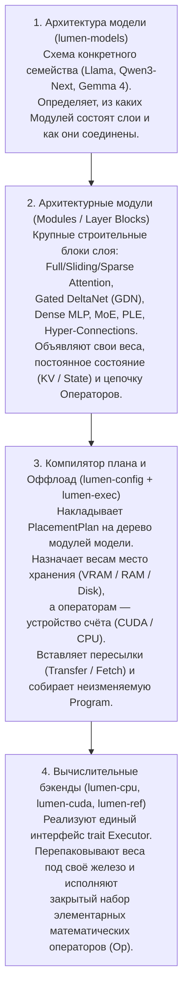
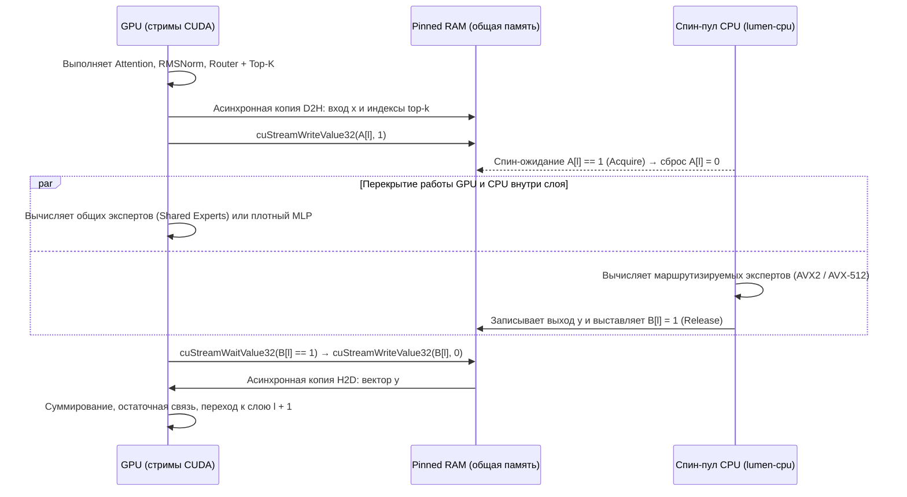

# Архитектура движка lumen-rs

**lumen-rs** — движок инференса больших языковых (LLM) и мультимодальных моделей, спроектированный для **гибридного выполнения (offload)**.

Целевой сценарий работы движка: модель не помещается целиком в видеопамять одной потребительской видеокарты (16–32 ГБ VRAM), поэтому часть весов и состояний размещается в системной оперативной памяти (RAM) или остаётся на NVMe-накопителе, а вычисления на каждом шаге распределяются между GPU и CPU.

Чтобы гибридный режим работал вблизи физического потолка пропускной способности железа, движок построен как **компилятор статического плана выполнения (`Program`)**:
- При загрузке модели описание её архитектуры и конфигурация размещения один раз компилируются в неизменяемую структуру `Program`. В ней для каждого оператора заранее назначены устройство счёта, буферы в памяти, стримы CUDA и точки синхронизации.
- В горячем цикле генерации токенов нет аллокаций памяти, поиска тензоров по именам и динамического ветвления по устройствам. Рантайм исполняет заранее скомпилированную последовательность вычислительных ядер, пересылок между устройствами и чтений с диска.

---

## Содержание

1. [Четыре уровня модульности](#1-четыре-уровня-модульности)
2. [Устройство Cargo-воркспейса и сборка](#2-устройство-cargo-воркспейса-и-сборка)
3. [План размещения (`PlacementPlan`) и режимы доступа к данным](#3-план-размещения-placementplan-и-режимы-доступа-к-данным)
4. [Подсистема памяти: четыре класса данных](#4-подсистема-памяти-четыре-класса-данных)
5. [Механика оффлоада: синхронизация GPU ↔ CPU и чтение с диска](#5-механика-оффлоада-синхронизация-gpu--cpu-и-чтение-с-диска)
6. [Представление весов и загрузка модели](#6-представление-весов-и-загрузка-модели)
7. [Компилятор плана (`lumen-exec`) и выполнение шага](#7-компилятор-плана-lumen-exec-и-выполнение-шага)
8. [Рантайм генерации (`Engine`), спекулятивка и мультимодальность](#8-рантайм-генерации-engine-спекулятивка-и-мультимодальность)
9. [Правила расширяемости и архитектурные границы](#9-правила-расширяемости-и-архитектурные-границы)

**Связанные документы:**
- [config.md](config.md) — устройство JSON-конфига и правила каскадного размещения
- [ltq-format.md](ltq-format.md) — спецификация формата квантования LTQ; [ltq-design.md](ltq-design.md) — обоснование, бенчмарки и квантователь
- [kernels.md](kernels.md) — устройство вычислительных ядер на GPU (CUDA C++) и CPU (AVX2 / AVX-512)
- [performance.md](performance.md) — физический потолок железа (`Program::floor`) и метрика эффективности $\eta$
- [api.md](api.md) — чат-шаблоны, CLI и HTTP-сервер
- [models/README.md](models/README.md) — поддерживаемые семейства моделей и их архитектурные модули
- [roadmap.md](roadmap.md) — порядок реализации по фазам и технические риски

---

## 1. Четыре уровня модульности

Архитектура `lumen-rs` разделяет описание моделей, внутренние строительные модули слоёв, планирование оффлоада и аппаратные бэкенды на четыре независимых уровня. Добавление компонента на одном уровне не требует изменений на остальных.



### Разделение ответственности между уровнями

1. **Уровень архитектуры модели (`trait Architecture` в `lumen-models`):**
   Описывает топологию конкретного семейства моделей (по полю `model_type` из конфига HuggingFace). Архитектура собирает слои из общих модулей (например: чередование трёх слоёв `GatedDeltaNet + MoE` и одного слоя `FullAttention + MoE`, плюс модуль `PLE`).
2. **Уровень архитектурных модулей (Modules):**
   Внутренние строительные блоки современных трансформерных и гибридных сетей:
   - *Модули работы с контекстом (Sequence Mixers):* полное внимание (`FullAttention`), скользящее окно (`SlidingAttention`), разреженное внимание с индексатором (`SparseAttention` / QSA), линейное рекуррентное внимание (`GatedDeltaNet` / GDN).
   - *Модули преобразования каналов (Channel Mixers / FFN):* плотный перцептрон (`DenseMlp`) и смесь экспертов (`MoE` — маршрутизатор, банк маршрутизируемых экспертов и общие эксперты).
   - *Модификаторы потока и адаптеры:* послойные эмбеддинги (`PLE` и таблицы n-грамм), многопоточные остаточные связи (`HyperConnections`), нормализации (`RMSNorm`).
   Каждый модуль объявляет своё поддерево путей для конфига (например, `moe/routed-experts`), запрашивает необходимые веса и раскладывается в последовательность примитивных операторов `Op`.
3. **Уровень планировщика и размещения (`lumen-config` и `lumen-exec`):**
   Сопоставляет пути компонентов модели с физическими устройствами хранения и вычислений, строит раскладку памяти и компилирует граф в `Program`.
4. **Уровень вычислительных бэкендов (`trait Executor` в `lumen-backend`):**
   Исполнители (`lumen-cpu`, `lumen-cuda`, эталонный `lumen-ref`) работают в едином адресном пространстве процесса. Бэкенд не зависит от конкретных моделей и исполняет закрытый набор примитивных операторов (`Linear`, `Attention`, `DeltaNet`, `RmsNorm`, `RoPE` и др.) над выделенными буферами памяти.

---

## 2. Устройство Cargo-воркспейса и сборка

Воркспейс состоит из 20 крейтов со строгим направлением зависимостей: каждый крейт в таблице может зависеть только от крейтов, расположенных выше него.

| Крейт | Зона ответственности | Ключевые зависимости |
| :--- | :--- | :--- |
| **`lumen-core`** | Базовые типы: `DType`, формы тензоров `Shape`, идентификаторы устройств `Device`, мест хранения `MemLoc`, пути компонентов `ComponentPath`, типы ошибок | `half`, `bytemuck`, `thiserror` |
| **`lumen-kabi`** | `#[repr(C)]`-структуры параметров ядер и константы форматов. Из этого крейта `cbindgen` генерирует заголовок `lumen_kabi.h` для C++/CUDA-кода | — |
| **`lumen-config`** | Парсинг JSON-конфига, разрешение каскада и селекторов слоёв, валидация → сборка плоского плана `PlacementPlan` | `serde`, `serde_json`, `strsim` |
| **`lumen-mem`** | Владение памятью (`Buffer`), трейт аллокатора, арены активаций, страничный пул KV-кэша, пул рекуррентных состояний, привязка к NUMA и чтение с диска | `memmap2`, `libc`, `io-uring` |
| **`lumen-tensor`** | Дескрипторы тензоров (`TensorRef`, `TensorView`) и канонические виды весов: `LtqLinear`, `RowTable`, `DenseLinear`, `ExpertBank` | `lumen-core`, `lumen-mem` |
| **`lumen-format`** | Чтение контейнера `.ltq` (заголовок, таблица тензоров, `mmap`) и чтение исходных чекпойнтов `safetensors` для квантователя | `safetensors`, `memmap2`, `hf-hub` |
| **`lumen-ltq`** | Эталонный декодер формата LTQ на Rust (по [спецификации](ltq-format.md)) и преобразование Адамара-256 для верификации быстрых ядер | `lumen-core`, `half` |
| **`lumen-backend`** | Набор элементарных операторов `enum Op`, интерфейс бэкенда `trait Executor`, профиль железа `HwProfile` | `lumen-tensor` |
| **`lumen-ref`** | Эталонный скалярный бэкенд на `f32`: исполняет любую `Program` и служит оракулом точности для дифференциальных тестов | `lumen-backend`, `lumen-ltq` |
| **`lumen-cpu`** | Вычислительный бэкенд CPU: спин-пул горячего пути, SIMD-ядра на AVX2 и AVX-512, CPU-сторона пересылок `Transfer` и `Fetch` | `lumen-backend`, `lumen-ltq`, `rayon` |
| **`lumen-cuda-kernels`** | Исходники ядер на CUDA C++ (`.cu`), `extern "C"`-обёртки запуска и сырые привязки к CUDA Driver API (`bindgen` по `cuda.h`). Собираются через `nvcc` в статическую библиотеку | `lumen-kabi`; при сборке: `nvcc`, заголовки `CUTLASS` и `FlashInfer` |
| **`lumen-cuda`** | CUDA-бэкенд: контексты, стримы, события, аллокатор VRAM, регистрация `pinned`-памяти, захват CUDA Graphs, вызов ядер из `lumen-cuda-kernels` | `lumen-backend`, `lumen-cuda-kernels` |
| **`lumen-models`** | Реестр архитектур по `model_type`, конструкторы модулей (Attention, GDN, MoE, PLE и др.), алиасы имён весов и нормализация экспертов | `lumen-tensor`, `lumen-format` |
| **`lumen-exec`** | Компилятор плана: строит `Program` из графа модели и `PlacementPlan`, считает физический потолок (`Program::floor`) и выполняет авторазмещение (`--auto`) | `lumen-config`, `lumen-models`, `lumen-backend` |
| **`lumen-media`** | Препроцессинг изображений, видео и аудио для мультимодальных моделей (декодирование, ресайз, нарезка на патчи и кадры) | `image`, `symphonia`, `rubato` |
| **`lumen-chat`** | Токенизация (`tokenizers`), рендеринг шаблонов чата (`minijinja`), парсеры рассуждений (`<think>`, Harmony) и вызовов инструментов, потоковая детокенизация | `tokenizers`, `minijinja`, `openai-harmony`, `lumen-media` |
| **`lumen-engine`** | Рантайм `Engine`: управление запросами, страничным KV, prefix cache, батчингом, сэмплингом и спекулятивным декодированием | `lumen-exec`, `lumen-cpu`, `lumen-cuda` (опц.), `lumen-chat` |
| **`lumen-quantize`** | Квантователь из BF16 (`safetensors`) в `.ltq`: сбор гессианов, расчёт информации Фишера, DP-профиль битности, GPU-ядра Block16-LDLQ и Витерби | `lumen-engine`, `lumen-ltq` |
| **`lumen-server`** | HTTP-сервер на `axum` с поддержкой протоколов OpenAI (`/v1/chat/completions`) и Anthropic (`/v1/messages`) через SSE | `lumen-engine`, `lumen-chat`, `tokio`, `axum` |
| **`lumen-cli`** | Исполняемый бинарник `lumen`: команды `run`, `chat`, `serve`, `inspect`, `bench`, `probe`, `pack`, `quantize` | `lumen-engine`, `lumen-quantize`, `lumen-server`, `clap` |

### Инструментарий сборки и граница Rust ↔ CUDA C++

- **Стабильный Rust (MSRV 1.89):** интринсики AVX-512 стабилизированы начиная с выпуска 1.89. Выбор набора инструкций процессора (AVX2 или AVX-512 VNNI/VBMI) выполняется динамически при запуске.
- **Статическая линковка ядер CUDA C++20:** при сборке с фичей `--features cuda` скрипт `lumen-cuda-kernels/build.rs` компилирует `.cu`-файлы через `nvcc` (CUDA Toolkit ≥ 12.8) в статическую библиотеку с машинным кодом SASS для архитектур `sm_80`, `sm_86`, `sm_89`, `sm_90`, `sm_100`, `sm_120` и PTX для совместимости с более новыми GPU. Во время работы бинарнику требуется только установленный драйвер NVIDIA (без зависимости от CUDA Toolkit или `cuBLAS`). Альтернатива `cuda-oxide` (чистый Rust для GPU) была проверена на ядре GEMV LTQ: она догоняет `nvcc` только при компиляции через `libNVVM` (без него теряет 25–43%), а её инструментарий находится в стадии альфа ([`results/kbench_gemv_g4.json`](https://github.com/lumen-inference/ltq-research/blob/main/results/kbench_gemv_g4.json), [`src/kbench/`](https://github.com/lumen-inference/ltq-research/tree/main/src/kbench)).
- **Узкий C ABI мост (`lumen-kabi`):** хостовый код на Rust и ядра на C++ взаимодействуют только через `#[repr(C)]`-структуры параметров из `lumen-kabi`. Заголовок `lumen_kabi.h` генерируется автоматически с помощью `cbindgen` и проверяется на актуальность в CI.
- **Сборка без CUDA:** без флага `--features cuda` воркспейс собирается стандартным `cargo build` без зависимостей от NVIDIA.

---

## 3. План размещения (`PlacementPlan`) и режимы доступа к данным

В `lumen-rs` место постоянного хранения тензора (`store`) и устройство, выполняющее вычисления над ним (`compute`), задаются независимо:

```rust
#[derive(Copy, Clone, Eq, PartialEq, Hash)]
pub enum Device {
    Cpu(u16),   // Вычислительный узел процессора, например "cpu:0"
    Cuda(u16),  // Видеокарта, например "cuda:0"
}

#[derive(Copy, Clone, Eq, PartialEq, Hash)]
pub enum MemLoc {
    Ram(u16),   // Системная память NUMA-узла, например "ram:0"
    Vram(u16),  // Видеопамять карты, например "vram:0"
    Disk,       // Отображение файла на NVMe-накопителе ("disk")
}
```

При загрузке модели конфигурационный файл (или алгоритм авторазмещения `--auto`) преобразуется в плоскую структуру `PlacementPlan`, сопоставляющую каждому компоненту каждого слоя структуру `Place`:

```rust
pub struct Place {
    pub compute: Device,                 // Устройство счёта на стадии генерации токенов (decode)
    pub store: MemLoc,                   // Место постоянного хранения весов
    pub prefill_compute: Option<Device>, // Опциональное устройство счёта на стадии обработки промпта (prefill)
}

pub struct PlacementPlan {
    pub tree: ComponentTree,                         // Дерево компонентов от архитектуры модели
    pub global: BTreeMap<ComponentPath, Place>,      // Внеслойные узлы: embed, ple, vision-tower, lm-head, mtp
    pub layers: Vec<BTreeMap<ComponentPath, Place>>, // Послойное размещение (индекс = номер слоя)
    pub kv: Vec<KvPlacement>,                        // Параметры размещения KV-кэша по слоям
    pub state: Vec<StatePlacement>,                  // Параметры размещения рекуррентных состояний
    pub provenance: Provenance,                      // Источник каждого правила в JSON (для lumen inspect)
}
```

### Матрица режимов доступа `(store, compute, вид доступа)`

Любая пара `(store, compute)` допустима. Конкретный режим доступа к данным выбирается один раз при компиляции плана по тройке параметров **(место хранения, устройство счёта, требуется ли весь тензор целиком или выборка отдельных строк/экспертов)**:

| Хранение (`store`) ↓ \ Счёт (`compute`) → | CPU (весь тензор) | CPU (выборка строк/экспертов) | GPU (весь тензор) | GPU (выборка строк/блоков) |
| :--- | :--- | :--- | :--- | :--- |
| **`vram:G`** (Видеопамять) | **Readback** (копия D2H в RAM) | **Readback** (только выбранные срезы) | **Direct** (локальный доступ в VRAM) | **Direct** (локальный доступ в VRAM) |
| **`ram:N`** (Оперативная память) | **Direct** (локальный доступ в RAM) | **Direct** (локальный доступ в RAM) | **Streamed** (двойная буферизация H2D) | **ZeroCopy** (чтение по PCIe из ядра) |
| **`disk`** (NVMe-накопитель) | **Fetch** (чтение с диска в RAM) | **Fetch** (чтение выбранных строк) | **Fetch + H2D** (диск → RAM → GPU) | **Fetch + H2D** (строки → GPU) |

Описание режимов доступа:
1. **Direct:** данные находятся в локальной памяти вычислительного устройства (`vram:0` для `cuda:0` или `ram:0` для `cpu:0`).
2. **ZeroCopy:** таблица размещена в закреплённой памяти (`pinned RAM`), зарегистрированной в драйвере CUDA (`cuMemHostRegister`). Когда ядру GPU требуется прочитать только несколько строк из большой таблицы (словарные эмбеддинги или выбранные индексатором страницы KV-кэша), ядро обращается к этим строкам напрямую через шину PCIe без участия хоста: у `Qwen3.8-Flash-Next` чтение эмбеддинга одного токена через `ZeroCopy` передаёт всего **5 КБ** вместо **1.27 ГБ** при копировании всей таблицы в режиме `Streamed`. Аналогично при разреженном внимании QSA KV-кэш в `ram:N` читается с `cuda:G` через `ZeroCopy` (выбранные индексатором блоки), а полный скан кэша ключей индексатора (`indexer/keys`) из `ram:N` на контексте 262k стоит около **0.2 ГБ** трафика PCIe на токен (~3 мс на PCIe 5.0), освобождая VRAM под веса.
3. **Streamed:** веса хранятся в `pinned RAM` и асинхронно копируются в кольцевой буфер VRAM на отдельном стриме на один слой вперёд. На стадии **prefill** (`"prefill-compute": "cuda:0"`) стоимость пересылки по PCIe амортизируется на большой чанк токенов (512–4096 токенов).
4. **Fetch:** используется для больших таблиц выборки (`RowTable`), оставленных на NVMe-диске (`"store": "disk"`). Фоновый пул потоков ввода-вывода читает нужные строки в двойной `pinned`-буфер заранее, за несколько слоёв до оператора-потребителя (`ZeroCopy` для `mmap`-файла невозможен, так как регистрация в CUDA закрепила бы в RAM весь файл).
5. **Readback:** копирование данных из VRAM в `pinned RAM` на стриме `d2h`, позволяющее использовать свободную видеопамять как дополнительное хранилище при нехватке системной RAM.

---

## 4. Подсистема памяти: четыре класса данных

Во избежание аллокаций в горячем цикле вся память в `lumen-mem` разделена на четыре класса по времени жизни:

| Класс памяти | Время жизни | Механизм выделения | Размещение |
| :--- | :--- | :--- | :--- |
| **1. Веса модели** | Вся сессия | Единый регион на устройство с суб-аллокацией (выравнивание 256 байт). В RAM — анонимный `mmap` с `mbind` и `MADV_HUGEPAGE`; на диске — прямое отображение файла (`mmap`) без копирования | По полю `store` компонента |
| **2. Активации** | Один шаг (`step`) | Статическая раскладка в арене: по анализу интервалов жизни каждому промежуточному тензору назначается фиксированное смещение под максимальный размер батча | На устройстве `compute` оператора |
| **3. KV-кэш внимания** | Жизнь последовательности | Страничный пул (`KvPool`, страница = 64 токена) и таблица страниц на запрос; для sliding-слоёв — кольцевой буфер | По полю `attention.kv-cache.store` |
| **4. Рекуррентное состояние (`State`)** | Жизнь последовательности | Слот фиксированного размера на последовательность (`StatePool`) плюс история состояний для отката спекулятивного декодирования | По полю `state.store` |

### Организация KV-кэша и рекуррентных состояний

- **Стандартный и квантованный KV-кэш:** хранит ключи ($K$) и значения ($V$) страницами по 64 токена. Секция `kv-quantization` позволяет задать раздельную битность для $K$ и $V$ (от 2 до 8 бит) с деквантованием на лету внутри ядра внимания.
- **Кольцевой кэш скользящего окна (`SlidingAttention`):** выделяет кольцо на $W + T_{\max} - 1$ позиций, где $W$ — размер окна, а $T_{\max}$ — максимальное число токенов одной последовательности за шаг (размер чанка prefill или длина черновика $k + 1$), чтобы новые позиции не перезаписывали данные, нужные соседним токенам того же шага или при откате черновика.
- **Специализированные раскладки KV (Gemma 4 и QSA):**
  - При равенстве ключей и значений ($K = V$ на глобальных слоях Gemma 4 12B, 26B, 31B) кэш хранит только $V$, а $K$ восстанавливается в ядре внимания, сокращая объём глобального KV вдвое.
  - Слои с разделяемым кэшем (`num_kv_shared_layers` в Gemma 4 E2B/E4B) не выделяют собственный буфер и читают кэш последнего опорного слоя того же типа.
  - Индексатор разреженного внимания (`QSA` в Qwen3.8-Flash-Next) ведёт собственный компактный кэш 128-мерных ключей и усреднённых ключей завершённых 4-токенных блоков.
- **Рекуррентные состояния (`StatePool`):**
  - В слоях `GatedDeltaNet` состояние последовательности включает матрицу $H_v \times D_k \times D_v$ в `fp32` и буфер `conv1d` на `conv_kernel - 1` позиций (например, ~3 МБ на слой или 108 МБ на 36 слоёв у Qwen3.8-Flash-Next).
  - В слоях `PLE` с разреженной свёрткой хранятся 9 последних позиций по 4 потокам остаточных связей и 2 последних ID токенов.
  - Для поддержки отката при спекулятивном декодировании слот состояния хранит историю на $k$ шагов черновика, а для кэширования префиксов (`PrefixCache`) снимки состояния сохраняются на границах реплик чата.

---

## 5. Механика оффлоада: синхронизация GPU ↔ CPU и чтение с диска

Когда соседние операторы выполняются на разных устройствах, планировщик вставляет оператор `Transfer { src, dst, bytes }`, использующий буфер в `pinned RAM`.

### Протокол флагов в Pinned RAM и спин-пул CPU

Синхронизация между GPU и CPU выполняется напрямую через 32-битные слова-флаги в `pinned RAM` без участия хостового управляющего потока и планировщика ОС:
- GPU ожидает готовности CPU через драйверную операцию `cuStreamWaitValue32` и выставляет сигнал для CPU через `cuStreamWriteValue32`.
- Рабочие потоки CPU (`spin-pool` в `lumen-cpu`) активно опрашивают тот же адрес в памяти.

Чтобы ожидания на флагах можно было захватить внутрь статического **CUDA Graph** (где ожидаемое значение фиксируется в узле графа в момент захвата), используется протокол **«флаг сбрасывает потребитель»** со своей парой флагов `A[l]` и `B[l]` на каждый слой $\ell$:



Пока CPU вычисляет маршрутизируемых экспертов, GPU параллельно выполняет независимую ветвь того же слоя (общих экспертов или параллельный плотный MLP) и ожидает флаг `B[l]` только перед копированием результата `y` обратно в VRAM.

### Чтение с диска (`Fetch`)

На NVMe-диске (`MemLoc::Disk`) размещаются преимущественно таблицы строк (`RowTable`), в которых адреса читаемых строк зависят только от ID токенов (таблицы n-грамм, таблицы PLE, эмбеддинги). Это позволяет запускать чтение с диска упреждающе:
- На стадии **prefill** все ID токенов чанка известны заранее.
- На стадии **decode** ID нового токена известен сразу после сэмплинга предыдущего шага, тогда как данные PLE требуются только после входных операций — время чтения с NVMe перекрывается вычислениями первых слоёв.
- Чтение выполняется выделенным пулом потоков ввода-вывода (`io-threads`, через `io_uring` или `pread`) в двойной `pinned`-буфер, а готовность буфера сигнализируется по тому же протоколу флагов, что и в `Transfer`. Благодаря этому в вычислительных потоках никогда не возникают страничные прерывания (`page fault`).

---

## 6. Представление весов и загрузка модели

Загрузчик `lumen-format` и нормализатор `lumen-models` сводят все веса модели к трём дескрипторам:

```rust
pub struct LtqLinear {
    pub m: u32, pub k: u32,           // Логические размеры матрицы [M, K]
    pub m_pad: u32, pub k_pad: u32,   // Размеры, дополненные до кратных 16 и 256
    pub slices: Vec<LtqSlice>,        // Срезы строк со своими форматами из меню LTQ
    pub d_row: WeightRef,             // Масштабы строк fp16 [M]
    pub e: WeightRef,                 // Показатели блоков int8 [M, K/256]
    pub suh: WeightRef,               // Вектор поворота входа fp16 [K]
    pub bias: Option<WeightRef>,
    pub layout: TileLayout,           // Canonical (на диске) | CpuBand16 | GpuWarp
}

pub struct RowTable {
    pub rows: u64, pub dim: u32,
    pub codec: RowCodec,              // Dense(dtype) | Int8Rows | LtqRing { format, ring, hadamard }
    pub shards: Vec<WeightRef>,       // Секции таблицы (например, хэш-головы n-грамм)
    pub head_offsets: Option<Vec<u64>>,
    pub head_bias: Option<WeightRef>,
}
```

Третий дескриптор — **`DenseLinear`** для небольших неквантованных матриц (`bf16` / `fp16` / `fp32`). Для экспертов MoE формируется дескриптор **`ExpertBank`**, объединяющий таблицу дескрипторов всех экспертов слоя и нормализованную спецификацию маршрутизатора **`RouterSpec`**.

При загрузке метод `Executor::prepare_weight` перепаковывает канонические тайлы LTQ под целевое устройство:
- **`CpuBand16` (для CPU):** тайлы укладываются горизонтальными полосами по 16 строк непрерывно вдоль оси $K$ с чередованием полей, обеспечивая последовательное потоковое чтение из DRAM (та же полосная укладка в CPU-MoE `exllamav3` дала ускорение в 3.4 раза на «холодных» экспертах).
- **`GpuWarp` (для GPU):** коды и битовые плоскости выравниваются 32-битными словами под варповое чтение.

Команда `lumen pack` выполняет эту перепаковку заранее и сохраняет готовые укладки в файл `.ltq`.

### Нормализация экспертов (`ExpertBank`) и маршрутизации (`RouterSpec`)

Каноническое представление экспертов в движке — `ExpertBank` на каждую проекцию: таблица дескрипторов экспертов (срезы, масштабы, `suh`, `bias`) и, где возможно, непрерывная укладка всех экспертов подряд. Поскольку ядра всегда обращаются к экспертам через таблицу дескрипторов, разная битность отдельных экспертов (назначенная алгоритмом DP) поддерживается нативно:

| Укладка на диске | Как распознаётся | Действие при нормализации (`Architecture::normalize`) |
| :--- | :--- | :--- |
| **LTQ поэкспертно:** `mlp.experts.{e}.gate_up_proj.ltq.*`, `mlp.experts.{e}.down_proj.ltq.*` | Индекс эксперта `{e}` в имени тензора | Сборка банка по индексу `e`; `gate_up` остаётся слитым, как его квантовал `lumen-quantize` |
| **3D-стек dense:** `mlp.experts.gate_up_proj` и `down_proj` с осью `E` (BF16-сборки `gpt-oss`, `Qwen3-MoE`, `Qwen3.8-Flash-Next`, `Gemma 4 26B-A4B`) | Трёхмерный тензор с осью `0 == num_experts` | Разрезание вдоль оси `E`, обработка dense-путём (вход квантователя и неквантованные модели) |
| **Слитый `gate_up`** | Вторая ось равна $2 \cdot I$ | При конкатенации (`concat`) — деление пополам; при чередовании (`interleave` у `gpt-oss`: чётные строки — `gate`, нечётные — `up`) — разнесение при копировании |
| **Альтернативные имена** (`block_sparse_moe.experts.{e}.w1/w3/w2` у `Mixtral`) | Таблица алиасов архитектуры | Приведение к каноническим именам `gate`, `up`, `down` |

На этом же шаге различные варианты маршрутизации приводятся к единой структуре `RouterSpec`:

| Семейство моделей | Формула маршрутизации в `RouterSpec` |
| :--- | :--- |
| **Qwen (`Qwen3-MoE`, `Qwen3-Next`), Mixtral** | `softmax → top-k` (с перенормировкой весов или без неё) |
| **gpt-oss** | `top-k → softmax` (выбор `top-k` по сырым логитам до `softmax`) |
| **DeepSeek-V3, Kimi-K2, GLM-4.5** | `sigmoid` + поправочный смещающий вектор `e_score_correction_bias` + групповой `top-k` |
| **Gemma 4 (`26B-A4B`)** | Вход: `RMSNorm` без веса $\times \text{scale} \times \text{hidden}^{-1/2}$; затем `softmax → top-k → перенормировка → × per_expert_scale` |

---

## 7. Компилятор плана (`lumen-exec`) и выполнение шага

Архитектура модели реализует трейт `Architecture`, возвращающий дерево компонентов и логический граф операторов:

```rust
pub trait Architecture {
    fn from_hf(cfg: &HfConfig) -> Result<Self> where Self: Sized;
    fn components(&self) -> ComponentTree;               // Дерево узлов для конфига и размещения
    fn weights(&self) -> WeightSchema;                   // Канонические ключи, формы и алиасы имён
    fn normalize(&self, m: &mut Manifest) -> Result<()>; // Нормализация экспертов MoE и слитых проекций
    fn build(&self, g: &mut GraphBuilder);               // Построение графа операторов
}
```

### Проходы планировщика (`lumen-exec`)

1. **Привязка устройств:** назначение `Device` операторам и `MemLoc` весам по `PlacementPlan`.
2. **Валидация поддержки (`Executor::supports`):** проверка того, что каждый бэкенд поддерживает назначенные ему операторы.
3. **Исключение мёртвых строк на prefill:** `LmHead` вычисляется только для последнего токена промпта; у моделей с разделяемым KV на финальных слоях (например, последние 18 из 42 слоёв у Gemma 4 E4B) эти слои на prefill вычисляются только для строк, требующих логитов.
4. **Слияние операторов (Fusion):** объединение `Q + K + V`, `Gate + Up`, `Add + RmsNorm`, `Bias + Residual`, `HcMix + Norm` и восстановления $K$ из $V$ внутри ядра внимания.
5. **Вставка `Transfer` и `Fetch` и разбиение на сегменты (`Segment`).**
6. **Статическая раскладка арен активаций и запись CUDA Graphs** по корзинам размера батча (1, 2, 4, 8…).

---

## 8. Рантайм генерации (`Engine`), спекулятивка и мультимодальность

Ядро генерации представляет собой синхронную структуру `Engine`, управляемую одним выделенным потоком:

```rust
pub struct Engine {
    program: Program,
    kv: KvPool,
    states: StatePool,
    prefix: PrefixCache,
    sched: Scheduler,
    sampler: Sampler,
    drafter: Option<Box<dyn Drafter>>,
}
```

- **Prefix Cache:** блоки KV-кэша адресуются цепочечным хэшем токенов и медиа-вложений со счётчиком ссылок; для гибридных моделей с рекуррентными состояниями используются снимки состояния на границах ходов диалога.
- **Сэмплинг на устройстве:** цепочка `softcap → repeat-penalty → temperature → top-k → top-p → min-p → Philox` исполняется на устройстве `output-layer`; на хост передаётся только 4-байтный ID выбранного токена.
- **Асинхронный шаг:** поскольку ID выбранного токена остаётся в памяти устройства, шаг $N+1$ ставится в очередь до того, как хост завершит детокенизацию и проверку стоп-условий шага $N$.
- **Спекулятивное декодирование (`trait Drafter`):** поддерживает поиск по промпту (`NGram`), внешнюю модель-черновик (`DraftModel`), встроенный слой `Mtp` и 4-слойный ассистент `Gemma4Assistant`, читающий KV-кэш основной модели.
- **Мультимодальность (`lumen-media`):** энкодеры изображений и звука компилируются в отдельную `Program`, их выходные эмбеддинги кэшируются по хэшу медиафайла и подставляются в декодер на позиции токенов-заполнителей.

---

## 9. Правила расширяемости и архитектурные границы

| Ось расширения | Куда добавляется | Контракт | Что остаётся неизменным |
| :--- | :--- | :--- | :--- |
| **Архитектура модели** | Модуль семейства в `lumen-models`, регистрация по `model_type` | `trait Architecture`: дерево компонентов, схема весов, нормализация, граф из имеющихся операторов | Планировщик `lumen-exec`, бэкенды, парсер конфига, формат контейнера |
| **Оператор (`Op`)** | Вариант в `enum Op` (`lumen-backend`) и реализация в `lumen-ref` | Семантику задаёт эталон; бэкенд без своей реализации возвращает `supports = false`, и план отвергается при загрузке | Архитектуры моделей, не использующие этот оператор |
| **Вычислительный бэкенд** | Отдельный крейт (`ROCm`, `Metal`, `Vulkan`) | `trait Executor`: поддержка операторов, перепаковка весов, исполнение сегмента, замер ресурсов для `HwProfile` | Модели `lumen-models`, планировщик `lumen-exec`, другие бэкенды |
| **Устройство или место хранения** | `Device` и `MemLoc`, строка матрицы режимов доступа (раздел 3) | Реализация `Transfer` и `Fetch` для новой пары мест (второй GPU, узел NUMA, CXL) | Операторы и вычислительные ядра |
| **Формат LTQ** | Таблица `formats` в заголовке `.ltq` | Параметры `K`, маски, `h`, `sub`, `lut` и `gain` — данные из файла | Ядра, пока формат находится в пределах параметров шаблонов |
| **Вид весов или версия контейнера** | `lumen-format`, `lumen-tensor` | При загрузке все укладки сводятся к `LtqLinear`, `RowTable`, `DenseLinear` | Операторы и вычислительные ядра |
| **Черновик спекулятивки** | Реализация `trait Drafter` (раздел 8) | Контракт `DraftRequest → DraftOut` | Ядро `Engine` и архитектуры моделей |
| **Чат-формат / HTTP API** | Шаблон и парсер в `lumen-chat`, адаптер в `lumen-server` | Преобразование `ChatRequest → поток ChatEvent` | Ядро генерации `lumen-engine` |

### Девять правил, удерживающих архитектурные границы

1. **Имя модели встречается только в двух крейтах.** Идентификаторы `model_type` и названия семейств моделей присутствуют только в `lumen-models` (реестр архитектур) и `lumen-chat` (парсеры вывода). В планировщике, бэкендах, ядрах и рантайме ветвлений по имени модели нет; CI автоматически проверяет отсутствие имён семейств вне этих двух крейтов.
2. **Особенность модели — параметр оператора, а не ветка кода.** Новый вариант `Op` заводится только тогда, когда поведение не выражается параметрами и композицией существующих операторов. Набор операторов закрыт (`enum Op`, а не трейт-объекты), чтобы планировщик мог анализировать и сливать операторы, а `Program` оставалась сериализуемыми данными для `lumen inspect`.
3. **Семейства собираются из общих построителей блоков, а не копируются.** В `lumen-models` живут общие конструкторы модулей (`Attention`, `GatedDeltaNet`, `MoE`, `DenseMlp`, `RMSNorm`, `PLE`, `HyperConnections`). Архитектура представляет собой разбор конфига и композицию модулей; надстройки (`Qwen3.8-Flash-Next` над `qwen3_5_moe`, `Gemma 4 E2B/E4B` над базовой `Gemma 4`) подменяют отдельные модули, не дублируя метод `build`.
4. **Направление зависимостей проверяется автоматически.** Каждый крейт зависит только от крейтов, расположенных выше него в таблице раздела 2; `lumen-exec` обращается к бэкендам только через `trait Executor`, бэкенды не знают о моделях, а модели — о бэкендах. CI сверяет граф из `cargo metadata` с разрешённым ориентированным ациклическим графом (DAG).
5. **Сначала эталон, потом скорость.** Каждый новый оператор появляется одновременно с эталонной реализацией в `lumen-ref`, а быстрое ядро добавляется под дифференциальным тестом против эталона. В `match` по `enum Op` запрещена ветка по умолчанию `_`: новый вариант не скомпилируется, пока каждый бэкенд явно не обработает его.
6. **У каждого формата LTQ есть универсальный запасной путь.** Ядро общего вида читает параметры формата из структуры во время работы, тогда как шаблонные специализации по константам `K`, маскам и дробному режиму ускоряют форматы стандартного меню. Благодаря этому новый формат работает сразу после добавления в заголовок файла и ускоряется по мере добавления шаблонной специализации.
7. **Оптимизации допускаются только в объявленных местах:** внутри ядер и их специализаций, в проходах планировщика (слияния в разделе 7) и в укладках весов (раздел 6). Каждый проход оптимизации регистрируется в списке проходов и проверяется тестом на совпадение логитов с включённым и выключенным проходом. Обходных путей мимо `Program` нет.
8. **Схема конфига выводится автоматически из дерева компонентов.** Добавление новой архитектуры не требует изменений в `lumen-config`: каскадное разрешение, валидация путей и отчёт `lumen inspect` работают напрямую по дереву `Architecture::components()`.
9. **Фичи сборки отражают только бэкенды и сервер** (`cuda`, `server`, в дальнейшем `rocm`, `metal`); фич компиляции под отдельные модели не существует.

### Прогноз расширения архитектуры

| Ожидаемое расширение | Что требуется добавить | Затрагиваемые подсистемы |
| :--- | :--- | :--- |
| **Плотные и MoE-модели на известных блоках** (новые Llama, Qwen, Mistral) | Модуль в `lumen-models` и минимальная тестовая фикстура | Изменений вне `lumen-models` нет |
| **MLA и разреженное внимание с индексатором** (DeepSeek, DSA из V3.2) | Вариант KV «латентный» (сжатый KV + общий RoPE-ключ, поглощение проекций в ядре); индексатор использует тот же механизм списков страниц, что и QSA | Новый вариант `Attention` в ядрах; планировщик и страничный пул KV не меняются |
| **SSM-слои (`Mamba-2`) и гибриды на их основе (`Nemotron-H`)** | Оператор `Ssm`; класс памяти «рекуррентное состояние» уже реализован для `GatedDeltaNet` | Новый оператор `Op::Ssm` и его вычислительные ядра |
| **Несколько видеокарт (Multi-GPU)** | Устройство `cuda:1` в плане размещения, оператор `Transfer` GPU ↔ GPU (P2P или через `pinned RAM`) | Послойный конвейер уже поддерживается планом; для тензорного параллелизма добавляется оператор коллективов |
| **AMD ROCm (HIP)** | Крейт `lumen-rocm`: перенос ядер CUDA C++ через `hipify`, замена `CUTLASS` и `FlashInfer` на `composable_kernel` и порт внимания | Отдельный крейт бэкенда, остальные крейты не затрагиваются |
| **Apple Silicon (Metal, единая память)** | Крейт `lumen-metal`; `ram` и `vram` отображаются в единую физическую память, оффлоад сводится к выбору устройства счёта | Отдельный крейт бэкенда со своими ядрами на MSL |
| **Квантованный KV-кэш (`TurboQuant-MSE`)** | Параметр раскладки KV у `Attention`, поворот Адамаром внутри `KvWrite` | Ядра внимания и формат страницы `KvPool` |
| **Новые форматы меню LTQ** | Новые записи в массиве `formats` заголовка `.ltq` | Только данные (ядра меняются только при выходе за пределы параметров шаблонов) |
| **Черновики спекулятивки типа `EAGLE-3`** | Передача скрытых состояний нескольких слоёв целевой модели в `DraftRequest` | Расширение структуры `DraftRequest` |
| **Новые внешние протоколы (OpenAI Responses API и др.)** | HTTP-адаптер в `lumen-server` | Только крейт `lumen-server` |

**Вне целей проекта:** модели, не использующие авторегрессионную генерацию по одному токену (диффузионные языковые модели), а также обучение моделей. Их вычислительный цикл не укладывается в абстракцию `Engine::step()`; при необходимости они реализуются как отдельный рантайм поверх тех же `Program` и бэкендов.

---

## Источники

- [NVIDIA CUDA Driver API Documentation](https://docs.nvidia.com/cuda/cuda-driver-api/)
- [NVIDIA CUTLASS & CuTe](https://github.com/NVIDIA/cutlass)
- [FlashInfer — Kernel Library for LLM Serving](https://github.com/flashinfer-ai/flashinfer)
- Сравнение `cuda-oxide` против `CUDA C++` на GEMV LTQ: [`results/kbench_gemv_g4.json`](https://github.com/lumen-inference/ltq-research/blob/main/results/kbench_gemv_g4.json), [`src/kbench/`](https://github.com/lumen-inference/ltq-research/tree/main/src/kbench)
- [`turboderp-org/exllamav3`](https://github.com/turboderp-org/exllamav3) (v1.6.3) — эталон для сравнения качества; `modules/row_table.py`, `modules/ngram_embedding.py`, `modules/ple.py`, `modules/qsa_indexer.py`, `modules/hyperconnections.py`
- [DeepWiki: CPU MoE Offloading in ExLlamaV3](https://deepwiki.com/turboderp-org/exllamav3/2.3.1-cpu-moe-offloading)
