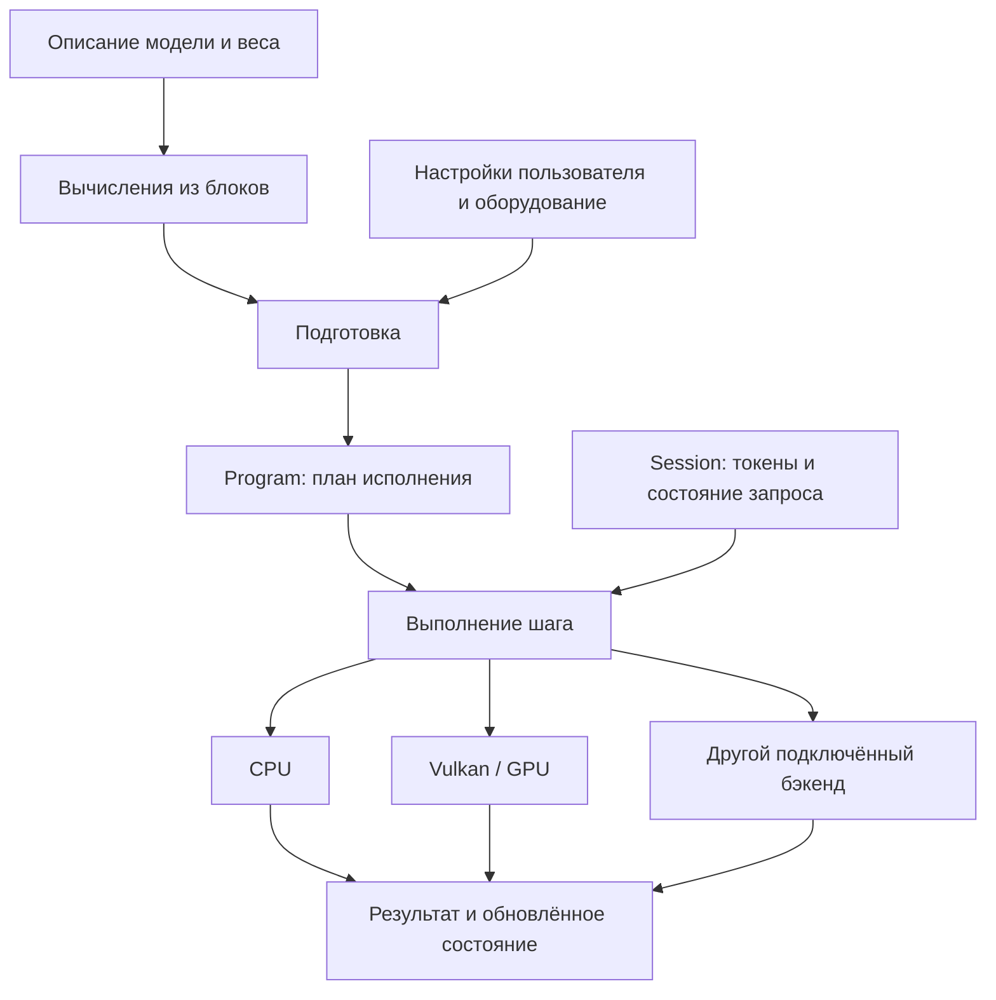

# Как устроен Velri

[English](../EN/architecture.md)

Velri — движок для запуска нейросетевых моделей. Он должен загрузить модель, выполнить её вычисления на доступном оборудовании и вернуть результат приложению. Для языковой модели это обычно оценки следующего токена, из которых можно выбрать продолжение текста.

Мы проектируем движок на **C17 с двумя первыми бэкендами: CPU и Vulkan** для Windows, Linux и Android ARM64. Через общий внутренний C-интерфейс можно будет подключать другие бэкенды. C — язык движка; Vulkan — API для GPU, его кернелы пишутся на GLSL и собираются в SPIR-V.

Это целевая архитектура. В прежнем Rust-прототипе были реализованы чтение настроек, `inspect`, проверка LTQ, вычислительный граф, тестовый dense-f32 декодер с искусственными весами и CPU-кернелы. Библиотека на C, исполнение через Vulkan и генерация с реальной моделью ещё не готовы. Имена исторических Rust-пакетов сохраняют префикс `lumen-*`. Название проекта и пути в документации используют `velri`.

Этот документ объясняет общую схему. Определения собраны в [словаре](glossary.md); порядок чтения всей документации — в [оглавлении](README.md).

## Что происходит при запуске модели

Представим, что приложение передаёт движку запрос и просит продолжить текст.

1. **Загружаем описание модели и веса.** Из описания узнаём, какие слои нужны, как они связаны и где находятся их веса.
2. **Собираем вычисления из готовых блоков.** Например, слой может содержать attention, MLP и остаточные связи. На этом этапе описываем математику модели.
3. **Готовим исполнение.** Учитываем настройки пользователя и возможности оборудования: выбираем кернелы, размещаем данные, резервируем память и составляем задания.
4. **Создаём сеанс.** У каждого запроса своя история токенов и своё изменяемое состояние. Веса одной модели можно использовать в нескольких сеансах.
5. **Выполняем шаги.** Сначала обрабатываем входной текст, затем получаем продолжение. Между шагами сохраняем те данные, которые понадобятся снова.

Такое разделение позволяет описать модель один раз и подобрать способ её выполнения под конкретное устройство. Человек, добавляющий модель, не должен заново писать управление потоками или обмен данными с видеокартой.

## Кто за что отвечает

| Часть движка | Её работа |
| :--- | :--- |
| Описание модели | Порядок слоёв, связи между ними, параметры и соответствие весов |
| Общие блоки | Повторяемые вычисления: attention, MLP, MoE, нормализации и другие механизмы |
| Подготовка | Проверка вычислений, выбор реализаций, размещение данных и планирование памяти |
| Исполнение, или runtime | Выполнение шагов, состояние сеансов, завершение и отмена |
| Бэкенды | Проверка поддержки операций, подготовленные кернелы, память и исполнение на своих устройствах |
| Платформенный код | Потоки ОС, сведения о процессоре, файлы, часы и загрузка библиотек |

Например, attention-блок сообщает, какие данные ему нужны и что он вычисляет. Подготовка выбирает подходящий кернел. CPU-бэкенд выполняет его на процессоре, а Vulkan-бэкенд — на GPU. Бэкендам не нужно читать конфигурацию семейства модели: необходимые параметры они уже получают от подготовки.

Небольшая модель может целиком работать на одном устройстве. Для большой модели предусматриваем распределение работы: attention на GPU, выбранные эксперты MoE на CPU, часть данных на диске. Такое размещение требует явных пересылок и учёта их стоимости. Оно не должно усложнять обычный запуск целиком на CPU или GPU.

## Как подключается другой бэкенд

У каждого бэкенда есть регистрация, собственные устройства и таблица C-функций. Подготовка спрашивает, умеет ли устройство выполнить конкретную операцию с указанными размерами, типами и раскладками. Затем получает подготовленную реализацию и требования к её памяти. Runtime запускает эту работу и дожидается результата через общий интерфейс завершения.

Для добавления бэкенда создаём его модуль, подключаем регистрацию к сборке и запускаем общий набор проверок. Описания моделей и планировщик не получают условий по имени нового бэкенда. Начать можно с нескольких операций; недостающие операции размещаются на других устройствах только при разрешённом смешанном плане с явными передачами данных.

Базовый обмен между двумя устройствами проходит через RAM в согласованном представлении данных. Несовместимая внутренняя раскладка требует явного поддержанного преобразования. Поэтому новый модуль реализует передачу в память CPU и обратно, а не отдельный протокол для каждого существующего бэкенда. Прямые межустройственные копии можно добавить позже как ускорение.

Требования к памяти, подготовке, ошибкам и регистрации собраны в [интерфейсе бэкендов](backends.md). Он остаётся внутренним интерфейсом исходников; стабильный ABI внешних бинарных плагинов для первого запуска не нужен.

## Как добавляется новая архитектура

Архитектура задаёт слои и связи между ними. Слои собираются из блоков, блоки — из операций. Один и тот же блок MLP можно использовать самостоятельно и внутри эксперта MoE. Повторное использование кода не означает, что у этих блоков автоматически общие веса.

Для новой модели нужно прочитать её настройки, сопоставить имена весов, собрать нужные блоки и описать сохраняемое состояние. Если подходящие операции уже существуют, менять кернелы не требуется. Если модель вводит новую математику, добавляем общий механизм с явными параметрами и проверками. Условий вида «если это семейство X, делай иначе» внутри общего блока быть не должно.

Attention тоже состоит из частей: получение входов, учёт позиции, выбор доступной истории и расчёт результата. Full attention, sliding-window attention, QSA и DSA могут использовать общие части, но их различия должны быть описаны явно. Одного флага `sparse` для этого недостаточно. GDN отдельно описывает своё рекуррентное обновление.

Граф хранит связи, размеры, типы данных и обращения к состоянию. При этом не нужно превращать каждое сложение двух чисел в отдельный узел: операция может быть достаточно крупной для быстрого кернела и иметь простое разложение для эталонного расчёта.

Подготовка может объединять несколько операций, в том числе через границы слоёв. Это допустимо, только если сохраняются результат, порядок изменения состояния и время жизни данных. Разные слои могут читать один ресурс. Подробный пример сборки архитектуры — в [документе о блоках](blocks.md).

## Как устроена память

Описание данных и выделение памяти — разные вещи. У области памяти есть владелец: он отвечает за её размер, ёмкость, размещение и освобождение. На одну область могут ссылаться несколько представлений с разной формой, смещением и шагом между элементами. Создание такого представления само по себе не копирует данные.

Это особенно важно для состояния attention. **K и V обозначают роли входных данных; из этих имён не следует, что нужны два отдельных буфера.** Модель может хранить их раздельно, использовать общую область, восстанавливать один вход из другого или получать оба из общего сжатого состояния. Преобразования должны быть указаны в графе.

Поэтому аллокатор выделяет только явно объявленные области. Он не знает названий семейств и не содержит специального режима «V-only» или «K-only». Если обе роли используют одни и те же сохранённые данные, учитываем их один раз. Если для преобразования нужен временный результат, отдельно учитываем его память. Кернел может избежать этого результата в памяти, выполнив преобразование вместе с последующим вычислением, если он поддерживает такую работу.

| Данные | Кто отвечает за их время жизни |
| :--- | :--- |
| Веса и подготовленные варианты их хранения | Модель; освобождение возможно после завершения всех сеансов и работ, которые их используют |
| Неизменяемый план заданий и описания выбранных кернелов | `Program`, связанный с моделью и контекстом устройств |
| История attention и рекуррентное состояние | `Session`; данные сохраняются между шагами одного сеанса |
| Промежуточные результаты, рабочая память и буферы пересылок | Сеанс или отдельный слот исполнения; повторное использование возможно после последнего потребителя |

Подготовленные веса неизменяемы. Их идентичность определяется исходным владельцем и версией, устройством, реализацией и форматом упаковки: совпадения размеров недостаточно для совместного использования. Изменяемые параметры и команды принадлежат сеансу или заранее выделенному слоту исполнения.

В бюджет памяти входят все одновременно живущие данные: исходные и перепакованные веса, накладные расходы физического резервирования, выравнивающие добавки, состояние, временные результаты и незавершённые пересылки. Память драйвера, объём которой нельзя получить, отмечаем как неизвестную. Если CPU и GPU используют общую физическую RAM, нельзя посчитать её дважды как два независимых запаса памяти: названия host-visible и device-local не доказывают независимость их ёмкости.

До запуска задаём пределы длины контекста, числа токенов за шаг и активных последовательностей. В этих пределах используем заранее выделенную память. Вызывать общий аллокатор для каждой операции во время генерации не нужно. Превышение предела приводит к понятной ошибке ёмкости либо требует отдельного явного расширения, когда незавершённых работ уже нет.

## Что делаем заранее, а что — на каждом шаге

Размеры весов и многие связи модели не меняются при генерации каждого токена. Подготовка один раз проверяет эти данные и находит веса по именам. Затем запрашивает поддержку на каждом разрешённом устройстве: учитывает формы, типы, шаги, допустимое пересечение памяти, обращения к состоянию и пределы меняющихся значений. Она выбирает размещение, кернелы и раскладку весов; до выделения памяти явно указывает необходимые пересылки и преобразования.

Подготовка рассчитывает повторяемые части заданий: размеры плиток, диапазоны работы потоков, адресацию и объём временной памяти. Работники не разбирают JSON, не ищут веса по именам и не вычисляют постоянную геометрию заново при каждом вызове.

На шаге меняются токены, позиции, текущая длина истории, маршруты MoE и выбранные страницы состояния. Для них используем подготовленные шаблоны с ограниченными размерами. Изменение числа обрабатываемых токенов или выбранных экспертов не должно требовать пересборки всей модели. Проверки меняющихся границ остаются: предварительная проверка весов не защищает от неверного индекса во время исполнения. Уже проверенные постоянные данные не сканируем повторно без причины.

Пул CPU-потоков принадлежит контексту исполнения. Число потоков задаёт пользователь; доступные ядра, SMT и общие кэши выясняем на конкретном устройстве. Иногда выгодно выполнить несколько операций одним заданием, чтобы реже передавать работу потокам. Это решение проверяем по времени всего шага и отдельных фаз: сокращение числа заданий не должно мешать полезному параллелизму.

Автоподбор может сравнить несколько способов исполнения, но у него должен быть ограниченный бюджет и понятный воспроизводимый отчёт о выборе. Результат зависит от формы задачи, реализации и доступных ресурсов. Победа на многократном чтении одной матрицы из кэша ещё не доказывает ускорение целой модели. Правила измерений — в [документе о производительности](performance.md).

## Что требуется от Vulkan-бэкенда

Предлагаемый базовый путь — **Vulkan 1.1 compute с FP32**. Бэкенд проверяет, поддерживает ли устройство каждую нужную операцию, формат данных и размер задачи. Более быстрые варианты могут использовать FP16, BF16, целочисленные dot-инструкции или cooperative matrices, если необходимые возможности доступны. Фиксированный размер subgroup не предполагается. Проверка возможностей важнее имени производителя. [Руководство Vulkan](https://docs.vulkan.org/guide/latest/querying_extensions_features.html).

Бэкенд управляет памятью GPU, вычислительными pipelines, описаниями доступных шейдеру ресурсов, буферами команд и очередями. Шейдеры поставляются в SPIR-V. Всё это остаётся внутри бэкенда: пользователю публичного C API не нужно управлять объектами Vulkan. Создание pipelines и подготовка descriptors выполняются при загрузке или подготовке, а не заново на каждом токене.

Для обмена между CPU и GPU сначала используем явные копирования и правила синхронизации Vulkan. Если GPU записал результат, CPU должен дождаться завершения записи и получить доступ к актуальным данным. Общая физическая память сама по себе этого не обеспечивает; обычный C-атомик тоже не заменяет синхронизацию Vulkan. Подробности — в [описании исполнения](execution-design.md).

Windows, Linux и Android — целевые платформы, а не уже проверенный список устройств. CPU-исполнение должно собираться отдельно. Если пользователь явно запросил GPU, на котором нужный путь недоступен, подготовка возвращает причину. При подготовке можно выбрать другое разрешённое устройство или объявленное эквивалентное разложение операции; выбор должен быть виден в отчёте. Автоматическая замена на CPU допустима только в выбранном для этого режиме. Во время выполнения шага бэкенд не может незаметно перейти на CPU.

## Как проверяем правильность

У каждой операции должны быть описаны входы, выходы, обращения к состоянию и временная память. Бэкенд либо поддерживает эти требования, либо явно отказывается выполнять операцию. Пропустить незнакомую операцию и продолжить нельзя.

При добавлении операции на C обновляем её общую проверку, диагностическое имя и эталон. Бэкенд выбирает обработчик по описанию операции или возвращает явный отказ; добавлять новое поле в общий интерфейс бэкенда для каждого кернела не нужно. Проверки в реестре и тестах должны обнаруживать пропущенные обработчики. Это заменяет часть защиты, которую сейчас дают исчерпывающие `match` в Rust. Бэкенд может поддерживать только часть операций, но для всей модели нужен полностью поддержанный подготовленный план.

Для новой математики пишем простой эталон. Оптимизированный кернел сверяем с ним, затем измеряем скорость. Целую модель дополнительно сравниваем с независимым исполнителем: правильное умножение матриц ещё не доказывает правильность порядка слоёв, масок или состояния. Правильность, скорость и переносимость подтверждаем отдельно.

Публичная библиотека сообщает об ошибке вызывающему приложению и не завершает его процесс. Долгоживущие объекты представлены непрозрачными C-дескрипторами. Для них предусмотрены парные операции создания и освобождения; для заимствованных данных указан срок жизни. Правила одновременных вызовов и отмены описаны в [API](api.md).

## Как разложим код по каталогам

Начинаем с одной библиотеки `velri`, отдельно собираемых необязательных бэкендов и отдельных приложений. Модуль — это группа C-файлов с небольшим внутренним интерфейсом. Каждый такой каталог не обязан становиться отдельной библиотекой.

| Планируемый каталог | Содержимое |
| :--- | :--- |
| `include/velri/` | Публичный C API: создание объектов, исполнение, статусы и диагностика |
| `src/core/` | Общие типы, описания тензоров и хранилищ, проверка размеров, граф |
| `src/model/` | Описания семейств моделей и общие блоки |
| `src/format/` | Чтение весов и LTQ, проверка форматов и смещений |
| `src/plan/` | Выбор размещения и кернелов, расчёт времени жизни данных, подготовка заданий |
| `src/runtime/` | Сеансы, шаги, выбор токена, завершение и отмена |
| `src/backend/interface.h`, `src/backend/registry.c`, `src/backend/common/` | Внутренний C-интерфейс, реестр подключённых модулей, общие помощники и передачи через RAM |
| `src/backend/cpu/`, `src/backend/vulkan/`, будущие модули | Кернелы, ресурсы устройств, очереди и исполнение |
| `src/platform/` | Потоки ОС, сведения об оборудовании, отображение файлов, часы, загрузка библиотек |
| `apps/`, `tools/` | Командная строка, сервер, квантователь и генератор кода |

Это будущая структура. Начинаем с CPU-библиотеки и тестов; Vulkan и HTTP включаются отдельно. Сервер и квантователь не являются зависимостями вычислительного ядра. Общие блоки не зависят от Vulkan, SIMD-инструкций и имён семейств; бэкенды не читают конфиги моделей; платформенный код не знает о тензорах. Подготовка соединяет их через непрозрачные ресурсы, описания операций и таблицы C-функций. Статический реестр явно включает выбранные при сборке модули. Публичный API приложения отделён от этого внутреннего интерфейса. Механизм динамических плагинов на первом этапе не требуется.

Сначала нужен проверяемый путь: небольшие веса → граф → подготовка → исполнение на CPU → проверенный результат. Для сравнения сохраняем независимые Python-фикстуры и эталонные результаты. Сохранять работающую Rust-реализацию до готовности нового пути не требуется. Общий интерфейс сначала проверяем небольшим бэкендом с ограниченным набором операций и управляемой задержкой завершения. Затем добавляем реальные модели, Vulkan и совместную работу устройств. Старые крейты не нужно превращать один к одному в C-библиотеки. Перед удалением прежнего кода сохраняем нужные эталонные данные, результаты измерений и описание алгоритмов; для CPU-кернелов уже есть [отдельный документ](kernel-reference.md).

Токенизацию и шаблоны чата проверяем отдельно; библиотека также принимает готовые номера токенов. Спецификация LTQ v1 сохраняется при смене языка. Квантователь может использовать общую загрузку и исполнение, но развивается отдельно от сервера. Сборка и библиотеки описаны в [стеке](dependencies.md), критерии готовности — в [порядке работ](roadmap.md).
