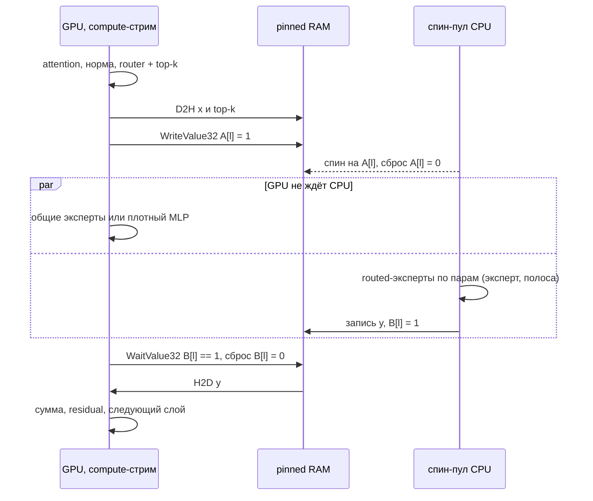

# lumen-rs — архитектура движка

Oct 27, 2026 · @Vemloir

lumen-rs — движок инференса LLM, рассчитанный прежде всего на оффлоад: модель не помещается в VRAM, часть весов считает CPU, часть лежит в RAM или на NVMe. Движок устроен как компилятор плана: конфиг и описание модели при загрузке превращаются в неизменяемую `Program`, где у каждого оператора уже есть устройство, буферы, стрим и точки синхронизации. В горячем цикле нет аллокаций, поиска по именам и решений о размещении — только запуск ядер, переходов и чтений с диска.

- **Оффлоад — основной сценарий, мерило — физический потолок.** CPU- и CUDA-бэкенды развиваются как равноправные. Движок сравнивается не с другими движками, а с нижней границей времени шага, которую задают пропускная способность и задержки железа ([performance.md](performance.md)).
- **Хост на Rust, ядра на CUDA C++.** Весь код движка — на Rust; ядра GPU — на CUDA C++, их заранее собирает nvcc вместе с `extern "C"`-обёртками запуска в статическую библиотеку, которая линкуется в бинарник, поэтому во время работы нужен только драйвер CUDA. Rust и C++ встречаются лишь на C ABI — обёртках запуска и структурах параметров ядер в `lumen-kabi`. CUTLASS и FlashInfer (только заголовки) используются напрямую, ядра exllamav3 — образец для порта.
- **Модель отдельно от размещения.** Архитектура отдаёт дерево компонентов и логический граф; `PlacementPlan` сопоставляет пути компонентов с местом счёта и хранения; связывает их планировщик `lumen-exec`. Каскадный JSON и авторазмещение — два способа получить план.
- **Три вида весов.** Квантованные матрицы (`LtqLinear`, формат LTQ), таблицы строк для выборки (`RowTable`: эмбеддинги, n-граммы, PLE) и плотные матрицы (`DenseLinear`). Все укладки на диске сводятся к ним при загрузке.
- **Три места хранения и четыре класса памяти.** Места: `vram`, `ram`, `disk`. Классы: веса — статично и навсегда; активации — статическая раскладка по смещениям в арене; KV — страничный пул; рекуррентное состояние — слот фиксированного размера на последовательность.
- **Переходы — явные операторы.** `Transfer` переносит активации между устройствами, `Fetch` читает с диска строки таблиц и тензоры. Место счёта и место хранения независимы: допустима любая пара, от неё зависит только режим доступа, который определяется тройкой (store, compute, вид доступа) один раз, при загрузке.
- **Формат квантования — LTQ.** Собственный формат и квантователь: решётчатое квантование (TCQ Унгербёка, 1024 состояния, замкнутая решётка) тайлов 16×16, дробные скорости через чётность младших бит и битность по срезам строк, назначенная DP по информации Фишера. На шести моделях — от плотных до MoE, Gated DeltaNet и PLE — при той же битности KLD ниже EXL3 или на уровне, квантование в 2.4–7 раза быстрее. Спецификация — [ltq-format.md](ltq-format.md), обоснование — [ltq-design.md](ltq-design.md).
- **Ядра GPU — на CUDA C++.** Свои ядра декодируют LTQ и реализуют операторы архитектур, CUTLASS даёт плотный GEMM на префилле и MMA (CuTe) внутри своих ядер, основа attention — FlashInfer. Ни cuBLAS, ни других библиотек CUDA во время работы. cuda-oxide проверен как альтернатива: на GEMV LTQ он догоняет nvcc только через libNVVM, а инструменты у него ещё альфа ([эксперимент](https://github.com/lumen-inference/ltq-research/blob/main/results/kbench_gemv_g4.json)).
- **Ядро генерации синхронное.** CLI крутит его цикл в главном потоке, HTTP-сервер говорит с ним через каналы.
- **Расширение — через известные точки.** У каждой оси роста (архитектуры, бэкенды, операторы, форматы, черновики, API) одна точка расширения с узким контрактом; модель не знает бэкенда, бэкенд — модели, ускорения живут внутри контрактов. Правила проверяются в CI (раздел 8).

**Документы.** Этот файл — устройство движка: крейты, план размещения, память, веса, планировщик, рантайм и правила расширения. Остальное — рядом:

- [performance.md](performance.md) — модель потолка, эталонный стенд, цели по η
- [kernels.md](kernels.md) — ядра GPU и CPU и их замеры
- [ltq-format.md](ltq-format.md) — спецификация формата LTQ; [ltq-design.md](ltq-design.md) — почему он такой, сравнения и квантователь
- [config.md](config.md) — конфиг и каскад размещения
- [api.md](api.md) — чат-слой, CLI и сервер
- [models/](models/README.md) — архитектуры моделей, по файлу на семейство
- [roadmap.md](roadmap.md) — порядок реализации и риски

## 1. Cargo-воркспейс

20 крейтов; каждый зависит только от тех, что выше в таблице. CUDA спрятана за фичей `cuda`; с ней `lumen-cuda-kernels` собирает исходники `.cu` через nvcc во время сборки.

| Крейт | Отвечает за | Ключевые зависимости |
| --- | --- | --- |
| `lumen-core` | `DType` (вкл. квант-типы), `Shape`, `Device`, `MemLoc`, `ComponentPath`, ошибки | half, bytemuck, thiserror |
| `lumen-kabi` | `#[repr(C)]`-параметры ядер и константы форматов; заголовок `lumen_kabi.h` для стороны `.cu` генерирует из них cbindgen | — |
| `lumen-config` | serde-схема, каскад, грамматика диапазонов, валидация → `PlacementPlan` | serde, serde\_json, serde\_path\_to\_error, strsim |
| `lumen-mem` | `Buffer` и хендлы, трейт аллокатора, арены, страничный пул KV, пул состояний, NUMA, чтение с диска | memmap2, libc, io-uring |
| `lumen-tensor` | `TensorRef`, `TensorView`, `LtqLinear`, `RowTable`, `DenseLinear`, `ExpertBank` | core, mem |
| `lumen-format` | контейнер `.ltq` (заголовок, таблица тензоров, mmap файла) и BF16-вход квантователя (safetensors и index.json), манифест; об архитектурах не знает | safetensors, memmap2, hf-hub |
| `lumen-ltq` | эталонный декодер LTQ по [спецификации](ltq-format.md), Адамар-256; golden-тесты против `ltq-research/src/ltq_format.py` | core, half |
| `lumen-backend` | набор операторов `Op`, `trait Executor` (поддержка операторов, перепаковка весов, исполнение сегмента, замер своих ресурсов), `HwProfile`, реестр ядер | tensor |
| `lumen-ref` | эталонный исполнитель: скалярный f32, исполняет любую `Program`; оракул для дифф-тестов | backend, ltq |
| `lumen-cpu` | спин-пул горячего пути, rayon для загрузки, ядра AVX2 и AVX-512, CPU-сторона `Transfer` и `Fetch` | backend, ltq, rayon |
| `lumen-cuda-kernels` | ядра на CUDA C++ (`.cu`), их `extern "C"`-обёртки запуска (выбор специализации шаблона — на стороне C++) и сырые привязки к API драйвера (bindgen по `cuda.h`): GEMV и GEMM LTQ, mgemm, reconstruct + GEMM на CUTLASS, Адамар-256, декод строк, attention на FlashInfer, DeltaNet, нормы, роутер, сэмплинг; шаги Витерби и LDLQ квантователя. `build.rs` собирает их nvcc в статическую библиотеку | kabi; nvcc, CUTLASS, FlashInfer (только заголовки, закреплённые), bindgen |
| `lumen-cuda` | контексты, стримы, события, аллокатор VRAM, регистрация pinned, GPU-часть `Transfer` и `Fetch`, запуск ядер через обёртки, CUDA Graphs | backend, cuda-kernels |
| `lumen-models` | реестр архитектур по `model_type`; архитектура → дерево компонентов, логический граф из общих построителей блоков, алиасы имён, нормализация MoE | tensor, format |
| `lumen-exec` | планировщик → `Program`, модель потолка (`Program::floor`), авторазмещение; с бэкендами говорит только через `Executor` | config, models, backend |
| `lumen-media` | изображения и аудио: декодирование, ресайз, нарезка на патчи, кадры | image, symphonia, rubato |
| `lumen-chat` | tokenizers + minijinja, Harmony, парсеры reasoning и tool calls, мультимодальные сообщения, детокенизация | tokenizers, minijinja, minijinja-contrib, openai-harmony, media |
| `lumen-engine` | `Engine`: KV и состояния, prefix cache, батчинг, сэмплинг, спекулятивка, стоп-условия; собирает конкретные исполнители | exec, cpu, cuda (opt), chat |
| `lumen-quantize` | квантователь LTQ: калибровочный прогон, гессианы, Фишер (обратный проход поддерживаемых блоков), профиль и DP по срезам строк, Витерби + Block16-LDLQ на GPU, полировка масштабов, запись контейнера | engine, ltq |
| `lumen-server` | axum: OpenAI и Anthropic API, SSE | engine, chat, tokio, axum |
| `lumen-cli` | бинарь `lumen`: run, chat, serve, inspect, bench, probe, pack, quantize | engine, quantize, chat, server, clap |

**Тулчейны и сборка**

- Стабильный Rust с MSRV 1.89: с этого релиза стабильны интринсики AVX-512. Интринсики без указателей безопасны внутри `#[target_feature]`-функций с 1.87; загрузки и записи через указатели — в явных блоках `unsafe {}`, и проект требует блок даже внутри `unsafe fn`.
- Ядра CUDA — C++20, собираются nvcc из CUDA Toolkit ≥ 12.8 (поддержка sm\_120). `lumen-cuda-kernels/build.rs` собирает ядра и обёртки в статическую библиотеку с SASS для sm\_80, 86, 89, 90, 100 и 120 и PTX compute\_120 для более новых GPU, слинкованную со статическим рантаймом CUDA; Rust вызывает обёртки и API драйвера напрямую. Toolkit нужен только для сборки, во время работы — только драйвер. CUTLASS и FlashInfer — git-сабмодули, закреплённые на коммите.
- Хост и device-код общаются только через `lumen-kabi`: структуры параметров и сырые указатели. Заголовок C генерируется из определений на Rust (cbindgen), CI падает на устаревшем закоммиченном заголовке; тесты запускают каждое ядро с формами, проверенными с обеих сторон.
- Время сборки: инстанцирования шаблонов (FlashInfer, CUTLASS, специализации по форматам) разнесены по отдельным `.cu`, собираются параллельно и кэшируются (sccache); сборке без фичи `cuda` CUDA не нужна вовсе.
- Фичи: `cuda` и `server`. Набор инструкций CPU выбирается в рантайме (`is_x86_feature_detected!`).
- `xtask`: генерация golden-фикстур LTQ из эталона на Python (`ltq-research/src/ltq_format.py`), бенчи.

## 2. План размещения

Конфиг разрешается один раз в плоский `PlacementPlan`: для каждого компонента каждого слоя — место счёта, место хранения и, если нужно, отдельное место счёта на prefill. После загрузки JSON больше никто не читает. Каскадный конфиг — один из способов получить план; второй — авторазмещение (`--auto --vram 14G`), которое ищет план с наименьшим потолком по критическому пути ([performance.md](performance.md)) в пределах бюджета памяти и печатает результат через `lumen inspect`.

**Дерево компонентов задаёт архитектура.** Схема конфига не зашита в движок: `Architecture::components()` перечисляет компоненты модели, а каскад, валидация и `inspect` работают по этому дереву. Имена компонентов, правила каскада и секции конфига — в [config.md](config.md).

```rust
pub struct Place {
    pub compute: Device,
    pub store: MemLoc,
    pub prefill_compute: Option<Device>,          // где считать на prefill, если не там же, где на decode
}

pub struct PlacementPlan {
    pub tree: ComponentTree,                       // от архитектуры
    pub global: BTreeMap<ComponentPath, Place>,    // вне слоёв: embed, ple, vision-tower, lm-head, mtp
    pub layers: Vec<BTreeMap<ComponentPath, Place>>, // индекс = номер слоя
    pub kv: Vec<KvPlacement>,                      // store, dtype, контекст, окно, раскладка (раздел 3)
    pub state: Vec<StatePlacement>,                // рекуррентные состояния слоя
    pub provenance: Provenance,                    // путь в JSON для каждого значения — для inspect
}
```

## 3. Память, места хранения и режимы доступа

```rust
#[derive(Copy, Clone, Eq, PartialEq, Hash)]
pub enum Device { Cpu(u16), Cuda(u16) }           // кто считает: "cpu:0", "cuda:1"

#[derive(Copy, Clone, Eq, PartialEq, Hash)]
pub enum MemLoc { Ram(u16), Vram(u16), Disk }     // где лежат байты: "ram:0", "vram:1", "disk"

pub struct Buffer {                                // владеет памятью
    loc: MemLoc,
    ptr: RawPtr,                                   // Host(*mut u8) | Dev(u64) | File(FileSpan)
    len: usize,
    kind: BufKind,                                 // HostNuma | HostPinned | Device | Mapped
}

#[derive(Copy, Clone)]
pub struct TensorRef {                             // то, что хранит Program
    buf: BufferId, offset: usize, shape: Shape, strides: Strides, dtype: DType,
}

#[derive(Copy, Clone)]
pub struct TensorView<'a> {                        // то, что получают ядра на время вызова; без refcount
    buf: &'a Buffer, offset: usize, shape: Shape, strides: Strides, dtype: DType,
}
```

`Program` хранит `TensorRef` — хендл и смещение, иначе она ссылалась бы сама на себя; `TensorView` собирается на время запуска. Ядра получают сырые указатели устройства и формы в структурах параметров `lumen-kabi`. Выделение VRAM и регистрация pinned-памяти требуют CUDA-контекста, поэтому `lumen-mem` даёт только трейт аллокатора и арены, а CUDA-реализацию держит `lumen-cuda`.

**Четыре класса памяти**

| Класс | Живёт | Аллокатор | Где |
| --- | --- | --- | --- |
| Веса | всю сессию | один регион на устройство, суб-аллокация с выравниванием 256 Б; в RAM — anon mmap + `mbind` + `MADV_HUGEPAGE`; на диске — mmap файла без копирования | по `store` |
| Активации | один шаг | статическая раскладка: каждому промежуточному тензору — смещение в арене по интервалам жизни, под максимальный батч | на `compute` оператора |
| KV-кэш | жизнь последовательности | страничный пул (блок 64 токена) и таблица блоков; у sliding-слоёв — кольцо | по `kv-cache.store` |
| Рекуррентное состояние | жизнь последовательности | слот фиксированного размера на последовательность плюс история для отката | по `state.store` |

**Раскладки KV**

- Обычный слой хранит K и V.
- Слой с K = V (глобальные слои Gemma 4 12B, 26B, 31B) хранит только V; K восстанавливается в ядре attention ([models/](models/README.md)). Глобальный KV вдвое меньше.
- Слой с общим KV (последние `num_kv_shared_layers` слоёв Gemma 4 E2B/E4B) своего кэша не имеет и читает кэш последнего слоя того же типа перед точкой разделения.
- Sliding-слой хранит кольцо на W + T\_max − 1 позиций, где W — окно, а T\_max — максимум токенов одной последовательности за шаг (чанк prefill или k+1 черновиков). Кольцо ровно на окно ломается: поздние токены чанка затирают слоты, которые ещё нужны ранним запросам того же чанка, а откат черновиков теряет нужные позиции. Альтернатива — ядро берёт K/V текущего шага из арены и пишет в кольцо после attention; это экономит память, но усложняет ядро.
- Индексатор QSA (Qwen3.8-Flash-Next) держит свой кэш: сырой 128-мерный ключ на токен и усреднённые ключи завершённых блоков по 4 токена.
- Квантование KV (секция `kv-quantization`, [config.md](config.md)) задаёт битность K и V по отдельности, одинаковую для всех слоёв; ядро attention деквантует блоки на лету. У слоя с K = V действует только `v-bits`.

**Рекуррентное состояние**

| Источник | Состояние на последовательность |
| --- | --- |
| Gated DeltaNet (`qwen3_next`, `qwen3_5_dense`, `qwen3_5_moe`, Qwen3.8-Flash-Next) | матрица $H_v \times D_k \times D_v$ в fp32 и conv-состояние на `conv_kernel - 1` позиций (например, 48 голов × 128 × 128 × fp32 = 3 МБ на слой, 108 МБ на 36 слоёв) |
| PLE-слой Qwen3.8-Flash-Next | 9 последних позиций dilated conv по 4 потокам residual и 2 последних id токенов |

Откат спекулятивки укорачиванием длины работает только для KV. Слот состояния держит историю: проверка черновика пишет состояния по позициям в хвостовые столбцы, откат восстанавливает окно из них (так сделано в exllamav3). Prefix cache для гибридных моделей опирается на снимки состояния, а снимок у Qwen3.8-Flash-Next весит 108 МБ, поэтому снимки ставятся на границах ходов чата, а не на каждом блоке.

**Режимы доступа к тензорам**

Место счёта и место хранения независимы: допустима любая пара (store, compute), от неё зависит только режим доступа. Режим определяется тройкой (store, compute, вид доступа) один раз, при загрузке: матмулу и плотному attention нужен весь тензор, выборке — только нужная часть (строки таблицы, активные эксперты, блоки KV от индексатора).

| store ↓ / compute → | cpu, весь тензор | cpu, выборка | cuda, весь тензор | cuda, выборка |
| --- | --- | --- | --- | --- |
| vram:G | Readback | Readback | Direct; Peer; без P2P — Staged через pinned RAM | Direct; Peer |
| ram:N | Direct; NumaRemote с предупреждением | Direct | Streamed | ZeroCopy |
| disk | Fetch | Fetch | Fetch + H2D | Fetch + H2D |

- **Streamed**: веса лежат в pinned RAM и копируются в кольцо VRAM на отдельном стриме, на слой вперёд. На prefill копия амортизируется на чанк; на decode веса заново идут через PCIe на каждом токене.
- **ZeroCopy**: таблица в pinned RAM (`cuMemHostRegister`), ядро по PCIe читает ровно нужные строки. Хост не участвует, id токенов уже на устройстве, запуск встаёт в CUDA-граф. Так GPU берёт эмбеддинги из RAM: у Qwen3.8-Flash-Next это 5 КБ на токен, а Streamed гнал бы всю таблицу, 1,27 ГБ.
- **Readback**: тензор из VRAM копируется D2H в pinned-буфер на стриме d2h, на слой вперёд; CPU ждёт готовности по тому же протоколу флагов, что и `Transfer`. Весь тензор идёт через PCIe на каждый вызов, выборка — только нужные строки или эксперты. Так VRAM служит дополнительной памятью, когда не хватает RAM.
- **Fetch**: строки или тензор целиком читаются с диска в pinned-буфер (см. «Чтение с диска»); дальше их использует CPU или забирает GPU одной H2D-копией. ZeroCopy здесь невозможен: регистрация mmap закрепит в RAM весь файл.
- **Ошибок по паре нет.** Дорогие сочетания — Streamed, Readback и Fetch всего тензора на decode — дают предупреждение, `lumen inspect` печатает для каждой пары байты на токен по PCIe и с диска, а авторазмещение сравнивает все пары по потолку.
- **KV и рекуррентные состояния** подчиняются той же таблице: `kv-cache.store` и `state.store` — обычные места хранения. Плотный attention читает весь кэш слоя, sparse attention (QSA) — только выбранные индексатором блоки, поэтому KV в `ram:N` при attention на `cuda:G` читается через ZeroCopy и освобождает VRAM под веса. Кэш индексатора (`indexer/keys`) сканируется целиком: в `ram:N` это стоит Qwen3.8-Flash-Next ~0,2 ГБ трафика PCIe на токен при контексте 262k (~3 мс на PCIe 5.0), зато освобождает VRAM; на устройстве attention скан остаётся в VRAM. Запись нового токена (`KvWrite`) и обновлённого состояния идёт обратно тем же каналом; состояние DeltaNet читается и пишется целиком на каждом шаге.

**Переходы активаций**

Когда соседние операторы стоят на разных устройствах, планировщик вставляет `Transfer { src, dst, bytes }` с буфером в pinned RAM. Через границу идут только вход и выход подблока: у моделей с hyper-connections четыре потока residual остаются на GPU.

Флаги — 32-битные слова в pinned RAM. GPU ждёт CPU через `cuStreamWaitValue32`, флаг для CPU ставит `cuStreamWriteValue32`, а CPU-воркеры спинят на том же слове. Так устроен CPU-оффлоад в exllamav3 (`EXL3_MOE_MEMOPS`): хост в горячем цикле не участвует.

Ожидания захватываются в CUDA-граф как узлы batch mem op, и ожидаемое значение запекается в узел при захвате. Поэтому монотонный счётчик шагов не годится. Протокол — «флаг сбрасывает потребитель», своя пара флагов на каждый слой с CPU-участком:

```
GPU:  D2H x и top-k → WriteValue32(A[l], 1)
CPU:  ждать A[l] == 1 (Acquire) → A[l] = 0 → эксперты → запись y → B[l] = 1 (Release)
GPU:  WaitValue32(B[l] == 1) → WriteValue32(B[l], 0) → H2D y
```

Следующий шаг выставит A[l] только после того, как GPU прошёл B[l] текущего шага, поэтому гонок нет. Это обычные вызовы API драйвера через привязки bindgen из `lumen-cuda-kernels`. На каждом GPU три стрима — compute, h2d, d2h; зависимости внутри GPU — события.

**Чтение с диска**

Чаще всего на диске лежат таблицы, у которых адрес строки зависит только от id токенов: n-граммы Qwen3.8-Flash-Next, PLE Gemma 4 E2B/E4B, эмбеддинги. Поэтому чтение начинается раньше, чем данные понадобятся:

- на prefill все адреса чанка известны заранее, и чтение идёт наперёд;
- на decode id известен сразу после сэмплинга (он всё равно уходит на хост для детокенизации), а PLE нужен не на входе, а в одном из первых слоёв — чтение прячется за ними; черновики спекулятивки дают адреса ещё раньше;
- частые строки оседают в кэше страниц.

Веса матмулов на диске читаются целиком на несколько слоёв вперёд: их адреса известны при загрузке. У routed-экспертов адреса известны только после роутера, поэтому их чтение попадает на критический путь; `inspect` показывает его цену.

Устройство:

- `MemLoc::Disk` — это mmap файла без копирования в анонимную память, поэтому перепаковки при загрузке нет и строки на диске должны быть пригодны как есть. Таблицы строк хранятся построчно (раздел 4), так что читается ровно нужное. Квантованные матрицы читаются в укладке из файла; если модель не упакована заранее (`lumen pack`, раздел 4), перепаковка идёт в I/O-пуле после чтения, и `inspect` об этом предупреждает.
- В горячем цикле не должно быть page fault: промах страницы на спин-воркере или в потоке движка останавливает весь шаг. Читает отдельный I/O-пул (`io-threads`, pread или io\_uring) в двойной pinned-буфер; оператор `Fetch` ждёт готовности по тому же протоколу флагов, что и `Transfer`; ядро читает только из готового буфера.
- `inspect` печатает строки и байты с диска на токен. `disk.mlock` держит таблицу в RAM целиком, если памяти хватает (аналог `--ngram_lock` в exllamav3).

**CPU-пул**

Флаговая схема требует воркеров, которые уже не спят. Поэтому горячий путь исполняет собственный спин-пул: воркеры узла крутятся на флаге слоя, сами разбирают работу и сами ставят флаг готовности. rayon остаётся для загрузки и перепаковки. `threads: 0` — число физических ядер узла минус `reserve-cores` (по умолчанию 1): потоку движка, драйверу CUDA, I/O-пулу и tokio нужно своё ядро. SMT не берём — GEMV упирается в память.

**NUMA** — для многосокетных машин; у настольного CPU один узел.

- `numa-spread: true`: устройство `cpu:N` — пул с потоками, прибитыми к ядрам узла N (`sched_setaffinity`); `ram:N` — память узла N (`mbind(MPOL_BIND)` через `libc::syscall`, затем first-touch потоками узла). `false`: один `cpu:0` и `ram:0` на всю машину.
- Веса для CPU копируются из mmap в анонимную память узла (их всё равно перепаковывать), если модель не упакована заранее (`lumen pack`, раздел 4).
- Буферы обмена с GPU выделяются на узле, к которому подключена карта (`numa_node` из sysfs), и регистрируются через `cuMemHostRegister`.

## 4. Веса: дескрипторы и загрузка

Квантованные матрицы хранятся в LTQ (*Lumen Trellis Quant*) — собственном формате движка; полная спецификация с раскладкой бит и эталонным декодом — [ltq-format.md](ltq-format.md). Загрузчик сводит все веса к трём дескрипторам: квантованный линейный слой (`LtqLinear`), `RowTable` и `DenseLinear`. Других форматов квантования движок не читает: модели получают из BF16 своим квантователем (`lumen quantize`, крейт `lumen-quantize`). Почему формат такой, сравнения и квантователь — [ltq-design.md](ltq-design.md).

Поля дескриптора повторяют тензоры матрицы в контейнере ([спецификация, раздел 6](ltq-format.md#6-контейнер)):

```rust
pub struct LtqLinear {
    pub m: u32, pub k: u32,              // логические размеры
    pub m_pad: u32, pub k_pad: u32,      // кратны 16 и 256
    pub slices: Vec<LtqSlice>,           // диапазоны строк со своим форматом
    pub d_row: WeightRef,                // fp16 [M]
    pub e: WeightRef,                    // int8 [M, K/256]
    pub suh: WeightRef,                  // fp16 [K]
    pub bias: Option<WeightRef>,
    pub layout: TileLayout,              // Canonical (как на диске) | CpuBand16 | GpuWarp — после перепаковки
}

pub struct LtqSlice { pub rows: Range<u32>, pub format: FormatId, pub data: WeightRef }

pub struct LtqFormat {                   // из заголовка .ltq, общий на модель
    pub k: u8, pub frac: Frac,           // Frac::{None, D2, D4}
    pub masks: ArrayVec<u16, 3>,         // m₀ = 359 и доп. маски
    pub h: u8, pub sub: u8,
    pub lut: Vec<f32>, pub gain: Vec<f32>,
}
```

На диске тайлы лежат в канонической раскладке спецификации: по срезам, внутри среза — по группам строк, поля SoA. Бэкенды перепаковывают их при загрузке (`Executor::prepare_weight`):

- **CPU** — полосами по 16 строк: группа строк тайла непрерывна по K, поля тайла чередуются, чтобы ядро читало DRAM одним последовательным потоком. Тот же приём (полоса тайлов вместо обхода по столбцам) в CPU-MoE exllamav3 дал ×3,4 на «холодных» экспертах.
- **GPU** — под варповый декод: коды и плоскости тайла словами u32 подряд.

`lumen pack` делает перепаковку один раз и пишет модель в итоговых укладках; после этого загрузка — mmap без копирования, и `store = disk` годится для любых весов.

**Таблицы строк** (эмбеддинги, n-граммы, PLE) хранятся построчно: плотно (bf16, int8 с масштабом) или кольцами LTQ ([спецификация, раздел 9](ltq-format.md#9-таблицы-строк)). Строки независимы, поэтому выборка читает ровно нужные байты одним куском; качество колец — в [ltq-design.md](ltq-design.md).

```rust
pub struct RowTable {
    pub rows: u64, pub dim: u32,
    pub codec: RowCodec,                 // Dense(dtype) | Int8Rows | LtqRing { format, ring, hadamard }
    pub shards: Vec<WeightRef>,          // части как хранятся (головы n-грамм), без склейки; у disk — хендлы mmap
    pub head_offsets: Option<Vec<u64>>,  // n-граммы: начало каждой хэш-головы
    pub head_bias: Option<WeightRef>,
}
```

**Загрузка**

1. Заголовок `.ltq` ([спецификация, раздел 6](ltq-format.md#6-контейнер)): `config` → архитектура; токенизатор, шаблон чата и препроцессор; `quantization` → таблица форматов (`lut`, `gain`), таблицы строк, список неквантованных модулей, итоговая битность.
2. Файл отображается через mmap один раз; таблица `tensors` даёт каждому тензору его смещение, данные не копируются (`lumen-format`).
3. Манифест: у матрицы есть `{p}.ltq.slices` → `LtqLinear`; таблица строк → `RowTable`; `.weight` → `DenseLinear` или неквантованный `RowTable`.
4. Имена переводятся в канонический `WeightKey { layer, component, expert }` по таблице алиасов архитектуры. Таблица живёт в `lumen-models`; `lumen-format` об архитектурах не знает.
5. Нормализация MoE (`Architecture::normalize`).
6. `Executor::prepare_weight` бэкенда переносит вес в целевой `store` с перепаковкой; тензоры со `store = disk` остаются хендлами mmap.

**Нормализация экспертов**

Канонический вид — `ExpertBank` на каждую проекцию: таблица дескрипторов экспертов (срезы, масштабы, `suh`, bias) и, где получается, непрерывная укладка всех экспертов подряд. Ядра всегда идут по таблице, поэтому разная битность экспертов ничего не ломает: DP назначает каждому эксперту свой формат.

| Укладка на диске | Как распознаём | Что делаем |
| --- | --- | --- |
| LTQ поэкспертно: `mlp.experts.{e}.gate_up_proj.ltq.*`, `mlp.experts.{e}.down_proj.ltq.*` | индекс эксперта в имени | собираем банк по e; gate\_up слит, как его квантовал `lumen-quantize` |
| Стек dense: `mlp.experts.gate_up_proj` и `down_proj` с осью E (BF16-сборки gpt-oss, Qwen3-MoE, Qwen3.8-Flash-Next, Gemma 4 26B-A4B) | 3-D тензор, ось 0 = num\_experts | режем по E, считаем dense-путём (вход квантователя и неквантованные модели) |
| Слитый gate\_up | вторая ось = 2·I | concat — делим пополам; interleave (у gpt-oss чётные — gate, нечётные — up) — разносим при копировании |
| Другие имена (`block_sparse_moe.experts.{e}.w1/w3/w2` у Mixtral) | алиасы архитектуры | сводим к gate, up, down |

Тем же шагом маршрутизация сводится к `RouterSpec`:

| Модель | Маршрутизация |
| --- | --- |
| Qwen, Mixtral | softmax → top-k с перенормировкой или без |
| gpt-oss | top-k → softmax |
| DeepSeek-V3 | sigmoid + поправочный bias + групповой top-k |
| Gemma 4 | вход: RMSNorm без веса × scale × hidden^(−½); softmax → top-k → перенормировка → × per\_expert\_scale |

## 5. Планировщик и пайплайн

Модель описывает дерево компонентов и логический граф, а планировщик компилирует их вместе с `PlacementPlan` в `Program` — список сегментов по устройствам с заранее назначенными буферами, стримами и переходами.

**Логический граф** (`lumen-models`)

```rust
pub trait Architecture {
    fn from_hf(cfg: &HfConfig) -> Result<Self> where Self: Sized;
    fn components(&self) -> ComponentTree;                  // что можно разместить
    fn weights(&self) -> WeightSchema;                      // канонические ключи, формы, алиасы имён
    fn normalize(&self, m: &mut Manifest) -> Result<()>;    // укладки экспертов, слитые проекции
    fn build(&self, g: &mut GraphBuilder);                  // операторы с путями компонентов
}
```

Операторы: `Embed`, `RowGather`, `PleInject`, `RmsNorm`, `RmsNormGated`, `Linear`, `QkNorm`, `Rope(RopeSpec)`, `Attention { window, sinks, mask, kv, sparse, gated }`, `KvWrite`, `IndexerScore`, `DeltaNet`, `ShortConv`, `HcMix`, `HcInject`, `Router(RouterSpec)`, `Experts { bank, act }`, `SharedExpert { gated }`, `DenseMlp`, `Act`, `Add`, `Scale`, `Softcap`, `LmHead`, `Sample`, `VisionEmbed`, а также вставляемые планировщиком `Transfer` и `Fetch`. У каждого есть путь компонента (`hidden-layers/moe/routed-experts/projections/gate`) и номер слоя — по ним берётся место из плана. Особенности архитектур — параметры операторов, а не отдельный код исполнителя: гибрид 3:1 Gated DeltaNet + Gated Attention, zero-centered RMSNorm (`1 + w`) и σ-гейт общего эксперта у `qwen3_next` / `qwen3_5_dense` / `qwen3_5_moe`, синки и чередование sliding/full у gpt-oss, K = V и p-RoPE у Gemma 4, четыре потока residual у Qwen3.8-Flash-Next.

**Проходы планировщика** (`lumen-exec`)

1. Размещение: оператору — `Device`, весу — `MemLoc`; `rope` и индексатор берут устройство attention.
2. Валидация: поддержка оператора бэкендом (`Executor::supports`). Сочетание store и compute не проверяется — допустима любая пара.
3. Мёртвые строки. На prefill строки, которые не питают ни кэш, ни логиты, не считаются: `LmHead` — только по последней строке; у моделей с общим KV (Gemma 4 E2B/E4B) последние `num_kv_shared_layers` слоёв считаются только для строк с логитами — у E4B это 18 слоёв из 42.
4. Слияние внутри одного устройства: q, k, v — один запуск с тремя дескрипторами (у каждой свои `suh` и масштабы, в одну матрицу их не склеить); gate и up; add + RMSNorm; bias + residual; смешивание потоков hyper-connections с нормой; восстановление K из V с RoPE внутри attention.
5. Вставка `Transfer` и `Fetch` на рёбрах между устройствами и выбор режимов доступа к весам, KV и состояниям; `Fetch` ставится так, чтобы чтение успевало за слои до потребителя.
6. Сегментация: подряд идущие операторы одного устройства образуют `Segment`.
7. Раскладка памяти: интервалы жизни → смещения в аренах под максимальный батч; кольца sliding на W + T\_max − 1; слоты состояний с историей под максимальный k спекулятивки.
8. Стримы, события, флаги; CUDA-графы для decode по корзинам размера батча (1, 2, 4, 8, …).

На каждом шаге в `Program` меняется только `StepInputs`: токены, позиции (\[3, T\] для M-RoPE), таблицы блоков KV, длины последовательностей, маски span'ов, внешние эмбеддинги (раздел 7), id строк для `Fetch`.

**Слой с экспертами на CPU**



GPU ставит флаг A после копии входа и идёт дальше, а флаг B ждёт только перед копией результата. Пока CPU считает routed-экспертов, GPU занят общими экспертами (Qwen) или плотным MLP, который у Gemma 4 26B-A4B идёт параллельно с MoE от того же входа. Буферы x, top-k и y лежат в pinned RAM, поэтому шаг целиком помещается в один CUDA-граф.

**Prefill и decode**

- Prefill идёт чанками по `cuda.prefill-chunk-size` токенов. На GPU работает путь reconstruct + CUTLASS, а эксперты на CPU получают до 1024 строк за раз — это узкое место. Чанк в смешанном батче тормозит decode соседей, поэтому его размер подстраивается под число активных decode-последовательностей.
- `prefill-compute: "cuda:0"` у компонента: на prefill эксперты из `ram:0` стримятся по PCIe в кольцо VRAM и считаются на GPU; хранение не меняется, копия в RAM та же: CPU-укладку полосами по 16 строк понимают оба бэкенда, GPU-ядра prefill считают адрес тайла по `TileLayout`. Аналог op-offload в llama.cpp.
- Чанк не режет span картинки, если модель видит картинку двунаправленно (раздел 7).
- Decode: CUDA-граф на каждый GPU-сегмент, а с флагами из раздела 3 — один граф на весь шаг. CPU-сегменты исполняет спин-пул своего узла.

**Асинхронный шаг.** Сэмплированный токен остаётся на устройстве и сразу становится входом следующего шага, поэтому хост ставит шаг N+1 в очередь, ещё не прочитав результат шага N. Детокенизация, стоп-условия и события прячутся за работой GPU. Если стоп-условие обнаруживается позже, лишний шаг отменяется: его результат выбрасывается, а длина последовательности откатывается. Если модели нужен `Fetch` по id (n-граммы), копия id на хост и так идёт для детокенизации, а GPU ждёт флаг `Fetch` только перед PLE-слоем.

## 6. Рантайм: ядро генерации и спекулятивка

Ядро генерации — синхронный `Engine`, которым владеет один поток. CLI крутит его цикл напрямую без tokio, сервер общается с ним через каналы команд и событий.

```rust
pub struct Engine {
    program: Program, kv: KvPool, states: StatePool, prefix: PrefixCache,
    sched: Scheduler, sampler: Sampler, drafter: Option<Box<dyn Drafter>>,
}

impl Engine {
    pub fn submit(&mut self, req: GenRequest, sink: Box<dyn EventSink>) -> SeqId;
    pub fn cancel(&mut self, id: SeqId);
    pub fn step(&mut self) -> StepReport;   // prefill-чанк и/или decode всех активных
}

pub enum Event {
    Token { id: u32, text: String, logprob: Option<f32> },
    Done { reason: Finish, usage: Usage },
    Error(EngineError),
}
```

Шаг: принять новые запросы, найти их префикс в кэше и выделить блоки KV и слоты состояний → собрать батч из decode-последовательностей и одного prefill-чанка → `Program::run` → сэмплинг → проверка черновика → события → стоп-условия.

**Prefix cache.** Блоки KV адресуются хэшем цепочки: хэш блока = хэш(хэш предыдущего блока, токены блока, хэши картинок в блоке); у блоков есть счётчик ссылок. Новый запрос ищет самый длинный общий префикс по токенам, а не дописывает к старой последовательности: у gpt-oss и других моделей с reasoning шаблон выбрасывает рассуждения прошлых ходов, и промпт расходится со сгенерированным. Для гибридных моделей префикс годится только до ближайшего снимка рекуррентного состояния (раздел 3). Выходы энкодеров кэшируются по хэшу содержимого.

**Сэмплинг** идёт на устройстве `output-layer`: softcap логитов (у Gemma 4 — 30 · tanh(z/30)) → repeat-penalty → temperature → top-k → top-p → min-p → выбор (Philox). На хост уходит только id токена, поэтому шаг decode целиком помещается в граф. Параметры лежат по последовательностям в device-буфере, и в одном батче могут быть разные настройки; для чисто CPU-конфигов есть CPU-реализация.

**Спекулятивное декодирование**

```rust
pub trait Drafter {
    /// Черновики сразу для пачки последовательностей.
    fn propose(&mut self, req: &DraftRequest<'_>, out: &mut DraftOut);
}

pub struct DraftRequest<'a> {
    pub seqs: &'a [SeqId],
    pub k: usize,
    pub last_tokens: &'a [u32],
    pub target_hidden: Option<TensorView<'a>>,  // последнее скрытое состояние цели
    pub target_kv: Option<KvView<'a>>,          // чтение KV цели
}

pub struct DraftOut {
    pub tokens: Vec<u32>,                       // seqs × k
    pub probs: Option<Vec<f32>>,                // вероятности черновика; None — детерминированный черновик
}
```

| Черновик | Что берёт у цели | Особенности |
| --- | --- | --- |
| `NGram` (prompt lookup) | ничего | детерминированный, `probs = None` |
| `DraftModel` | ничего | своя подсекция `draft` с тем же каскадом |
| `Mtp` (Qwen3.8-Flash-Next) | скрытое состояние | MTP-слой со своими attention, MoE и hyper-connections; у него своё место в плане (`mtp`) |
| `Gemma4Assistant` (`gemma-4-*-assistant`) | скрытое состояние, таблица эмбеддингов и KV | 4 слоя без своего KV: attention читает кэш цели ([models/gemma4.md](models/gemma4.md)) |

Целевая модель проверяет k+1 токенов за шаг: при greedy — точное совпадение, иначе стандартная rejection-проверка по `probs`. Откат KV — укорачивание длины, блоки просто перезаписываются; откат состояний — по истории в слоте (раздел 3). С экспертами на CPU k+1 токенов задевают больше разных экспертов, поэтому k подбирается по доле принятых токенов.

## 7. Мультимодальность

Энкодер — отдельная `Program` со своим местом в плане; декодер получает его выходы как внешние эмбеддинги.

Какие энкодеры у каких моделей — в [models/](models/README.md#энкодеры).

- **Вход декодера** — id токенов плюс внешние эмбеддинги на позициях `image_token_id` и `audio_token_id`: `Embed` подставляет их по маске. Для M-RoPE позиции трёхмерные.
- **Маска.** У Gemma 4 токены одной картинки видят друг друга двунаправленно, но только на sliding-слоях; глобальные слои остаются причинными. Отсюда ограничение планировщика: чанк prefill не режет span картинки.
- **Препроцессинг** — `lumen-media` по `processor_config` из заголовка `.ltq` (`preprocessor_config.json` или `processor_config.json` модели): ресайз, нормализация, нарезка на патчи, кадры видео, ресемплинг аудио.
- **Кэш.** Выходы энкодера кэшируются по хэшу содержимого; блоки prefix cache включают хэши картинок, поэтому многоходовый чат не перекодирует одну картинку на каждом ходу.
- DeepStack (Qwen3-VL) у Qwen3.8-Flash-Next выключен (`deepstack_visual_indexes: []`); если понадобится, «добавка в слой ℓ» — тот же оператор, что у PLE.

## 8. Расширяемость

Движок будет расти по известным осям: архитектуры моделей, бэкенды, операторы, форматы весов, черновики спекулятивки, API. У каждой оси одна точка расширения с узким контрактом, и добавление по одной оси не трогает остальные. Скорость не покупается ценой этих границ: все ускорения живут внутри контрактов — в ядрах, проходах планировщика и укладках весов, — а горячий цикл исполняет `Program`, в которой решения уже приняты.

**Точки расширения**

| Что добавляется | Куда | Контракт | Что не меняется |
| --- | --- | --- | --- |
| Архитектура модели | модуль семейства в `lumen-models`, регистрация по `model_type` | `Architecture` (раздел 5): дерево компонентов, схема весов, нормализация, граф из имеющихся операторов | планировщик, бэкенды, конфиг, формат |
| Оператор | вариант `Op` в `lumen-backend` и реализация в `lumen-ref` | семантику задаёт эталон; бэкенд без своей реализации отвечает `supports = false`, и план падает при загрузке, а не во время работы | архитектуры, которые его не используют |
| Бэкенд (ROCm, Metal, Vulkan) | свой крейт | `Executor`: поддержка операторов, перепаковка весов, исполнение сегмента, замер ресурсов для `HwProfile` | модели, планировщик, другие бэкенды |
| Устройство или место хранения (второй GPU, узел NUMA, CXL) | `Device` и `MemLoc`, строка таблицы режимов доступа (раздел 3) | `Transfer` и `Fetch` для новой пары мест | операторы и ядра |
| Формат LTQ | таблица `formats` в заголовке `.ltq` | K, маски, h, sub, `lut` и `gain` — данные; декодер берёт их из файла | ядра, пока формат в пределах их параметров |
| Вид весов или версия контейнера | `lumen-format`, `lumen-tensor` | при загрузке всё сводится к `LtqLinear`, `RowTable`, `DenseLinear` | операторы и ядра |
| Черновик спекулятивки | реализация `Drafter` (раздел 6) | `DraftRequest` → `DraftOut` | `Engine`, модели |
| Чат-формат, API | `lumen-chat` (шаблон, парсер вывода), адаптер в `lumen-server` | `ChatRequest` → поток `ChatEvent` | ядро генерации |

**Правила, которые держат границы**

1. **Имя модели встречается в двух крейтах.** `model_type` и названия семейств — только в `lumen-models` (реестр архитектур) и `lumen-chat` (парсеры вывода). В планировщике, бэкендах, ядрах и рантайме ветвлений по модели нет; CI ищет имена семейств вне этих крейтов.
2. **Особенность модели — параметр оператора, а не ветка кода.** Новый вариант `Op` заводится, только если поведение не выражается параметрами и композицией имеющихся. Набор операторов закрыт — enum, а не трейт-объекты: планировщик должен видеть операторы, чтобы их сливать, а `Program` должна оставаться данными, которые печатает `inspect`.
3. **Семейства собираются из блоков, а не копируются.** В `lumen-models` есть общие построители блоков: attention с вариантами из [kernels.md](kernels.md), Gated DeltaNet, MoE, плотный MLP, нормы, PLE, hyper-connections. Архитектура — это разбор конфига и композиция блоков; надстройка (Qwen3.8-Flash-Next над `qwen3_5_moe`, Gemma 4 E2B/E4B над базовой Gemma 4) подменяет блоки, а не копирует `build`.
4. **Направление зависимостей проверяется.** Крейт зависит только от крейтов выше в таблице раздела 1; `lumen-exec` знает бэкенды только через `Executor`, бэкенды не знают моделей, модели не знают бэкендов. CI сверяет граф из `cargo metadata` с разрешённым.
5. **Сначала эталон, потом скорость.** Оператор появляется вместе с реализацией в `lumen-ref`; быстрое ядро — после, под дифф-тестом против эталона. В `match` по `Op` нет ветки `_`: новый вариант не соберётся, пока каждый бэкенд явно не ответит, поддерживает ли он его.
6. **У каждого формата есть медленный, но верный путь.** Ядро общего вида читает параметры формата во время работы, а специализации шаблонов по K, маскам и дробному режиму ускоряют форматы меню. Новый формат работает сразу и становится быстрым, когда для него добавят специализацию.
7. **Ускорения — только в объявленных местах:** ядра и их специализации, проходы планировщика (слияния, раздел 5) и укладки весов (раздел 4). Проход регистрируется в списке проходов, и тест сравнивает логиты с ним и без него. Быстрых путей мимо `Program` нет.
8. **Схема конфига выводится из дерева компонентов.** Новая архитектура не добавляет кода в `lumen-config`: каскад, валидация и `inspect` работают по её `components()`.
9. **Фичи сборки — по бэкендам и серверу** (`cuda`, `server`, дальше `rocm`, `metal`); фич под модели нет.

**Прогноз:** что, вероятно, придётся добавить и во что это ляжет.

| Ожидается | Что нужно | Цена |
| --- | --- | --- |
| Плотные и MoE-модели на известных блоках (новые Llama, Qwen, Mistral) | модуль в `lumen-models` и крошечная фикстура | изменений вне `lumen-models` нет |
| MLA и разреженное attention с индексатором (DeepSeek, DSA из V3.2) | вариант KV «латентный»: сжатый ключ-значение и общий RoPE-ключ, поглощение проекций в ядре; индексатор — тот же механизм списков блоков, что у QSA | новый вариант attention в ядрах; планировщик и память не меняются, KV уже страничный |
| SSM-слои (Mamba-2) и гибриды на них (Nemotron-H) | оператор `Ssm`; класс памяти «рекуррентное состояние» уже есть у Gated DeltaNet | новый оператор и его ядра |
| Несколько GPU | `cuda:1` в плане, `Transfer` GPU ↔ GPU (P2P или через RAM) | раскладка по слоям ложится в план уже сейчас; тензорный параллелизм — новый оператор коллективов |
| ROCm (HIP) | крейт `lumen-rocm`: ядра CUDA C++ переносятся через hipify, вместо CUTLASS и FlashInfer — composable\_kernel и порт attention | отдельный бэкенд, остальное не трогается |
| Apple (Metal, единая память) | крейт `lumen-metal`; `ram` и `vram` — одна память, оффлоад вырождается в выбор устройства счёта | бэкенд, ядра пишутся заново |
| Квантованный KV (TurboQuant-MSE) | параметр раскладки KV у `Attention`, поворот Адамаром в `KvWrite` | ядра attention и раскладка страницы KV |
| Новые форматы LTQ | строки в таблице форматов | данные; ядра — только при выходе за их параметры |
| Черновики вроде EAGLE-3 | скрытые состояния нескольких слоёв цели в `DraftRequest` | расширение `DraftRequest` |
| Новые API (OpenAI Responses и др.) | адаптер в `lumen-server` | только сервер |

Вне цели: модели, которые не генерируют по одному токену (диффузионные LM), и обучение. Их цикл не ложится в `Engine::step`; если понадобятся, это отдельный рантайм над теми же `Program` и бэкендами.

## Источники

- [API драйвера CUDA](https://docs.nvidia.com/cuda/cuda-driver-api/)
- [NVIDIA CUTLASS и CuTe](https://github.com/NVIDIA/cutlass)
- [FlashInfer — ядра attention со страничным KV](https://github.com/flashinfer-ai/flashinfer)
- cuda-oxide против CUDA C++ на GEMV LTQ: [`results/kbench_gemv_g4.json`](https://github.com/lumen-inference/ltq-research/blob/main/results/kbench_gemv_g4.json), [`src/kbench/`](https://github.com/lumen-inference/ltq-research/tree/main/src/kbench)
- [turboderp-org/exllamav3](https://github.com/turboderp-org/exllamav3) — 1.6.3: эталон для сравнения качества; `modules/row_table.py`, `modules/ngram_embedding.py`, `modules/ple.py`, `modules/qsa_indexer.py`, `modules/hyperconnections.py` — образец архитектурных модулей
- [DeepWiki: CPU MoE Offloading](https://deepwiki.com/turboderp-org/exllamav3/2.3.1-cpu-moe-offloading)
