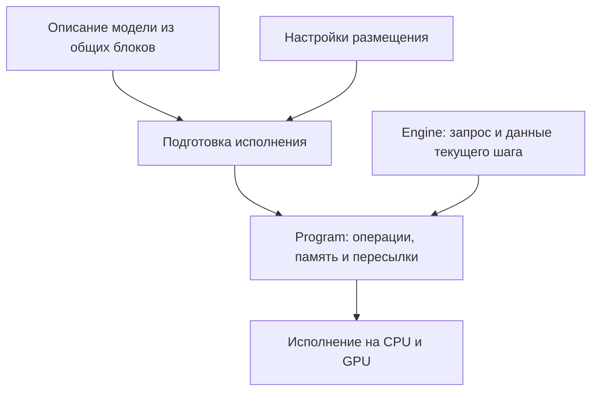

# Архитектура движка lumen-rs

`lumen-rs` — движок для запуска языковых моделей на одном компьютере. Его основной сценарий: модель не помещается в видеопамять, поэтому часть данных приходится хранить в оперативной памяти или на NVMe-накопителе. Вычисления при этом можно распределить между GPU и CPU. Такое выполнение мы называем гибридным.

В блоке MoE есть несколько подсетей — экспертов, а роутер выбирает, какие из них обработают токен. Например, GPU может вычислять внимание, а CPU — выбранных экспертов. Тогда движку нужно передать вход экспертов с GPU на CPU, дождаться результата и вернуть его на GPU. Он должен заранее знать, какие данные понадобятся, где они находятся и сколько памяти займут вычисления. На этом разделении — описание модели, подготовка работы и исполнение — строится архитектура проекта.

**Сейчас проект находится на стадии фундамента.** Работают разбор настроек, построение дерева компонентов модели и команда `inspect`, которая показывает выбранное размещение. Есть чтение и проверка контейнера LTQ, эталонный декодер весов, расчёты размеров памяти и несколько эталонных вычислительных ядер. Полностью запустить модель и сгенерировать текст пока нельзя: подготовка исполнения и рабочие CPU/CUDA-бэкенды ещё предстоят.

Ниже описано, как эти части должны работать вместе. Где уже есть код с более узкими возможностями, это указано отдельно. Порядок разработки находится в [roadmap.md](roadmap.md), а ещё не проверенные способы ускорения — в [execution-design.md](execution-design.md).

## 1. Четыре уровня модульности

У движка четыре основные задачи: описать модель, собрать её из общих вычислительных блоков, подготовить выполнение на выбранном оборудовании и исполнить вычисления.

**Описание модели** отвечает на вопрос «что вычислять?». Оно задаёт состав и порядок слоёв, связи между ними и соответствие весов из файла этим слоям. Например, одна модель чередует обычное внимание и MLP, другая — рекуррентные блоки и MoE. Эти различия принадлежат описанию модели.

**Общие блоки** позволяют собирать такие описания без копирования реализации каждого слоя. Крупный блок, например MoE, можно составить из маршрутизации, вычисления экспертов и объединения их выходов. Более мелкие операции — проекции, нормализации, выборку — можно переиспользовать в разных блоках. Слой при этом не обязан быть жёсткой границей: несколько слоёв могут читать одно хранилище, а остаточная связь может соединять разные части модели.

**Подготовка исполнения** отвечает на вопрос «как выполнить эти вычисления здесь?». Она получает описание модели и настройки размещения, выбирает поддерживаемые реализации, резервирует память и добавляет необходимые пересылки. Результат называется `Program`: это подготовленное расписание работы. Для первого запуска достаточно прямого расписания; общий оптимизатор всех возможных моделей не требуется.

**Бэкенды** выполняют операции на конкретном оборудовании. CPU-бэкенд вызывает CPU-ядра, CUDA-бэкенд — GPU-ядра. Управление выделенной памятью, очередями устройств и пересылками должно быть общим, чтобы каждый блок не создавал собственную систему управления этими ресурсами.

Названия семейств моделей нужны при чтении их конфигов и весов. Общий блок должен описывать вычислительный механизм, а не особый случай для конкретного семейства. Например, QSA и DSA — разные алгоритмы разреженного внимания. Они могут переиспользовать одинаковые операции, но один флаг `sparse` не описывает различия между ними.

## 2. Устройство Cargo-воркспейса и сборка

Крейт — отдельная единица сборки Rust со своими зависимостями. Сейчас в проекте их 20, однако часть пока содержит только заглушки. Поэтому таблица показывает и назначение, и фактическое состояние каждой части.

Крейты перечислены в порядке, который проверяют архитектурные тесты: зависеть можно только от крейтов выше по таблице. Это помогает, например, не допустить зависимости вычислительного бэкенда от описаний конкретных моделей. Фактические зависимости записаны в `Cargo.toml` каждого крейта.

| Крейт | За что отвечает сейчас или будет отвечать |
| :--- | :--- |
| `lumen-core` | Общие типы: формы и типы данных тензоров, устройства, места хранения, пути компонентов и ошибки |
| `lumen-kabi` | Типы параметров и константы для передачи данных между Rust и CUDA C++ |
| `lumen-config` | Читает JSON, применяет правила размещения и объясняет в `inspect`, откуда взялась каждая настройка |
| `lumen-mem` | Описывает буферы, рассчитывает размеры кэшей и распределение временных данных в общей области памяти; рабочие пулы ещё предстоят |
| `lumen-tensor` | Описывает тензоры и веса: размеры, форматы и ссылки на данные |
| `lumen-ltq` | Декодирует LTQ эталонным способом и выполняет связанное преобразование входа |
| `lumen-format` | Читает и проверяет контейнер LTQ |
| `lumen-backend` | Задаёт операции и интерфейс их исполнителя |
| `lumen-ref` | Содержит отдельные эталонные ядра; исполнение операций через общий интерфейс пока не подключено |
| `lumen-cpu` | Будущий CPU-бэкенд; пока заглушка |
| `lumen-cuda-kernels` | Будущая сборка CUDA-ядер; пока заглушка |
| `lumen-cuda` | Будущий CUDA-бэкенд; пока заглушка |
| `lumen-models` | Читает конфиги моделей и строит дерево компонентов; сопоставление весов и описание вычислений ещё предстоят |
| `lumen-exec` | Будет подготавливать исполнение; пока заглушка |
| `lumen-media` | Будет подготавливать изображения, аудио и другие медиа; пока заглушка |
| `lumen-chat` | Будет преобразовывать сообщения диалога в токены и разбирать ответ; пока заглушка |
| `lumen-engine` | Будет управлять генерацией и состоянием запросов; пока заглушка |
| `lumen-quantize` | Будет выполнять калибровку и квантование весов; пока заглушка |
| `lumen-server` | Будет предоставлять HTTP-интерфейс; пока заглушка |
| `lumen-cli` | Командная строка: работает `inspect`, остальные команды сообщают об отсутствии реализации |

Это разделение можно пересматривать. Отдельный крейт полезен, если он изолирует зависимости, предоставляет самостоятельно используемую библиотеку или имеет особую сборку, как CUDA. Для обычного разделения кода достаточно модулей. Например, подготовка исполнения и управление генерацией могут оставаться разными модулями даже внутри одного runtime-крейта. При объединении или разделении крейтов нужно вместе обновлять манифесты и архитектурные тесты.

Сейчас проект использует Rust edition 2024 с минимальной версией компилятора 1.89 и собирается без CUDA. Подключение CUDA-сборки, генерация C-заголовков и включение бэкендов через Cargo features ещё предстоят.

## 3. План размещения (`PlacementPlan`) и режимы доступа к данным

Место хранения данных и место вычислений — разные настройки. Веса могут постоянно находиться в RAM, но использоваться GPU. Возможен и другой вариант: веса экспертов находятся в RAM, а CPU вычисляет результат прямо там, передавая на GPU только выход.

В конфигурации за это отвечают `store` и `compute`. Дополнительное поле `prefill-compute` позволяет выбрать другой вычислитель для обработки входного текста. Обработка уже известного входа называется **prefill**, а последующая пошаговая генерация — **decode**. У них разные объёмы работы, поэтому подходящее размещение может различаться.

`lumen-config` применяет настройки к дереву компонентов модели — `ComponentTree`. Путь вроде `attention/kv-cache` позволяет обратиться к нужной части, а правило для диапазона слоёв избавляет от перечисления каждого слоя вручную. Результат — `PlacementPlan`, где уже разрешены все эти правила. Команда `inspect` показывает план вместе с источником каждой настройки. Подробный синтаксис находится в [config.md](config.md).

Один путь может обозначать компоненты с разным способом доступа на разных слоях. Например, обычное внимание читает весь доступный контекст или окно, а разреженное — выбранные позиции. Поэтому тип компонента хранится для конкретной пары «слой и путь». Регистрация проверяет границы слоёв и конфликты типов; `inspect` объединяет строки отчёта только при совпадении размещения, типов и источников настроек.

Сейчас план также получает метки предполагаемого доступа. `Streamed` означает копирование данных порциями, `ZeroCopy` — прямое чтение GPU из зарегистрированной памяти хоста, `Fetch` — чтение с диска, а `FetchH2d` добавляет к нему пересылку на GPU. Функция `AccessMode::resolve` выбирает метку по месту хранения, вычислителю и текущей классификации доступа.

Эта классификация ещё упрощённая. Например, кэш индексера помечен как разреженный ради выбора `ZeroCopy`, хотя индексер сканирует его целиком. Это ограничение текущей политики, а не определение алгоритма. И сами метки пока не означают работающий offload: будущая подготовка исполнения должна проверить поддержку операций, чтения и записи, пересылок и доступную память. Принятый конфиг сам по себе этого не гарантирует.

## 4. Подсистема памяти: четыре класса данных

Чтобы правильно выделять и переиспользовать память, нужно понимать, как долго нужны данные. Веса обычно живут всё время, пока загружена модель. Активации — промежуточные результаты вычислений — нужны только части текущего шага. Состояние внимания и рекуррентное состояние сохраняются между шагами и принадлежат конкретной последовательности токенов. Получаются четыре основных класса данных, а для пересылок дополнительно нужны временные буферы.

Это различие позволяет экономить память. Например, два промежуточных результата могут занимать один участок памяти, если первый больше не нужен к моменту появления второго. Но данные, которые GPU ещё читает или CPU ещё передаёт, переиспользовать нельзя. Отмена запроса также не освобождает буфер мгновенно: сначала должна завершиться использующая его работа.

**Имена входов вычисления не определяют количество хранилищ.** Q, K и V — роли входов attention. Архитектура модели задаёт, откуда берётся каждый из них. Это могут быть отдельные сохранённые тензоры, результаты преобразований одного общего представления или данные другого слоя. Для получения K из V, V из K или обоих из третьего представления нужно явно описать соответствующее преобразование; движок не предполагает, что оно всегда возможно.

Предположим, два слоя читают один буфер S. Память под S выделяется и учитывается один раз, а оба слоя получают ссылку на него. Если перед чтением требуется преобразование, подготовка также учитывает его временную память. Получить вход по небольшим частям и сначала построить полный дополнительный тензор — разные по расходу памяти реализации. Этот расход нельзя скрывать внутри блока.

До запуска подготовка задаёт максимальные размеры шага и резервирует нужную память. Затем исполнитель может брать свободные страницы или слоты из уже выделенного пула. Это не требует нового обращения к общему аллокатору на каждом токене. Для выхода за пределы зарезервированной ёмкости должно быть определено поведение, а не незаметное превышение бюджета.

Для состояния важна и запись. При обычной генерации новое состояние становится основой следующего шага. При спекулятивной генерации часть предварительно вычисленных токенов может быть отвергнута, поэтому соответствующие изменения нужно уметь откатывать. Порядок записи, фиксации и отката должен быть определён до включения таких режимов.

Сейчас `KvLayerSpec` и `StateLayerSpec` лишь рассчитывают размеры. В KV-описании уже есть варианты с отдельными K/V, одним сохранённым представлением и ссылкой на другой слой, но общего описания всех перечисленных связей и рабочих пулов ещё нет. Расчёт квантованного кэша также пока не включает служебные данные квантования — масштабы и смещения.

## 5. Механика оффлоада: синхронизация GPU ↔ CPU и чтение с диска

Offload требует не только выбрать устройство, но и обеспечить порядок работы. Вернёмся к примеру с экспертами на CPU. Сначала GPU вычисляет вход и выбор экспертов, затем данные копируются в RAM. CPU может начать вычисление только после окончания этой передачи. GPU получает результат обратным копированием и лишь затем использует его в следующей зависимой операции.

В это время GPU может выполнять другую ветвь, если ей не нужен результат CPU. Например, общие эксперты MoE могут вычисляться параллельно с выбранными экспертами. Подготовленный план должен различать такие независимые ветви и места, где их результаты необходимо дождаться.

Для первого рабочего пути достаточно явных копирований и событий, сообщающих об их завершении. Более сложные способы — флаги в закреплённой памяти, активное ожидание CPU-потоков, двойная буферизация и CUDA Graphs — имеет смысл принимать после измерений. Их варианты и условия проверки вынесены в [execution-design.md](execution-design.md).

С диском действует тот же принцип зависимостей. Чтение строки таблицы можно начать, когда известен её адрес. Если до использования строки есть другая работа, чтение и вычисления могут перекрываться. Если же строка нужна для самого первого вычисления, как входной embedding, придётся дождаться чтения. Маленький размер строки сам по себе не делает задержку NVMe незаметной.

## 6. Представление весов и загрузка модели

Загрузка модели состоит из нескольких задач, которые важно не смешивать. Читатель контейнера проверяет, правильно ли устроен файл и допустимы ли указанные в нём размеры и диапазоны данных. Он не должен знать, какой слой конкретного семейства использует каждую матрицу.

Это знает адаптер модели. Он сопоставляет имена тензоров из checkpoint с частями модели и приводит их к общим описаниям весов. Например, в одном checkpoint матрицы экспертов лежат отдельно, в другом собраны в один большой тензор. После загрузки вычислительный код должен получать понятное описание экспертов, сохраняя их порядок, масштабы и остальные параметры.

Для таких описаний уже существуют `LtqLinear`, `DenseLinear`, `RowTable` и `ExpertBank`: квантованная матрица LTQ, обычная матрица, таблица строк и набор экспертов. Это дескрипторы — структуры с размерами, форматом и ссылками на данные. Их определения находятся в `lumen-tensor`, а устройство байтов LTQ описано в [ltq-format.md](ltq-format.md).

Затем бэкенд может подготовить веса в удобной для своего оборудования укладке. CPU и GPU могут предпочитать разный порядок данных в памяти, но такая перепаковка должна сохранять значения весов. Если одновременно нужны несколько представлений, каждое входит в бюджет памяти. Эти операции загрузки и подготовки должны быть доступны и генерации, и квантователю.

## 7. Компилятор плана (`lumen-exec`) и выполнение шага

Задача `lumen-exec` — превратить описание вычислений и размещение в работу, которую исполнитель сможет повторять. Название «компилятор» здесь не означает, что сначала требуется построить универсальную систему оптимизации. Первому `Program` достаточно хранить порядок операций, выбранные реализации, ссылки на буферы и необходимые ожидания и пересылки.

Например, до запуска можно определить: эту проекцию выполняет GPU-ядро, её выход записывается в такой-то буфер, затем часть данных передаётся CPU. Во время шага не нужно заново искать вес по имени из checkpoint или решать, на каком устройстве выполнять проекцию. Эти решения уже приняты при подготовке.

При этом не все данные постоянны. ID токенов, позиции, длины последовательностей, страницы их состояния и параметры сэмплинга меняются. Они передаются отдельно как входы шага. Для prefill и decode сначала можно использовать разные подготовленные расписания, каждое со своими ограничениями размера.

Подготовка должна проверить, что бэкенды поддерживают выбранные операции и что память укладывается в бюджет. Операция может быть крупным блоком или последовательностью более мелких действий. В обоих случаях должно быть известно, какие данные она читает, какие изменяет и сколько временной памяти использует: иначе нельзя безопасно построить расписание.

Позже можно объединять соседние операции в одно ядро (fusion), захватывать участки исполнения в CUDA Graphs и автоматически выбирать размещение. Это способы ускорить уже корректное выполнение. Они добавляются после проверки численных результатов, изменений состояния и пользы по измерениям.

**Текущий `Architecture` ещё не предоставляет такое полное описание.** Он возвращает структурный `Layout` и дерево компонентов для настроек. В `Layout` пока не сохранены все сведения, необходимые для вычислений. При реализации исполнения их нужно выразить явно; дерево путей `ComponentTree` само по себе не описывает ни вычисления, ни владельцев памяти.

## 8. Рантайм генерации (`Engine`), спекулятивка и мультимодальность

`Program` описывает выполнение вычислений, а `Engine` управляет запросом во времени. Он хранит состояние последовательности, вызывает обработку входного текста, получает оценки следующего токена и выбирает токен по настройкам сэмплинга. Затем повторяет шаги, пока не выполнится условие остановки. После завершения запроса он освобождает ресурсы, дождавшись всех использующих их операций.

Начать можно с одной последовательности. Позже `Engine` сможет объединять работу нескольких запросов в batch, переиспользовать вычисленное состояние общего префикса и проверять токены, предложенные черновой моделью. Эти возможности меняют управление последовательностями, но алгоритмы attention и других блоков остаются в описании модели и вычислительных реализациях.

Мультимодальный ввод добавляет подготовку изображений, аудио и других данных, а также необходимые модели вычисления. Конкретные очереди, потоки, способы хранения префиксов и интерфейсы черновиков будут определяться при реализации. Их не нужно закреплять ради первого текстового запуска.

Калибровка для квантования использует часть тех же вычислений, но решает другую задачу: пропускает подготовленные данные через модель и собирает статистику промежуточных результатов. Поэтому ей нужен доступ к загрузке модели и нижнему уровню исполнения, но не к HTTP, оформлению диалога или планировщику запросов. Текущая зависимость заглушки `quantize → engine` предварительная и должна быть пересмотрена при реализации. Обратный проход для расчёта дополнительных статистик потребует отдельной работы; он не возникает автоматически из наличия прямого прохода.

## 9. Правила расширяемости и архитектурные границы

При добавлении модели сначала нужно описать её конфиг, соответствие весов и соединение блоков. Если необходимые вычисления уже существуют, они переиспользуются. Если нет — следует определить, какой общий механизм отсутствует. Например, новый способ преобразования входов или хранения состояния должен описываться через собственное поведение, а не через условие «если это такое-то семейство».

Это не обещание, что любая модель затронет ровно один крейт. Новая вычислительная возможность может потребовать расширения интерфейса операций, работы с памятью и бэкендов. Важно, чтобы после расширения механизм можно было использовать в любой подходящей композиции.

Для новой операции нужна простая эталонная реализация. Оптимизированные CPU/GPU-версии сравниваются с ней в пределах заданных численных допусков. Результаты целой модели также нужно сравнивать с независимой реализацией: собственный эталон и быстрый путь могут разделять одну ошибку в описании модели.

Сейчас операции перечислены в закрытом enum `Op`. Каждый бэкенд должен явно обработать каждый вариант: исполнить его или сообщить об отсутствии поддержки. Wildcard-ветви в этих сопоставлениях запрещены, чтобы новый вариант не оказался незаметно пропущен. Это не требует дробить все блоки до скалярных действий и не означает готовый интерфейс сторонних плагинов.

Автоматические проверки также следят за направлением зависимостей и появлением имён семейств вне `lumen-models` и `lumen-chat`. Эти тесты помогают удерживать границы, но не заменяют проверку математики и памяти. При любом ускорении должны оставаться понятными владелец каждого буфера, его размер, время жизни и операции, которые его изменяют.

Первоначальный объём проекта — авторегрессионный инференс: модель последовательно генерирует токены. Общее обучение моделей и другие циклы генерации пока не входят в него. Следующие шаги и критерии их готовности перечислены в [roadmap.md](roadmap.md).
